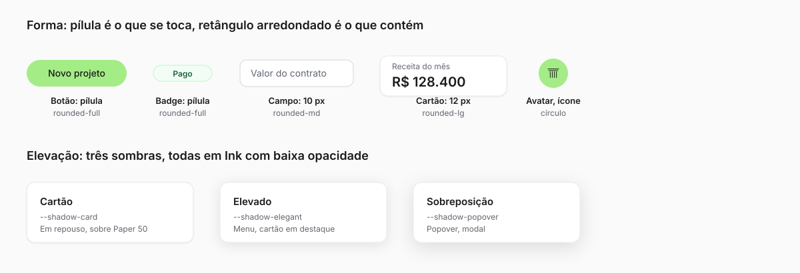

# Linguagem de design

> O "tipo de design" da Pilar: o estilo, os princípios e as regras de forma, espaço, ícone,
> imagem e movimento que fazem uma tela parecer Pilar. Cor: [color.md](./color.md). Tipografia:
> [typography.md](./typography.md). Logotipo: [logo.md](./logo.md). Componentes e padrões de tela:
> `docs/design/PILAR_DESIGN_SYSTEM.md`.

## 1. O estilo em uma frase

**Técnico e calmo.** Parece o desenho de um escritório de projeto bem feito: muito branco, traço fino,
medida certa, número em primeiro plano. Nada pede atenção sem motivo, e o único verde da tela
aponta para a próxima ação.

Estética **Paper + Ink**: papel quase branco, tinta escura, linha em vez de bloco, cor só quando
conta algo.

| É | Não é |
|---|---|
| Preciso, sóbrio, legível | Corporativo frio ou "startup colorida" |
| Linha fina, borda leve, muito respiro | Gradiente chamativo, sombra pesada, vidro e brilho |
| Número e fato no centro | Ilustração decorativa, mascote, emoji |
| Verde pontual, na ação | Verde em fundo de página inteira |
| Calmo, mesmo em dado ruim | Alarmista: vermelho só em perigo real |

## 2. Princípios

Saem dos valores de [BRAND.md](./BRAND.md). Quando duas opções empatam, vale o princípio de menor número.

1. **O número primeiro.** A tela existe para o dono saber se o projeto dá lucro. O dado mais
   importante é o maior e o mais escuro; o resto recua.
2. **Linha, não bloco.** Separe com borda fina e espaço, não com cor de fundo. Bloco de cor
   é para o que precisa ser visto (ação primária, alerta).
3. **Verde é ação.** O verde da marca marca o próximo passo (botão primário, item ativo, sinal
   "ao vivo"). Se tudo é verde, nada é.
4. **Mostre a conta.** Todo valor calculado diz de onde veio (fonte, período, fórmula). Sem
   número misterioso, sem promessa de autonomia que não existe.
5. **Humano no loop.** Quando a IA faz algo, a tela mostra o que ela fez, deixa corrigir e
   pede aprovação antes de efeito externo.
6. **Calma sob pressão.** Erro e atraso aparecem claros, com próximo passo, sem grito
   visual, sem "Oops".
7. **Mesma coisa, mesmo jeito.** Um status tem uma cor em toda a Pilar. Um modal de formulário
   tem a mesma largura, o mesmo rodapé. A página decide o conteúdo, nunca cor, raio ou sombra.

## 3. Forma

| Elemento | Raio | Regra |
|---|---|---|
| Botão, badge, chip, aba, filtro | **Pílula** (`rounded-full`) | Tudo que é ação ou estado é pílula |
| Cartão, painel, modal | 12 px (`rounded-lg`, `--radius` 0,75 rem) | Contêiner de conteúdo |
| Campo de texto, seletor | 10 px (`rounded-md`) | Campo é retângulo arredondado, não pílula |
| Item pequeno, tag de tabela | 8 px (`rounded-sm`) | |
| Avatar, ícone do app | Círculo | |

A regra de bolso: **pílula é o que você toca; retângulo arredondado é o que contém.**

Borda é de 1 px em Gray 200. Sem borda dupla, sem borda colorida (exceto estado de foco e a
borda suave de status).

## 4. Espaço e layout

- **Base de 4 px.** Toda medida é múltiplo de 4 (escala do Tailwind). Entre elementos
  relacionados, 8 a 12 px; entre grupos, 24 px; entre seções do app, 32 a 48 px.
- **Ritmo de seção fluido** (landing): `py-section` (48 → 80 px), `py-section-sm` (32 → 48 px),
  `py-section-lg` (56 → 112 px).
- **Larguras nomeadas**: `max-w-content` 1080 px para leitura e marketing, `max-w-wide` até 1600 px
  para heros e grades largas. Modal de formulário só em `sm`, `md` ou `lg`.
- **Respiro vale mais que enfeite.** Na dúvida entre mais um elemento e mais espaço, mais espaço.

### Produto

Página nova usa `PilarPage`: cabeçalho, ação principal e conteúdo no mesmo esqueleto. Navegação
em trilho de módulos e painel. Aba de seção e filtro numa linha só, no topo. Detalhes e
exceções em `docs/design/PILAR_DESIGN_SYSTEM.md`.

### Celular

O celular tem casca própria, não é o desktop encolhido: barra de navegação flutuante em pílula
(`BottomNav`, com blur), ação principal como botão flutuante (`MobileFab`, 44 px), modal como painel de
baixo com alça, campo de texto com 16 px. Detalhes na SPEC 134.

### Landing

A página é um **cartão encaixado na janela**: quatro barras brancas fixas e cantos arredondados
no vão interno (`.site-frame`), que somem abaixo de 850 px. Seções em Paper, cartões do bento
alternando branco, verde lavado e verde cheio. Hero em duas linhas estáveis, com o verbo em
pílula verde (ver [typography.md](./typography.md), seção 6).

## 5. Elevação

Três sombras, todas leves, todas em Ink com baixa opacidade: `--shadow-card`, `--shadow-elegant`,
`--shadow-popover` (valores e uso em [color.md](./color.md), seção 5). Nada de sombra colorida,
sombra interna ou brilho. Em dúvida, borda sem sombra.

## 6. Ícones

- Biblioteca única: **lucide-react**. Não misture outra.
- Traço fino e contínuo, ponta e junção redondas, o mesmo gesto do símbolo da marca.
- 16 px em botão e linha de lista (`[&_svg]:size-4` já está no `Button`); maior só em navegação
  e estado vazio.
- Cor é a do texto ao redor. Ícone verde sobre fundo claro não existe (ver [color.md](./color.md)).
  Para destacar, use um círculo de fundo verde com ícone Ink.
- Ícone sozinho leva `aria-label` e tooltip. Ícone decorativo leva `aria-hidden`.
- Ícone não é a única pista de significado.

## 7. Imagem e ilustração

- **A tela real é a imagem principal.** Capturas do produto com dado de exemplo (nunca dado de
  cliente), em moldura limpa. Ficam em `apps/marketing/public/screens/`.
- **Paisagem de morros verdes** é o fundo da hero e do e-mail: as curvas suaves do verde da marca
  sobre Paper.
- **Foto só de gente e obra reais.** Nada de banco de imagem genérico (capacete, aperto de mão,
  prancheta). Sem foto, a página fica melhor com a captura do produto.
- **Ilustração, se houver, segue o símbolo:** traço uniforme, ponta redonda, sem preenchimento
  gradiente, no máximo Ink e verde da marca.
- Toda imagem tem texto alternativo que descreve o conteúdo, não a decoração.

## 8. Movimento

**A marca é o movimento** (ADR 0049): quando algo espera ou entra, quem se move é o símbolo.

| Situação | Como se move |
|---|---|
| Espera dentro de botão, campo ou linha | `Button loading` ou `BusyMark`: o símbolo respira |
| Espera de página, seção ou cartão | `PageLoader` (anel de leitura), só depois de 300 ms |
| Entrada no app | `EntryVeil` |
| Hover do logo | As caneluras ficam verdes uma a uma, só cor |
| Botão | Faixa de luz varre no hover; no clique, escala 0,98 |
| Troca de rota no celular | Fade e subida de 8 px, 240 ms |

Curvas e tempos são tokens (`tokens.css`): `--ease-out-expo` para entrada e assentamento,
`--ease-out-quint` para hover; `--dur-fast` 300 ms, `--dur-base` 500 ms, `--dur-slow` 700 ms.
Nada de `Loader2` nem `animate-spin` (teste reprova o PR). Quem pede **movimento reduzido**
recebe o quadro final, sem animação.

## 9. Voz visual dos dados

- Algarismos tabulares em coluna de número. Dinheiro e data só por `@/lib/format`.
- Valor ruim em vermelho forte e valor bom em verde forte, **só** para dinheiro (receita, despesa,
  saldo). Número neutro fica Ink.
- Estado vazio ensina a primeira ação, com um verbo ("Criar primeiro projeto"). Erro diz o que
  houve e o que fazer.
- Gráfico leva rótulo e valor, não só cor, e nunca mais de 6 séries.

## 10. Acessibilidade

Faz parte do estilo, não é camada extra.

- Contraste de texto mínimo 4,5 : 1 (medido em [color.md](./color.md)).
- Foco visível em todo elemento interativo: anel de 2 px em Ink com 2 px de afastamento
  (`focus-visible:ring-2`).
- Alvo de toque de 40 px (botão padrão) ou 44 px (grande, botão flutuante). O botão pequeno de 36 px só em tabela densa.
- Campo de texto com 16 px no celular, para o iOS não dar zoom.
- Nada só por cor, nada só por hover, nada que dependa de som.
- Respeitar movimento reduzido.
- O Axe roda no CI; o roteiro manual está em `docs/design/ACESSIBILIDADE.md`.

## 11. Como a marca se aplica fora do produto

| Peça | Fundo | Logo | Fonte | Cor de apoio |
|---|---|---|---|---|
| Landing e site | Paper 100 | Horizontal Ink | Geist | Verde só no CTA e na pílula |
| E-mail | Paper 0 | Símbolo PNG | Geist | Botão em pílula verde com texto Ink |
| Apresentação, deck | Paper 0 ou Ink | Horizontal | Geist | Capa em Ink com verde de acento |
| Proposta e documento | Paper 0 | Horizontal Ink | Geist e Inter | Ink; verde só em destaque |
| Rede social | Ícone do app (disco verde) | Ícone | Geist | Verde da marca |
| Anúncio | Paper 100 ou Ink | Horizontal | Geist | Um verde, uma mensagem |

Voz e mensagens: [voice-tone.md](./voice-tone.md) e [messaging.md](./messaging.md).
