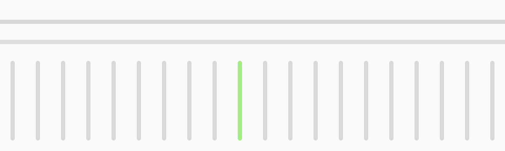

# Imagem e ilustração

> Fotografia, croqui, padrão gráfico, ícone e gráfico de dados. Serve landing, deck, e-mail e
> [Instagram](./social-instagram.md). Cor: [color.md](./color.md). Estilo geral:
> [design-language.md](./design-language.md).

## 1. Princípio

**A prova é o produto e o trabalho real.** A Pilar mostra tela de verdade, número de verdade e obra
ou escritório de verdade. Quando não há nada real para mostrar, desenha com traço de projeto, não
compra foto genérica.

Ordem de preferência, da mais para a menos Pilar:

1. **Tela do produto** com dado de exemplo.
2. **Croqui e cota** desenhados no traço da marca.
3. **Número grande** (tipografia como imagem).
4. **Foto real** de escritório, obra ou pessoa que autorizou.
5. Nada. Espaço vazio é aceitável; foto de banco de imagem não é.

## 2. Tela do produto

- Sempre com **dado de exemplo** (conta `dev@local.test` e seed). Nunca dado, nome ou valor de cliente
  em material público: o repositório é público.
- Moldura limpa: cartão Paper 0, raio 12 px, borda Gray 200, sombra `--shadow-elegant`. Sem
  mockup de notebook ou celular com reflexo.
- Corte na tarefa: mostre o trecho que responde à pergunta da peça (a margem do projeto, o aditivo
  preparado), não a tela inteira.
- Captura em desktop 1440 px ou celular 390 px, no tamanho real, sem ampliar.
- Texto da tela precisa continuar legível no tamanho final da peça. Se não ficar, recorte mais.

## 3. Croqui e ilustração

A ilustração é **desenho técnico**, com a mesma regra do símbolo.

| Regra | Valor |
|---|---|
| Traço | Uniforme, ponta e junção redondas. 3 px num canvas de 1080 px (6 px em linha de contorno principal) |
| Cor | Ink sobre Paper (ou branco sobre Ink). Sem cinza intermediário em contorno |
| Preenchimento | **Um** por desenho, em verde da marca, numa área que carrega o sentido da peça |
| Vocabulário | Planta baixa, corte, cota, carimbo de prancha, régua, esquadro, coluna |
| Cota | Linha com tique nas pontas e a medida em Geist 500, Ink |
| Carimbo | Caixa de 2 px com `PRANCHA 01` e `REV C` em Gray 600 |
| Proibido | Perspectiva, 3D, sombra, gradiente, textura, personagem, mascote, emoji |

A biblioteca (20 a 30 peças, no `post-automation`) segue estas regras: planta com cotas, corte de
laje, detalhe de pilar, prancha com carimbo, régua com escala, tabela de revisão. Peça nova entra
só se couber na tabela acima.

## 4. Padrão colunata

O padrão é o símbolo virado arquitetura: uma linha de capitel, uma de ábaco e uma fileira de
caneluras no passo X do símbolo.

- Arquivos: `assets/pattern-colunata.svg` (sobre Paper) e `assets/pattern-colunata-ink.svg` (sobre Ink).
- Traço em Paper 300 (`#D9D9D9`) sobre claro e Ink 800 (`#3D3D3D`) sobre escuro: é fundo, nunca compete
  com o texto.
- Um traço de canelura em verde da marca, e só um. É decoração, exceção documentada à regra do verde
  sobre claro (elemento decorativo não carrega informação).
- Uso: faixa de rodapé de landing, fundo de capa de deck, divisor de seção, cabeçalho de documento.
  Não cubra a tela com ele e não coloque texto por cima.

## 5. Fotografia

Quando houver foto, ela é documental.

- **Quem e onde:** sócio e equipe de escritório de projeto, mesa com prancha, tela com modelo, obra
  vista pelo projetista. Gente real, com autorização escrita.
- **Luz natural**, sem pose de banco de imagem, sem aperto de mão, sem capacete ou prancheta de
  cenário. Mão trabalhando, tela, papel, detalhe.
- **Cor natural.** Sem filtro, sem duotone, sem preto e branco forçado. Se precisar de coerência, ajuste só
  exposição e balanço de branco.
- **Enquadramento:** seco e próximo; deixe espaço para o texto em um dos terços.
- **Sobre foto:** texto branco com véu Ink que leve o fundo a 4,5 : 1 (ver [logo.md](./logo.md), seção 7).
- **Legenda e alt text** dizem o que está acontecendo, com quem e onde.
- Foto de obra de cliente exige autorização escrita do escritório e do cliente final.

## 6. Ícones

Biblioteca única, **lucide-react**, traço fino, ponta redonda. Em material fora do app (capa de
destaque, deck), o mesmo desenho: só linha, 3,2 px em canvas de 1080, sem preenchimento. Regras
completas em [design-language.md](./design-language.md), seção 6.

## 7. Gráfico de dados

- Barra e linha, com **valor escrito** no dado e no eixo. Sem pizza e sem 3D.
- Ink para o dado principal, Gray 400 para o comparativo e **verde da marca** só para destacar o
  que o título diz. Vermelho forte só para prejuízo.
- Grade em Gray 200, atrás dos dados. No máximo 6 séries.
- Título do gráfico é a conclusão ("Margem caiu de 22% para 9% no 3º mês"), não o nome do eixo.
- Fonte e período embaixo, em 12 px (28 px em Instagram).

## 8. Checklist

- [ ] Existe versão real (tela, número, desenho) antes de procurar foto?
- [ ] Dado de exemplo, sem nome ou valor de cliente?
- [ ] Um preenchimento verde no máximo?
- [ ] Traço uniforme, sem sombra, sem gradiente?
- [ ] Alt text escrito e contraste do texto sobre imagem acima de 4,5 : 1?
- [ ] Autorização escrita para toda pessoa, cliente ou obra?
