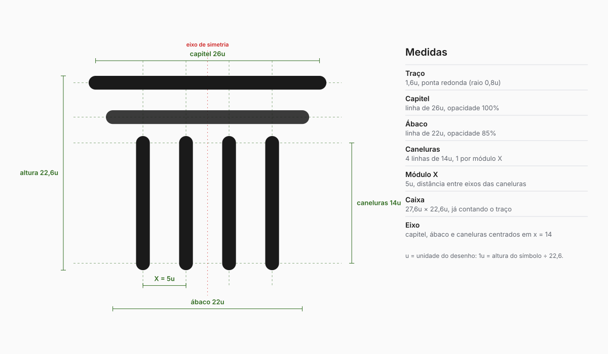
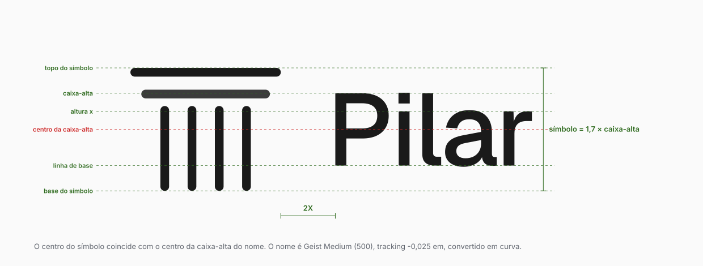
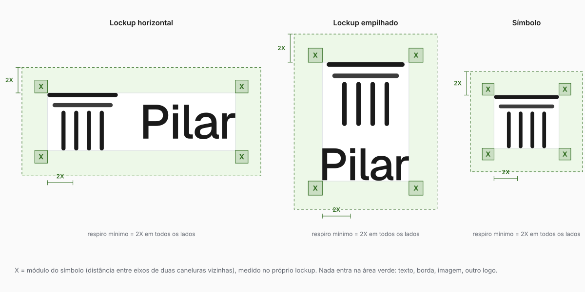
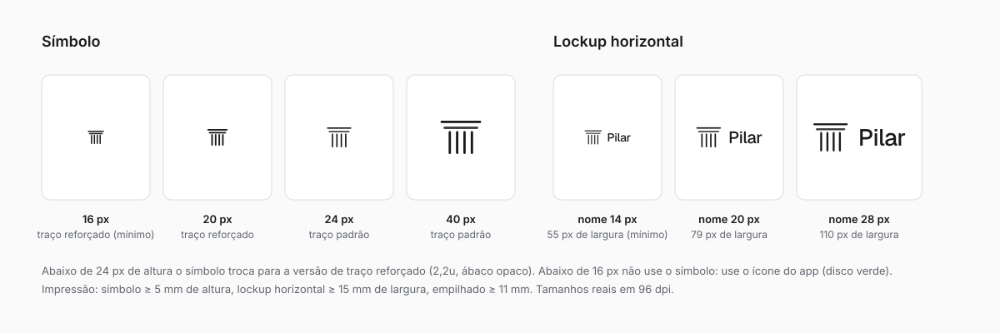
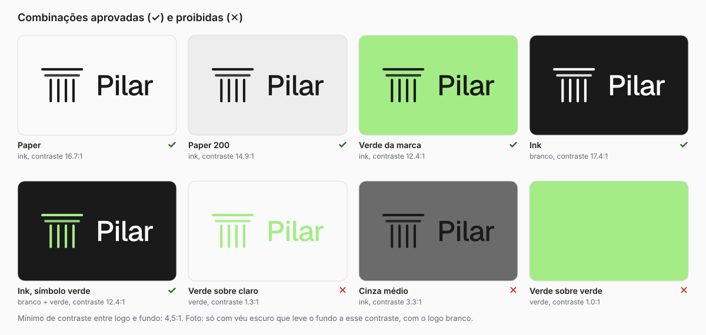
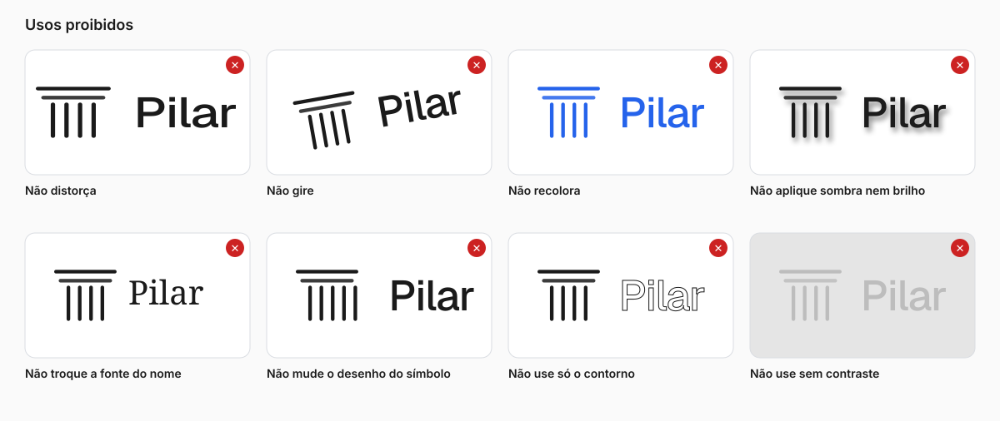

# Logotipo

> Regras de uso do símbolo, do nome e das combinações. Os arquivos estão em
> [`assets/logo/`](./assets/logo/) e saem de `scripts/brand/build.py`, então desenho,
> diagramas e as medidas deste texto vêm dos mesmos números.
> Visão geral da identidade: [BRAND.md](./BRAND.md). Cor: [color.md](./color.md).
> Tipografia: [typography.md](./typography.md).

## 1. O que é

O logotipo tem duas peças: o **símbolo** (uma coluna desenhada com seis linhas) e o **nome**
(Pilar, em Geist Medium). Usadas juntas formam o **lockup**.

- **Símbolo.** A coluna é a tradução direta do nome: o elemento que sustenta a estrutura.
  É feita só de linhas de mesmo traço e ponta redonda, o jeito de um desenho técnico de
  escritório de projeto. Capitel e ábaco em cima, quatro caneluras embaixo, sem base.
- **Nome.** "Pilar" em Geist, peso 500, tracking -0,025 em, convertido em curva. Grafia sempre
  "Pilar" (nunca "PILAR" nem "pilar").
- **Personalidade.** Calmo, preciso, estrutural. O símbolo é leve de propósito: o peso visual
  da marca fica no conteúdo do cliente, não no logo.

## 2. Família de arquivos

Use SVG sempre que o destino aceitar. PNG só para apresentação, redes sociais e documento.

| Peça                         | Arquivo                                             | Quando usar                                                                        |
| ---------------------------- | --------------------------------------------------- | ---------------------------------------------------------------------------------- |
| Lockup horizontal (primário) | `pilar-logo-horizontal-{ink,white,black,brand}.svg` | Cabeçalho, rodapé, documento, assinatura de e-mail, material de venda              |
| Lockup empilhado             | `pilar-logo-vertical-{ink,white,black,brand}.svg`   | Capa, slide de abertura, quando o espaço é mais alto que largo                     |
| Símbolo                      | `pilar-mark-{ink,white,black,brand}.svg`            | Quando o nome já aparece perto, avatar, selo, marca d'água                         |
| Símbolo, traço reforçado     | `pilar-mark-small-{ink,white}.svg`                  | Símbolo com menos de 24 px de altura                                               |
| Só o nome                    | `pilar-wordmark-{ink,white}.svg`                    | Texto corrido institucional, rodapé de contrato                                    |
| Ícone do app                 | `pilar-app-icon.svg`                                | Ícone de app, PWA, perfil de rede social                                           |
| Favicon                      | `pilar-favicon.svg`                                 | Aba do navegador                                                                   |
| PNG                          | `png/`                                              | Tamanhos prontos: símbolo 1024, lockup horizontal 2000, empilhado 1200, ícone 1024 |

Sufixos de cor: `ink` (#1A1A1A, padrão sobre claro), `white` (sobre escuro), `brand`
(nome branco e símbolo verde, só sobre Ink), `black` (#000000, só impressão a uma cor, com ábaco opaco).

## 3. Construção do símbolo



Medidas em **u**, a unidade do desenho. 1u = altura visível do símbolo ÷ 22,6.

| Elemento                    | Medida                                                 |
| --------------------------- | ------------------------------------------------------ |
| Caixa visível (com o traço) | 27,6u × 22,6u, proporção 1,22 : 1                      |
| Traço                       | 1,6u, ponta redonda de raio 0,8u                       |
| Capitel                     | linha de 26u, opacidade 100%                           |
| Ábaco                       | linha de 22u, opacidade 85%, 4u abaixo do capitel      |
| Caneluras                   | 4 linhas de 14u, opacidade 100%                        |
| Módulo X                    | 5u, a distância entre eixos de duas caneluras vizinhas |
| Eixo de simetria            | capitel, ábaco e caneluras centrados em x = 14u        |

O módulo X é a régua de toda a marca: o respiro e o espaço entre símbolo e nome saem dele.

**Peso do traço por tamanho.** O desenho tem dois pesos:

- **Padrão**, traço 1,6u, ábaco a 85%: de 24 px de altura para cima e em qualquer impressão.
- **Reforçado**, traço 2,2u, ábaco opaco: abaixo de 24 px. O traço fino some em tela pequena.
  O ábaco opaco evita o cinza sujo quando o pixel não resolve a transparência.

## 4. Lockups e proporções



### Horizontal (primário)

| Relação                     | Valor                                                   |
| --------------------------- | ------------------------------------------------------- |
| Altura do símbolo           | 1,7 × altura da caixa-alta do nome                      |
| Alinhamento vertical        | o centro do símbolo coincide com o centro da caixa-alta |
| Espaço entre símbolo e nome | 2X, contado da tinta do símbolo até a tinta do "P"      |
| Proporção do conjunto       | 3,26 : 1 (393,5 × 120,7 no arquivo)                     |

### Empilhado

| Relação                     | Valor                                  |
| --------------------------- | -------------------------------------- |
| Altura do símbolo           | 2,0 × altura da caixa-alta do nome     |
| Alinhamento horizontal      | símbolo e nome centrados no mesmo eixo |
| Espaço entre símbolo e nome | 1,5X                                   |
| Proporção do conjunto       | 0,73 : 1 (192,7 × 265,0 no arquivo)    |

### Quando usar cada peça

1. **Horizontal** é o padrão. Na dúvida, use este.
2. **Empilhado** só quando a área for quase quadrada ou mais alta que larga.
3. **Símbolo sozinho** só quando "Pilar" já estiver legível por perto (mesma tela, mesma página)
   ou quando o espaço for menor que o lockup mínimo.
4. **Só o nome** em texto institucional, onde o símbolo atrapalharia a leitura.
5. **Ícone do app** onde o contexto pede forma fechada: tela inicial, avatar, aba do navegador.

Não monte um lockup novo. Não aproxime, afaste, aumente ou reposicione as peças.

## 5. Respiro



Em todos os lados do logotipo fica uma área livre de **2X**, medida com o X do próprio lockup.
Nada entra nela: texto, borda, imagem, linha de grade, outro logo. O respiro é mínimo, não ideal;
em capa e abertura dê mais.

## 6. Tamanho mínimo



| Peça              | Tela                            | Impressão        |
| ----------------- | ------------------------------- | ---------------- |
| Símbolo           | 16 px de altura                 | 5 mm de altura   |
| Lockup horizontal | 56 px de largura (nome a 14 px) | 15 mm de largura |
| Lockup empilhado  | 40 px de largura                | 11 mm de largura |

Abaixo do mínimo de tela, o símbolo deixa de ser legível. Use o ícone do app (disco verde),
que mantém a forma em 16 px.

## 7. Cor e fundo



O logotipo usa só as cores da tabela. Nunca pinte o logo com outra cor, nem com cor de status.

| Versão  | Cor do símbolo | Cor do nome | Fundo                                                |
| ------- | -------------- | ----------- | ---------------------------------------------------- |
| `ink`   | #1A1A1A        | #1A1A1A     | Paper (#FFFFFF a #EDEDED) e verde da marca           |
| `white` | #FFFFFF        | #FFFFFF     | Ink (#1A1A1A) e fundos escuros                       |
| `brand` | #A4EC86        | #FFFFFF     | Só Ink (#1A1A1A)                                     |
| `black` | #000000        | #000000     | Impressão a uma cor, gravação, carimbo (ábaco opaco) |

Regras:

- Contraste mínimo entre logo e fundo: **4,5 : 1**. Ink sobre Paper dá 16,7 : 1; Ink sobre verde da
  marca, 12,4 : 1; branco sobre Ink, 17,4 : 1.
- **Verde sobre fundo claro é proibido** (1,4 : 1). O verde da marca é fundo ou acento sobre Ink,
  nunca traço de logo sobre branco.
- Sobre foto: só com véu escuro que leve o fundo a 4,5 : 1, e com o logo branco.
- Uma cor só (carimbo, gravação, bordado): use `black`, que já vem com o ábaco opaco, porque
  esses processos não fazem transparência.

## 8. Usos proibidos



Não distorça, não gire, não recolora, não aplique sombra ou brilho, não troque a fonte do nome,
não mude o desenho do símbolo (nem o número de caneluras), não use só o contorno e não use em
fundo sem contraste. Também não: animar o logo fora do que a seção 9 permite, colocar o logo dentro
de caixa, balão ou moldura que reduza o respiro, usar o símbolo como bullet, e escrever o nome em
caixa-alta ou minúscula.

## 9. Movimento

O logo só se move dentro do produto e da landing, e sempre pela marca (ADR 0049):

- **Hover.** As caneluras ficam verdes uma a uma. Só cor, o símbolo nunca gira nem muda de tamanho.
  O verde do hover é o `--mark-hover` (verde escuro sobre fundo claro, verde da marca sobre escuro).
- **Desenho.** Na entrada, o símbolo se desenha uma vez (`PilarMark variant="draw"`).
- **Espera.** O símbolo respira enquanto algo carrega (`variant="rhythm"`, `BusyMark`).
- **Movimento reduzido.** Quem pede menos movimento recebe o quadro final, sem animação.

Em impressão, PDF e e-mail o logo é estático.

## 10. Marca registrada

O símbolo de marca (™ ou ®) só entra depois que o registro no INPI estiver concedido em nome da
empresa titular. Até lá, o logo e o nome aparecem sem símbolo.

## 11. No código

- Produto e landing usam o componente `Logo` (`src/components/Logo.tsx`) e o `PilarMark`
  (`src/components/motion/PilarMark.tsx`). Não recrie o símbolo com `<svg>` solto nem o nome como
  texto estilizado.
- E-mail usa PNG (Gmail bloqueia SVG em ``): `apps/marketing/public/email/logo-v2.png`,
  configurado em `supabase/functions/_shared/email/brand.ts`. Versione o nome ao trocar de logo.
- Cor do logo no código é `currentColor`: o contêiner decide (`text-ink` ou `text-white`).

### Código e especificação coincidem

Até 28/10/2026 o código tinha quatro diferenças pequenas (caneluras 0,5u fora do eixo, traço
#0A0A0A em vez do token, nome do `Logo` escrito como texto, ábaco a 90% no `app-icon.svg`). O BEZ-385
alinhou tudo: `PilarMark` com as caneluras em 6,5, 11,5, 16,5 e 21,5; `public/*.svg` e
`apps/marketing/public/*.svg` iguais aos de `brand/assets/logo/`; PNGs dos ícones e o PNG do e-mail
(`logo-v2.png`) gerados do ícone oficial; `Logo` com o nome em curva (`PilarWordmark`).
`src/components/logotipo.oficial.test.tsx` reprova se produção se afastar dos arquivos oficiais.

## 12. Como regenerar os arquivos

```bash
python3 -m venv /tmp/fvenv && /tmp/fvenv/bin/pip install fonttools brotli
/tmp/fvenv/bin/python scripts/brand/build.py
```

Requer `rsvg-convert` (`brew install librsvg`) para os PNG. A geometria do símbolo e os
parâmetros dos lockups ficam no topo de `scripts/brand/build.py`; o nome em curva vem da Geist
variável em `apps/marketing/public/fonts/` (licença SIL OFL 1.1). Mexeu na geometria? Rode o
script e confira os diagramas: eles se atualizam junto.
