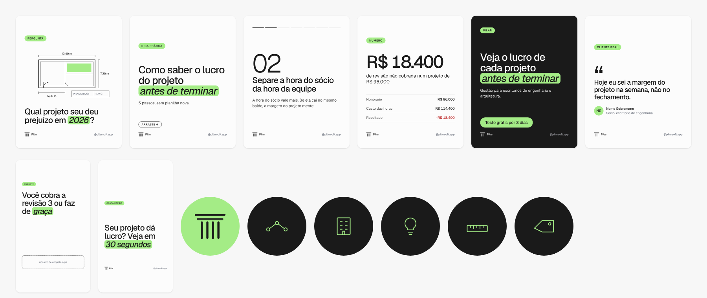

# Instagram

> Sistema visual do perfil **@pilarsoft.app**: como o perfil se apresenta, o desenho de cada
> formato, a grade do feed e o que conferir antes de publicar. Estratégia, pilares, cadência e
> calendário vivem no repo `post-automation` (`docs/plano-presenca-social.md`, `pilares.md`,
> `voice.md`). Este arquivo diz **como cada peça se parece**; aquele diz **o que publicar e quando**.
> Quando os dois conflitarem em visual, vale este (e o `brand/` inteiro).
> Identidade: [BRAND.md](./BRAND.md). Voz: [voice-tone.md](./voice-tone.md). Imagem: [imagery.md](./imagery.md).
> Movimento em vídeo: [motion.md](./motion.md).

## 1. A ideia visual do perfil

**Prancha de escritório de projeto, não anúncio.** O feed parece o caderno de um engenheiro que
mostra a conta: papel claro, tinta escura, traço de croqui, número grande, e um verde só, que
aponta o que importa. Quem passa o dedo reconhece a Pilar pelo **papel claro + pílula verde +
número ou pergunta grande**, sem precisar ver o logo.

Cinco regras valem para qualquer peça:

1. **Uma ideia por peça.** Um gancho, um número ou uma pergunta. Se tem dois, são duas peças.
2. **Paper e Ink, verde de tempero.** Fundo Paper (padrão) ou Ink (fechamento e contraste). O verde
   aparece **uma vez** como pílula, selo ou preenchimento de croqui. Verde nunca é cor de texto sobre
   fundo claro (ver [color.md](./color.md)).
3. **Texto grande, pouco texto.** O feed é visto no celular a cerca de um terço do tamanho. O
   piso de texto no canvas de 1080 px é **32 px** (28 px só no rodapé). Nada menor.
4. **O número primeiro.** Quando houver dado, ele é o maior elemento da peça.
5. **Mostre a conta, sem prometer o que não existe.** Dado de exemplo é marcado como exemplo; prova
   social só com autorização escrita; nada de "a IA faz tudo".

## 2. O perfil

| Item                             | Regra                                                                                                                                                                           |
| -------------------------------- | ------------------------------------------------------------------------------------------------------------------------------------------------------------------------------- |
| Nome de usuário                  | `@pilarsoft.app`                                                                                                                                                                |
| Nome (campo de busca)            | `Pilar                                                                                                                                                                          | Gestão com agentes de IA` |
| Foto                             | `assets/social/avatar.png`: símbolo Ink sobre verde da marca, 1080 × 1080. O Instagram corta em círculo; o símbolo ocupa metade da largura e sobra respiro. Sem o nome na foto. |
| Bio (125 caracteres, limite 150) | "Do contrato à execução, num fluxo só. Gestão com agentes de IA para escritórios de engenharia e arquitetura. Agende uma demo."                                                 |
| Link                             | Landing com UTM: `utm_source=instagram&utm_medium=bio&utm_campaign=perfil`                                                                                                      |
| Categoria                        | Software (ou Serviço de tecnologia)                                                                                                                                             |
| Botão de contato                 | WhatsApp do Matheus, quando o fundador aprovar                                                                                                                                  |
| Destaques                        | Como funciona, Clientes, Dicas, Bastidores, Planos                                                                                                                              |
| Capas dos destaques              | `assets/social/destaque-*.png`: ícone de linha em verde sobre Ink, 1080 × 1920, ícone no centro. O Instagram mostra um círculo central, então nada fora do centro.              |

As capas dos destaques são Ink com ícone verde de propósito: formam uma faixa escura e pequena no
topo do perfil, que contrasta com o feed claro e leva o olho aos destaques. É um uso de verde
**sobre Ink**, permitido.

### Os cinco ícones

Traço de 3,2 px, ponta e junção redondas, só linha (sem preenchimento), a mesma regra do símbolo:

| Destaque      | Desenho                              |
| ------------- | ------------------------------------ |
| Como funciona | Três nós ligados por linha (o fluxo) |
| Clientes      | Edifício com janelas                 |
| Dicas         | Lâmpada                              |
| Bastidores    | Régua                                |
| Planos        | Etiqueta                             |

## 3. Formatos e medidas

| Formato              | Canvas                   | Proporção | Uso                                     |
| -------------------- | ------------------------ | --------- | --------------------------------------- |
| Post e carrossel     | 1080 × 1350 px           | 4:5       | Foto-pergunta, carrossel, número, prova |
| Story                | 1080 × 1920 px           | 9:16      | Enquete, caixinha, bastidor, repost     |
| Reel (vídeo e capa)  | 1080 × 1920 px           | 9:16      | Reels sem rosto e com apresentador      |
| Capa de Reel no grid | centro de 1080 × 1440 px | 3:4       | O perfil recorta o grid em 3:4          |
| Foto do perfil       | 1080 × 1080 px           | 1:1       | Mostrada em círculo                     |
| Capa de destaque     | 1080 × 1920 px           | 9:16      | Mostrada em círculo central             |

O Instagram muda medidas e recortes de tempos em tempos. Antes de produzir em escala, confira
no aplicativo se o grid continua 3:4 e se as zonas livres do story continuam valendo.

**Margens do canvas de 1080 px.** Unidade modular de 30 px. Laterais 90 px (3 módulos), topo e
base 120 px (4 módulos). Nada de texto fora dessa caixa.

## 4. Anatomia de um post



```
┌──────────────────────────────┐  120 px
│ [SELO]                       │  pílula verde, 28 px, caixa-alta, tracking +0,08 em
│                              │
│   (croqui, número ou vazio)  │  elemento visual: um só
│                              │
│  Gancho com [pílula] verde   │  Geist 500, 84 a 104 px, tracking -0,035 em
│  Apoio em uma ou duas linhas │  Geist 400, 40 px, Ink 800
│                              │
│ ▥ Pilar            @handle   │  rodapé: símbolo 42 px + nome + handle, 28 px
└──────────────────────────────┘  120 px
   90 px                90 px
```

| Peça               | Medida no canvas de 1080 px                                                                                       |
| ------------------ | ----------------------------------------------------------------------------------------------------------------- |
| Selo (badge)       | 28 px, peso 500, caixa-alta, tracking +0,08 em, pílula verde, ~60 px de altura                                    |
| Gancho (hook)      | 104 px (capa), 84 px (padrão), 68 px (texto longo). Entrelinha 1,04 a 1,1                                         |
| Destaque do gancho | Palavra em itálico dentro de pílula verde (raio 0,28 em, folga 0,16 em). **Uma por peça**, de uma a três palavras |
| Apoio (body)       | 40 px, peso 400, Ink 800, no máximo 860 px de largura, no máximo 3 linhas                                         |
| Número grande      | 178 a 260 px, peso 500 (dado) ou 300 (numeral de slide), algarismos tabulares                                     |
| Rodapé             | Símbolo (42 px de altura), "Pilar" e handle em 28 px, peso 500                                                    |
| Linha e filete     | 2 px em Paper 300 (`#D9D9D9`)                                                                                     |

**Fundos.** Paper (`#FCFCFC`) é o padrão. Ink (`#1A1A1A`) é para o slide final de carrossel e
para peça de impacto; sobre Ink o texto é branco e o verde pode ser traço. Grade de pontos
(`dots`) opcional no topo do Paper, a 9% de Ink, nunca sobre Ink.

## 5. Os templates

Ficam em `brand/social/templates/` (HTML, `{{placeholder}}`, o mesmo contrato do
`post-automation`: `hook`, `badge`, `brand`, `handle`) e são renderizados com
`python3 scripts/brand/render-social.py` para `brand/assets/social/`.

| Template           | Arquivo           | Pilar de conteúdo | Quando                                                                 |
| ------------------ | ----------------- | ----------------- | ---------------------------------------------------------------------- |
| Foto-pergunta      | `foto-pergunta`   | Dor, dica         | Segunda. Croqui + pergunta de até 12 palavras; pede comentário         |
| Capa de carrossel  | `carrossel-capa`  | Dica              | Slide 1. Gancho com pílula + "Arraste"                                 |
| Slide de carrossel | `carrossel-item`  | Dica              | Slides 2 a 6. Numeral, título, apoio, barra de progresso               |
| Número             | `dado`            | Dor, prova        | O dado grande + a conta em três linhas. Dado de exemplo sempre marcado |
| Final de carrossel | `carrossel-final` | Todos             | Último slide, Ink, um CTA em pílula verde                              |
| Prova social       | `prova`           | Prova             | Depoimento. **Só com autorização escrita** do escritório               |
| Story              | `story`           | Dor               | Enquete e caixinha; 250 px livres no topo e 340 px na base             |
| Capa de Reel       | `reel-capa`       | Todos             | Texto e rodapé dentro do centro 3:4                                    |
| Foto do perfil     | `avatar`          | nenhum            | Uma vez                                                                |
| Capas de destaque  | `destaque-*`      | nenhum            | Uma vez, cinco arquivos                                                |

Os arquivos `story-guia.png` e `reel-capa-guia.png` mostram as zonas livres em vermelho.

### Foto-pergunta: o croqui

O croqui é uma planta simples desenhada com a regra do símbolo: traço uniforme, ponta redonda,
Ink sobre Paper. Leva sempre **cota** (linha com tique nas pontas e medida), **carimbo de prancha**
(`PRANCHA 01 · REV C`) e **um** preenchimento verde numa área. A pergunta fica embaixo. A biblioteca
de croquis (20 a 30 peças) vem do `post-automation`; todas seguem [imagery.md](./imagery.md).

## 6. Carrossel

- **7 slides** é o padrão (o plano pede 7). Capa, cinco itens, final.
- **Capa:** gancho com pílula verde e a promessa concreta. Sem logo grande.
- **Itens:** um por slide. Numeral grande em Ink peso 300, título de uma ou duas linhas, apoio de
  até três linhas. A barra de progresso no topo mostra onde o leitor está.
- **Final:** Ink, gancho de fechamento, um CTA ("Teste grátis por 3 dias") e o handle. Nunca dois CTAs.
- **Continuidade:** mesmo fundo nos slides 1 a 6 (Paper); só o último vira Ink. Mesma margem, mesmo
  rodapé, mesma posição do título, para o olho não reaprender a tela a cada deslize.
- Cada slide funciona sozinho se for salvo ou compartilhado.

## 7. Story

- Canvas 1080 × 1920 com **250 px livres no topo** (foto do perfil e barra) e **340 px livres na
  base** (campo de resposta e botão). Texto e adesivo ficam entre eles.
- Um selo, uma pergunta grande com pílula, um adesivo (enquete, caixinha ou quiz). A resposta
  alimenta o `voz-do-cliente.md` do `post-automation`.
- Story de bastidor pode ser foto ou vídeo real, com o selo e o símbolo; nunca fotomontagem.

## 8. Reel

- **Capa:** 1080 × 1920, com tudo importante no centro de 1080 × 1440 (recorte do grid 3:4).
- **Legenda queimada** em todos (assistem sem som): Geist 500, 56 a 72 px, branco com plaquinha Ink
  a 80% ou Ink sobre plaquinha Paper, linha curta (até 6 palavras), sempre dentro das zonas livres.
- **Abertura e fechamento com o símbolo** (desenho em 0,5 s e retorno ao quadro final): ver
  [motion.md](./motion.md).
- Reels de tela do produto usam a UI real com dado encenado (nunca dado de cliente).

## 9. A grade do feed

O perfil mostra o feed em colunas de 3 peças no formato 3:4. Para o conjunto parecer coerente:

- **Ritmo.** A cada 3 posts: 2 em Paper e 1 em Ink ou com número grande. Nunca 3 Ink seguidos.
- **Âncora.** Toda linha de 3 tem pelo menos uma peça com pílula verde visível.
- **Alternância de tipo.** Foto-pergunta (croqui), carrossel (capa), número, Reel (capa). Evite
  repetir o mesmo tipo lado a lado.
- **Recorte.** O grid corta as bordas: mantenha selo e gancho a 90 px das laterais e o gancho
  no terço central da altura.
- **Pílula como assinatura.** A pílula verde fica em posições variadas, mas sempre contendo a
  palavra mais importante da peça.

## 10. Legenda, alt text e hashtag

- **Primeira linha** é o gancho (é o que aparece antes de "mais"). Frases curtas, sem travessão,
  sem emoji corporativo, em português do escritório.
- **Corpo:** a conta, o checklist ou o modelo. Uma pergunta ou convite no fim.
- **Link** vai na bio e, para o Instagram, não no corpo. A legenda diz "link na bio".
- **Alt text** em toda imagem: descreve o que está na peça (o dado, a pergunta, o desenho), não a decoração.
- **Hashtag:** poucas (até 5), de tema (`#engenharia`, `#projetoestrutural`, `#arquitetura`), nunca
  de volume ou de campanha genérica.
- **Dado:** número de exemplo leva "dados de exemplo" na legenda; número real leva a fonte.

## 11. O que nunca entra

- Foto de banco de imagem genérica (capacete, aperto de mão, prancheta).
- Emoji como decoração, sticker de GIF, filtro.
- Gradiente, sombra, brilho, 3D. A peça é plana.
- Mais de uma pílula verde por peça, ou verde em bloco grande.
- Dado, nome ou logo de cliente sem autorização escrita.
- Promessa de IA autônoma. Sempre "a IA monta, você aprova".
- Texto abaixo de 32 px (28 px no rodapé).

## 12. Checklist antes de publicar

- [ ] Uma ideia só, um gancho claro na primeira linha da imagem e da legenda
- [ ] Texto a partir de 32 px (28 px no rodapé), contraste 4,5 : 1 ou mais
- [ ] Uma pílula verde; verde não é cor de texto sobre fundo claro
- [ ] Margens de 90 px nas laterais, 120 px em cima e embaixo; story com as zonas livres
- [ ] Centro do Reel e do post tem o essencial para o recorte 3:4
- [ ] Símbolo e handle no rodapé; logo não distorcido ([logo.md](./logo.md))
- [ ] Dado de exemplo marcado; prova social autorizada por escrito
- [ ] Alt text escrito; link só na bio; UTM no que leva ao site
- [ ] Combina com os dois posts vizinhos no feed (ritmo, tipo, pílula)

## 13. Como produzir

- **Manual:** abra o template HTML no navegador em 1080 px de largura, preencha os textos e tire o PNG.
- **Automação:** copie `brand/social/templates/` e `apps/marketing/public/fonts/geist-variable*.woff2`
  para o `post-automation` (`templates/instagram/`) e aponte o `render-image.js`. Os placeholders
  são os mesmos dos templates atuais de lá. O `docs/brand.md` do `post-automation` está
  desatualizado (usa `#0A0A0A`, `#3C3C3C` e gradiente): vale o `brand/` do Pilar.
- **Gerar as prévias:** `python3 scripts/brand/render-social.py`.
