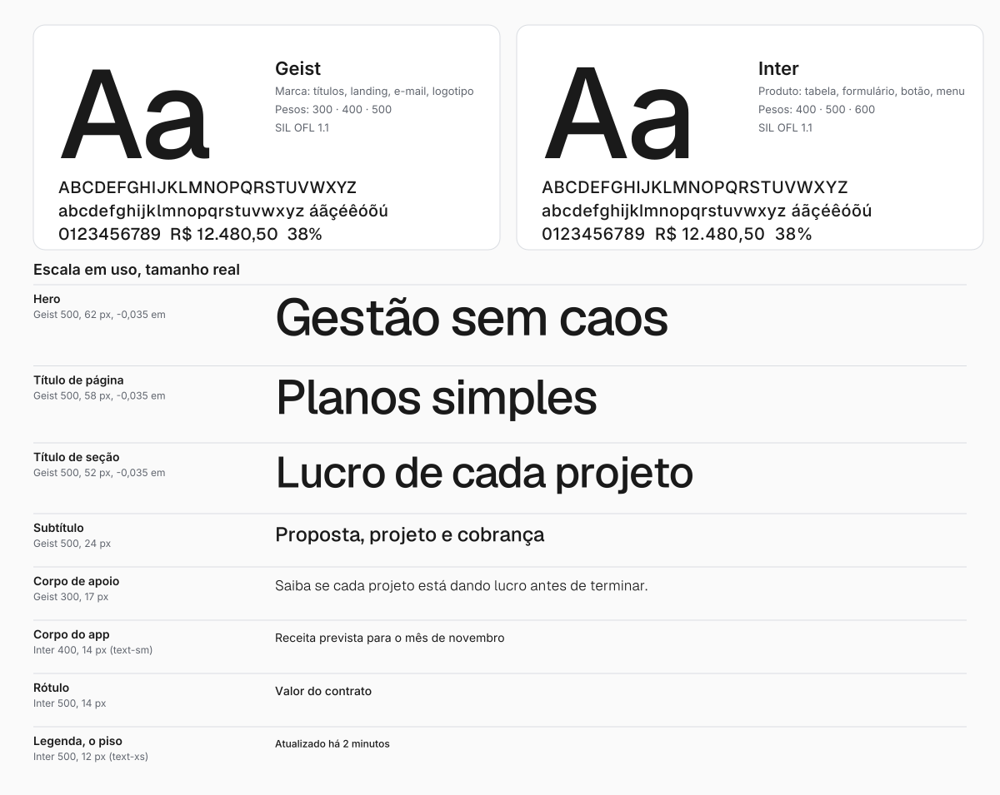

# Tipografia

> Famílias, escala, pesos, piso de tamanho e regras de composição. Cor do texto: [color.md](./color.md).
> Tom da escrita: [voice-tone.md](./voice-tone.md). Tokens: `src/styles/tokens.css` e `tailwind.config.ts`.

## 1. Famílias

A marca usa duas famílias sem serifa, da mesma linhagem (grotescas neutras, de desenho aberto e
boa leitura em número). Uma fala pela marca; a outra trabalha dentro do produto.

| Família | Papel | Onde está hoje | Licença |
|---|---|---|---|
| **Geist** | Marca: nome em curva, títulos, landing, e-mail, apresentações | `apps/marketing/public/fonts/geist-variable.woff2` (e itálico), autohospedada | SIL OFL 1.1 |
| **Inter** | Interface do produto: corpo, tabela, formulário, botão | Google Fonts no `index.html` do app; arquivos latinos em `apps/marketing/public/fonts/` | SIL OFL 1.1 |

Pilha de fallback: `Geist, Inter, system-ui, sans-serif` na landing; `Inter, sans-serif` no app.
Se nenhuma carregar, o sistema entrega a fonte do sistema operacional e o layout aguenta,
porque a escala usa `clamp()` e linhas com altura relativa.

**Regra de uso.** Texto que o usuário lê para trabalhar (tabela, campo, menu, modal) é Inter.
Texto que apresenta a marca (landing, e-mail, deck, material de venda, título de página pública)
é Geist. O logotipo é sempre Geist em curva. Não entra uma terceira família. Fonte serifada,
manuscrita ou decorativa nunca entra, nem em convite ou campanha.

**Convergência.** As duas famílias são parecidas o bastante para conviver, mas o destino é uma
só (Geist em tudo), o que tira um arquivo de fonte do app e acaba com o nome que muda de forma
entre app e site. Decisão e custo no card de acompanhamento; até lá vale a tabela acima.

## 2. Escala

Três escalas, para três usos. Não misture.

### 2.1 Títulos da marca (landing e site, em uso)

É o que está publicado em `apps/marketing/src/components/`. Geist Medium (500), tracking
**-0,035 em**, cor Ink. O tamanho muda por faixa de largura (≥ 1100, ≤ 1100, ≤ 850, ≤ 420 px).

| Nível | Tamanhos (≥1100 / ≤1100 / ≤850 / ≤420) | Entrelinha | Uso |
|---|---|---|---|
| Hero | 62 / 50 / 34 / 27 px | 1,10 | `<h1>` da home, uma vez por página |
| Título de página | 58 / 44 / 30 / 26 px | 1,06 | `<h1>` das páginas internas e chamada final (CTA) |
| Título de seção | 52 / 42 / 29 / 25 px | 1,08 | `<h2>` de cada seção |
| Subtítulo | 20 a 24 px | 1,30 | `<h3>`, título de cartão |
| Corpo de apoio | 15 a 17 px | 1,60 | Parágrafo sob título (peso 300 ou 400) |

Hoje os três títulos são classes arbitrárias em cada componente (`text-[62px]` e afins). A
consolidação em tokens é um card de acompanhamento: o desenho acima é o alvo.

### 2.2 Tokens fluidos (definidos, ainda sem uso)

`tokens.css` e `tailwind.config.ts` já definem uma escala com `clamp()` (`text-display`, `text-h1`
a `text-h4`, `text-lead`). Nenhum componente a usa hoje, e o teto de `display` (112 px) é maior
que qualquer título publicado. Antes de adotar, os valores devem ser alinhados à tabela 2.1.

| Token | Tamanho (mín. → máx.) | Entrelinha |
|---|---|---|
| `text-display` | 44 → 112 px | 0,95 |
| `text-h1` | 36 → 52 px | 1,10 |
| `text-h2` | 30 → 36 px | 1,15 |
| `text-h3` | 24 px | 1,30 |
| `text-h4` | 20 px | 1,40 |
| `text-lead` | 18 px | 1,60 |

Nunca em tabela de dados: lá o tamanho precisa ser estável.

### 2.3 Escala do produto (Tailwind)

Tamanhos fixos, para dado. Os mais usados:

| Classe | Tamanho | Uso |
|---|---|---|
| `text-2xl` | 24 px | Título de cartão (`CardTitle`, semibold, tracking-tight) |
| `text-base` | 16 px | Corpo longo, campo no celular |
| `text-sm` | 14 px | **Corpo padrão do app**: tabela, campo, botão, rótulo |
| `text-xs` | 12 px | Legenda, metadado, badge (semibold). **É o piso** (seção 4) |

## 3. Pesos

| Peso | Nome | Uso |
|---|---|---|
| 300 | Light | Corpo de apoio e lead da landing, itálico de destaque. Só a partir de 16 px |
| 400 | Regular | Corpo de leitura, descrição, texto de apoio |
| 500 | Medium | **Títulos da marca**, rótulo, botão, menu, o nome no logotipo |
| 600 | Semibold | Badge, título de cartão no app, número que precisa de ênfase |
| 700 | Bold | Quase nunca. Só se 600 não bastar para um número ou alerta |

Não use peso abaixo de 300 nem acima de 700. Itálico só no destaque de título (seção 6) e em
citação. Sublinhado só em link.

## 4. Piso da fonte

O piso é o menor tamanho em que a marca aceita texto. Abaixo dele a leitura cansa, o
leitor de tela e o zoom do celular não compensam, e o contraste medido deixa de valer.

| Contexto | Piso | Observação |
|---|---|---|
| Produto, texto de leitura | **12 px** (`text-xs`) | Corpo padrão é 14 px |
| Produto, rótulo em caixa-alta | 11 px | Só com peso 500 ou mais e tracking de +0,04 em ou mais (selo, eyebrow) |
| Campo de texto no celular | **16 px** | Menos que isso faz o iOS dar zoom ao tocar. Regra já vigente em `Input`, `Textarea`, `SelectTrigger` |
| Landing, corpo | 16 px | Lead em 18 px |
| Landing, legenda e nota legal | 12 px | |
| E-mail | 14 px corpo, 12 px rodapé | |
| Apresentação | 18 pt corpo, 12 pt nota de rodapé | Projeção pede mais que tela |
| Impressão | 9 pt corpo, 7 pt nota legal | |
| Peso 300 | 16 px | Abaixo disso, 400 |
| Logotipo, nome do lockup | 14 px | Ver [logo.md](./logo.md), tamanho mínimo |

Nada de 8, 9 ou 10 px, em lugar nenhum.

**Dívida conhecida.** O código atual tem `text-[10px]` em 220 pontos, `text-[11px]` em 142,
`text-[9px]` em 43 e `text-[8px]` em 15 (varredura de `src/` e `apps/marketing/src/`). Eles ficam
até a migração, que vem com uma regra de ESLint barrando tamanho arbitrário abaixo do piso.
Código novo já nasce dentro do piso.

## 5. Composição

**Entrelinha.** Texto corrido 1,5 a 1,6. Título 1,1 a 1,3 (quanto maior, mais curta). Tabela e lista
densa 1,35.

**Medida.** Linha de leitura entre 45 e 75 caracteres (cerca de `max-w-prose`, 65ch). Coluna de
marketing em `--container-content` (1080 px), seções largas em `--container-wide` (até 1600 px).

**Alinhamento.** À esquerda. Centralizado só em hero, título de seção curto e estado vazio.
Nunca justificado.

**Capitalização.** Sentence case em títulos, botões e menus ("Novo projeto", não "Novo Projeto").
Caixa-alta só em eyebrow curto e selo, sempre com tracking aberto. O nome do produto é "Pilar".

**Números.** Valor, data e percentual usam algarismos tabulares (`tabular-nums`, já em 83
arquivos) para colunas alinharem. Dinheiro e data sempre por `@/lib/format`, nunca montados à mão.
Sinal de menos com hífen-menos, e a cor do número segue [color.md](./color.md) (só
receita, despesa e saldo colorem).

**Pontuação.** Sem travessão ou meia-risca como pontuação. Troque por vírgula, parênteses, dois-pontos
ou ponto. Aspas retas. Reticências só quando o texto realmente se interrompe.

## 6. O destaque da marca

A assinatura tipográfica da Pilar é **uma palavra do título em itálico, dentro de uma pílula
verde**. Está no hero (`RotatingWord`, `apps/marketing/src/components/RotatingWord.tsx`), onde o
verbo troca ("Onde times e agentes *organizam* gestão, projetos e obras").

| Propriedade | Valor |
|---|---|
| Palavra | itálico, cor Ink, herda tamanho e peso do título |
| Pílula | fundo verde da marca (#A4EC86), raio de 0,28 em, folga lateral de 0,16 em |
| Quantidade | um por título, de uma a três palavras |
| Onde | hero e título de seção da landing, material de venda, deck |
| Onde não | dentro do produto, em botão, em corpo de texto |

O verde só aguenta área pequena (ver [color.md](./color.md)): por isso o destaque é uma pílula
justa em volta da palavra, nunca uma faixa ou um bloco.

`.hero-italic-highlight` e `.landing-highlight` em `src/styles/landing.css` são a versão antiga
(marca-texto no fundo da palavra) e nenhum componente os usa hoje. Remover é um card de acompanhamento.

## 7. Como aplicar no código

- Na landing, título segue a tabela 2.1 até os tokens serem consolidados: 500, `tracking-[-0.035em]`,
  cor `text-ink`.
- Nome de classe novo de tamanho precisa entrar no `extendTailwindMerge` de `src/lib/utils.ts`;
  sem isso o `tailwind-merge` descarta o tamanho quando há override de cor.
- Campo de texto: `text-sm max-md:text-base`. Não use `text-base md:text-sm`.
- Fonte nova ou peso novo exige ADR (decisão transversal).
