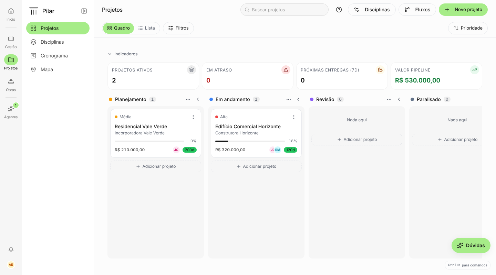
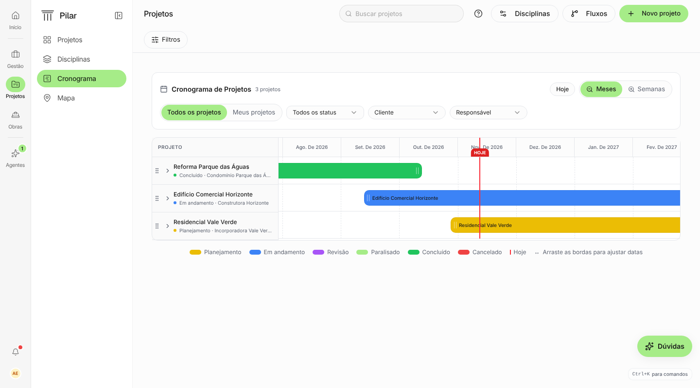
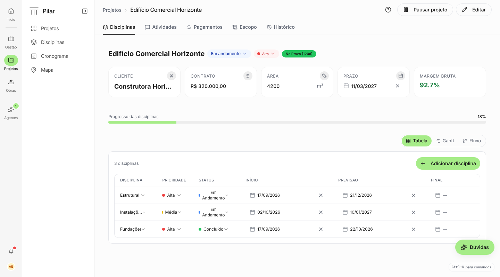
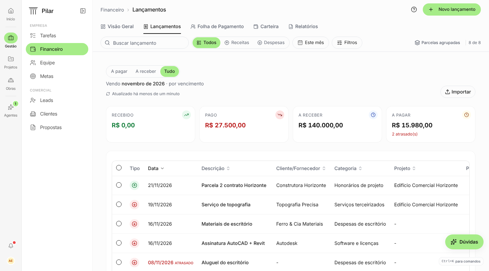
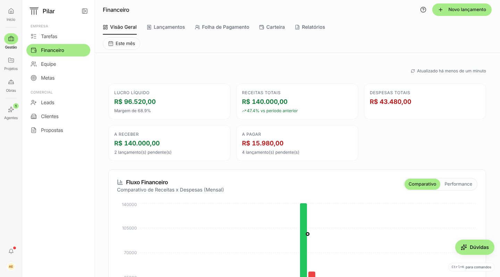
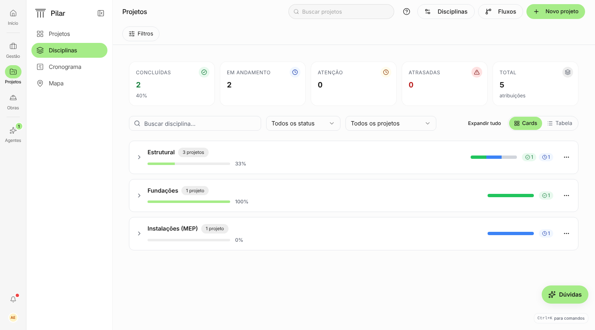
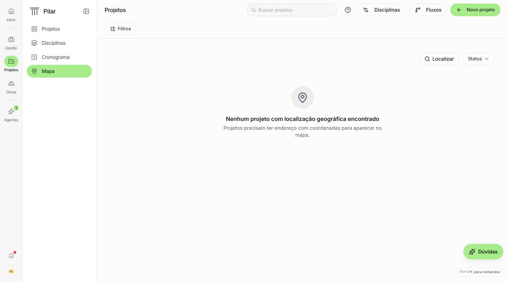
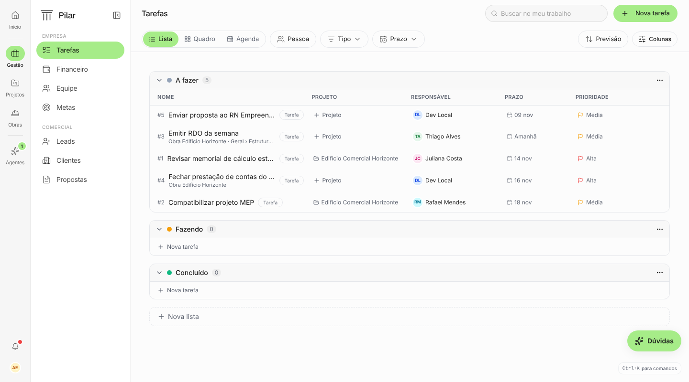
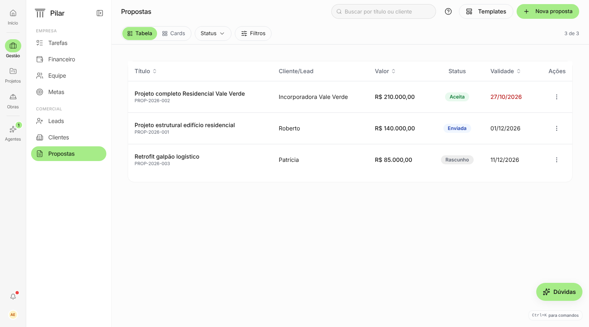

# Auditoria de espaço de tela (notebook 13")

Data: 2026-11-11. Pedido do Matheus: em MacBook 13" sobra pouco pixel para o conteúdo principal
(Kanban, Gantt, tabelas) porque cromo, espaçamento e elementos flutuantes consomem a tela.

## Como foi medido

- App local (`dev:local`, seed `admin@local.test` + `seed:demo`), branch base `staging` de hoje.
- Viewport **1440 × 800**: o que sobra de um MacBook Air 13" (1470 × 956 em escala padrão) depois da
  barra do Chrome. Os prints do Matheus em produção indicam viewport ainda menor, perto de
  **1320 × 750** (janela não maximizada ou zoom do navegador). Os números abaixo valem para 1440 × 800
  e pioram na proporção em 1320 × 750.
- Medição por print (pixel CSS, DPR 1) e por leitura das classes no código (`arquivo:linha`).
- Prints em [`auditoria-espaco-2026-11/`](auditoria-espaco-2026-11/) (dado seed apenas).

## Resumo

| Tela                     | Onde o conteúdo principal começa (y)                | Fração da altura para o conteúdo | Maior desperdício                                     |
| ------------------------ | --------------------------------------------------- | -------------------------------- | ----------------------------------------------------- |
| Projetos › Quadro        | 280 px (cabeçalho das colunas)                      | 59%                              | KPIs + linha "Indicadores" sozinha + padding de 40 px |
| Projetos › Cronograma    | 284 px; altura do Gantt travada em `100svh − 420px` | 41% (330 px em 750)              | Card de filtros duplicado + altura fixa               |
| Projeto › detalhe        | 540 px (1ª disciplina)                              | 32%                              | Título repetido, KPIs, progresso, linha só do seletor |
| Financeiro › Lançamentos | 520 px (1ª linha)                                   | 35%                              | 3 linhas de controles repetidos + KPIs fixos          |
| Financeiro › Visão geral | 490 px (gráfico)                                    | 39%                              | 5 KPIs quebrando em 2 linhas                          |
| Propostas                | 150 px, mas tabela travada em `100svh − 360px`      | 55%                              | Altura fixa deixa ~150 px mortos embaixo              |

Três causas explicam quase tudo:

1. **Altura por número mágico** (`calc(100svh − Npx)`) em vez de a área principal preencher o que sobra.
   O Gantt é o caso mais grave: em 750 px de viewport ele recebe 330 px, ou seja, 5 linhas.
2. **Controles repetidos em várias linhas**: a página tem a toolbar padrão (SPEC 124) e, dentro do
   conteúdo, outra linha ou card com filtro, seletor de visão, "Atualizado há…" e título repetido.
3. **Cromo que não se adapta ao notebook**: padding de 40 px (`xl:p-10`) em tela de dados, painel da
   sidebar de 208 px que não lembra que foi recolhido, e dois elementos flutuantes fixos no canto
   inferior direito por cima do conteúdo.

Corrigindo os itens P0 e P1 abaixo, o Gantt passa de ~5 para ~10 linhas visíveis (~14 com a linha
compacta), o Quadro de Projetos ganha ~150 px de altura e o detalhe de projeto mostra a primeira
disciplina ~300 px mais acima.

---

## 1. Problemas que valem para todas as telas (shell)

### 1.1 Elementos flutuantes no canto inferior direito

- **Dica "⌘K para comandos"**: `fixed bottom-4 right-4` (`src/components/CommandPaletteHint.tsx:12`).
  Fica sempre visível, em toda tela, para sempre. Ocupa ~130 × 24 px por cima da última coluna do
  Kanban, da última coluna das tabelas e da legenda do Gantt.
- **Botão "Dúvidas"/"Como faço?"**: `fixed bottom-16 right-4 h-11` (`src/components/agente/AgenteAjuda.tsx:185`).
  Ocupa ~115 × 44 px por cima do conteúdo (no print de Lançamentos ele cobre a coluna "Projeto").
- O cabeçalho de toda página **já tem o "?"** (`AjudaDaTela` no `PageHeader`). São três portas de ajuda
  na mesma tela: "?", pílula flutuante e dica de ⌘K.
- Também disputam o mesmo canto: `OnboardingChecklist` (`fixed md:bottom-4 right-4`, até 360 px de
  largura, `OnboardingChecklist.tsx:53`) e `NpsCard` (`fixed md:bottom-32 right-4 w-[360px]`, no Início).
  O checklist colide com a dica de ⌘K na mesma posição.

**Proposta**

- Tirar a dica de ⌘K do canto. Opções, em ordem de preferência: (a) mostrar o atalho no placeholder da
  busca do cabeçalho ("Buscar projetos ⌘K") ou no rodapé do trilho da sidebar, ao lado do sino;
  (b) mostrar a dica só nas primeiras N sessões e esconder depois do primeiro uso do ⌘K.
- Unificar a ajuda no "?" do cabeçalho: clicar no "?" abre o painel do agente de ajuda (o mesmo de
  hoje). No desktop, sem pílula flutuante. Se a pílula ficar, que vire um ícone redondo de 40 px que
  some durante drag/scroll horizontal do Kanban.
- Regra para o design system: **nada fixo por cima da área de conteúdo em desktop**, exceto toast e
  dialog. Elemento persistente mora no cabeçalho ou no trilho.

### 1.2 Padding da área de conteúdo

- `PageLayout` usa `p-6 md:p-8 xl:p-10 2xl:p-12` (`src/components/PageLayout.tsx:91`). Em 1440 px cai
  no `xl:p-10`: **40 px em cima, 40 px embaixo e 40 px de cada lado**. Somado ao `pb-2` do Kanban, sobram
  48 px vazios abaixo das colunas.
- Em tela de dados (Kanban, Gantt, tabela, mapa) isso é pixel puro jogado fora: entre a toolbar e os
  "Indicadores" há 40 px em branco (o gap que o Matheus apontou no print).

**Proposta**

- Nova prop no `PilarPage`/`PageLayout`: `density="compact"` (ou `fill`) com `px-6 pt-4 pb-4` e
  `containerClassName="h-full min-h-0 flex flex-col"` já embutido. Usar em Projetos (Quadro, Lista,
  Cronograma, Mapa, Disciplinas), Tarefas, Leads, Propostas, Clientes, Lançamentos.
- Manter o padding atual só em telas de leitura (Início, Visão geral, Configurações).
- Ganho: ~40 px de altura e ~32 px de largura por tela de dados.

### 1.3 Sidebar: 272 px fixos e não lembra que foi recolhida

- Trilho 64 px + painel 208 px (`src/lib/shellLayout.ts:6-7`). Em 1440 px é 19% da largura; em
  1320 px, 21%.
- **Bug**: o estado recolhido é gravado no cookie `sidebar:state` (`src/components/ui/sidebar.tsx:68`),
  mas nunca é lido. `defaultOpen` é sempre `true` (`sidebar.tsx:50`). Quem recolhe o painel perde a
  escolha a cada recarga.
- Escolher um módulo no trilho reabre o painel recolhido (`AppSidebar.tsx:94`).
- O painel de Projetos tem só 4 itens (Projetos, Disciplinas, Cronograma, Mapa) e ocupa 208 px na
  altura inteira.

**Proposta**

- Ler o cookie (ou `localStorage`) no `SidebarProvider` para respeitar a escolha.
- Abaixo de 1536 px de largura, começar com o painel recolhido e abrir como sobreposição (flyout) ao
  passar ou clicar no trilho, sem empurrar o conteúdo.
- Ganho: +208 px de largura, quase uma coluna inteira de Kanban (280 px) ou 2 meses a mais no Gantt.

### 1.4 Faixas de aviso possivelmente escondidas (verificar)

- `AceiteTermosBanner modo="faixa"` (`Layout.tsx:97`) e `FaixaAvisos` (`Layout.tsx:112`) estão no fluxo
  normal do `<main>`, mas o `PageLayout` é `fixed top-0 … z-40`. Nas telas que usam `PageLayout`, a
  faixa tende a ficar por baixo do painel. Não deu para disparar um incidente no seed para confirmar;
  vale um teste antes de mexer no layout.
- `ReadOnlyBanner` e `ImpersonationBanner` são `fixed top-0 z-60` sem reservar espaço: cobrem os
  36 px de cima do cabeçalho.

---

## 2. Tela por tela

### 2.1 Projetos › Quadro

Orçamento vertical em 1440 × 800:

| Faixa                                       | px      |
| ------------------------------------------- | ------- |
| Cabeçalho (`PageHeader`, h-14)              | 57      |
| Toolbar (Quadro/Lista, Filtros, Prioridade) | 52      |
| Padding superior (`xl:p-10`)                | 40      |
| Linha "Indicadores" sozinha                 | 16 + 16 |
| 4 KPIs                                      | 79 + 20 |
| **Começo das colunas**                      | **280** |
| Colunas                                     | 472     |
| Padding inferior + `pb-2`                   | 48      |

- A linha "Indicadores" ocupa uma linha inteira só com o gatilho. O `CollapsibleKpiSection` **já tem a
  prop `controls`** para pôr controles na mesma linha (SPEC 061), mas Projetos não usa
  (`src/pages/Projetos.tsx:437`).
- Recolhido, o bloco ainda custa ~32 px e não mostra nada.

**Proposta**

- Levar o gatilho "Indicadores" para a toolbar, à direita, ao lado de "Prioridade".
- Recolhido, mostrar um resumo inline na toolbar: `9 ativos · 8 em atraso · R$ 687 mil`. Os números
  continuam visíveis sem gastar uma linha. Aberto, os KPIs usam `KPICard density="compact"` (já existe).
- Com `density="compact"` no layout: colunas começam em ~125 px (KPIs recolhidos) ou ~215 px (abertos).
  **Ganho: +65 a +155 px de altura de coluna.**

### 2.2 Projetos › Cronograma (Gantt)

- **Altura travada**: `max-h-[calc(100svh-420px)]` (`CronogramaProjetosTab.tsx:448`). Em 800 px dá
  380 px; em 750 px dá **330 px**, menos 40 px do cabeçalho de meses: 290 px ÷ 56 px por linha ≈
  **5 linhas**. É exatamente o print do Matheus.
- **Filtros em dobro**: a toolbar da página mostra só "Filtros" (52 px), e logo abaixo há um card
  inteiro (116 px) com título "Cronograma de Projetos", contagem, Hoje, Meses/Semanas,
  Todos/Meus projetos, Status, Cliente, Responsável (`CronogramaProjetosTab.tsx:332-400`). O título
  repete o item ativo da sidebar.
- Legenda numa linha própria embaixo (`:702`), mais `space-y-4` entre os blocos.
- Linha de 56 px (`h-14`) para nome e status em duas linhas. Coluna de nomes com 260 px fixos
  (`CronogramaColunaProjetos.tsx:51`).
- Os elementos flutuantes cobrem a ponta direita da legenda e da última linha.

**Proposta**

- O Gantt preenche a altura que sobra (`flex-1 min-h-0`), sem `calc`.
- Subir Hoje, Meses/Semanas, Todos/Meus, Status, Cliente e Responsável para a toolbar da página
  (`PageToolbar`), na linha que hoje só tem "Filtros". Remover o card e o título.
- Legenda vira um popover "Legenda" na toolbar, ou chips de status que também filtram.
- Densidade de linha: opção "Compacta" com 36–40 px por linha (nome numa linha, status como bolinha
  e cliente no tooltip).
- Coluna de nomes redimensionável (arrastar a borda), padrão 220 px.
- **Ganho em 750 px de altura**: área do Gantt de 330 para ~590 px. São **~10 linhas** em 56 px ou
  **~14 linhas** em 40 px, contra 5 hoje. Com o painel da sidebar recolhido, +208 px de linha do tempo.

### 2.3 Projeto › detalhe

- O cabeçalho já mostra `Projetos › Edifício Comercial Horizonte`, e o conteúdo repete o nome num
  `h2 text-xl` com os chips de status, prioridade e prazo (`ProjetoDetailHeader.tsx:39-41`, ~52 px +
  `mb-6`).
- 5 KPIs fixos, sem recolher (`ProjetoDetailInfo.tsx:74`, ~86 px + `mb-6`).
- Barra "Progresso das disciplinas" numa linha própria (`:141`, ~26 px + `mb-6`).
- Linha só para o seletor Tabela/Gantt/Fluxo, alinhado à direita (`ProjetoDetailTabs.tsx:281`, ~48 px).
- Card com "3 disciplinas" + "Adicionar disciplina" (~65 px) antes do cabeçalho da tabela.
- Resultado: **a primeira disciplina aparece em y = 540**, com 2 linhas e meia visíveis.
- Aba Atividades: card `h-[70dvh] min-h-[420px]` (`ProjetoDetailTabs.tsx:351`), que somado aos
  ~366 px de cromo sempre força rolagem da página.
- Gantt do projeto: outro card de cabeçalho "Cronograma do Projeto" (`CronogramaTab.tsx:322-348`).

**Proposta**

- Remover o `h2` repetido e levar status, prioridade e prazo para a linha do cabeçalho, ao lado do
  breadcrumb.
- KPIs + progresso numa faixa recolhível (`CollapsibleKpiSection storageKey="projeto-detalhe"`), com
  o progresso dentro do primeiro KPI.
- Seletor Tabela/Gantt/Fluxo e "Adicionar disciplina" na toolbar da aba (`PageToolbar`), não em
  linha própria.
- Atividades e Gantt preenchem a altura disponível.
- **Ganho: a primeira disciplina sobe de y = 540 para ~230** (KPIs abertos ~330).

### 2.4 Financeiro › Lançamentos

- Área fixa de cima: cabeçalho 57 + abas 44 + toolbar 52 = 153 px. Até aí, ok.
- Dentro do conteúdo vêm mais três linhas (`Lancamentos.tsx:137-156`):
  - "A pagar / A receber / Tudo", um segundo seletor ao lado do "Todos / Receitas / Despesas" da toolbar;
  - "Vendo novembro de 2026 · por vencimento", que repete o "Este mês" da toolbar;
  - "Atualizado há menos de um minuto" e "Importar".
- 4 KPIs fixos (`:176`, ~107 px), mais `space-y-6`, mais card com `p-4`.
- **Primeira linha em y = 520**: 5 linhas visíveis, e a pílula de ajuda cobre a coluna "Projeto".
- Rolagem dupla: a tabela tem `maxHeight: min(70dvh, 720px)` (`LancamentosTable.tsx:372`) dentro de
  uma página que também rola.

**Proposta**

- Fundir os dois seletores num só, na toolbar (Tudo · A receber · A pagar · Recebido · Pago).
- "Vendo…" vira o próprio rótulo do filtro de período. "Atualizado há…" vira um ícone com tooltip na
  toolbar. "Importar" vai para as ações do cabeçalho.
- KPIs em `CollapsibleKpiSection` compacto, ou como resumo inline na toolbar quando recolhidos.
- A tabela preenche a altura, com uma rolagem só e cabeçalho fixo.
- **Ganho: a primeira linha sobe de 520 para ~210** (≈ 10 linhas a mais visíveis).

### 2.5 Financeiro › Visão geral

- Linha só para "Atualizado há menos de um minuto" (`VisaoGeral.tsx:231`, ~44 px).
- 5 KPIs em `lg:grid-cols-3 2xl:grid-cols-5` (`:235`): abaixo de 1536 px **quebram em 2 linhas**
  (3 + 2, com buraco à direita), ~222 px.
- Gráficos com altura fixa de 350 e 320 px.

**Proposta**: 5 colunas a partir de `lg` com `density="compact"` (1 linha, ~90 px); "Atualizado"
como ícone na toolbar. **Ganho: ~170 px**, e o gráfico entra na primeira dobra.

### 2.6 Projetos › Disciplinas e Mapa

- Nas duas abas a toolbar mostra só "Filtros" (52 px), e o conteúdo traz outra linha de filtro:
  - Disciplinas: busca, Status, Projeto, Expandir tudo e Cards/Tabela (`DisciplinasTab.tsx:412`, ~60 px).
    A busca repete a busca do cabeçalho. Os 5 KPIs não recolhem (`:396`, ~107 px).
  - Mapa: "Localizar" e "Status" (`MapaTab.tsx:201`, 48 px), mais uma linha de chips de status, mais
    altura `calc(100dvh - 320px)` (`:357`).
- **Proposta**: tudo isso na toolbar da página; KPIs recolhíveis; mapa preenchendo a altura.
  **Ganho: ~110 px (Disciplinas) e ~130 px (Mapa).**

### 2.7 Gestão › Tarefas

- Lista: ok. É a referência de tela que já usa a toolbar bem.
- Quadro: `KANBAN_BOARD_CLASS` é `h-full`, mas a página não passa `containerClassName="h-full flex
flex-col"`. A altura não resolve, as colunas crescem, a página inteira rola, e a barra de rolagem
  horizontal fica no fim da coluna mais alta.
- Agenda: segunda linha de controles no conteúdo (anterior/próximo, Hoje, Mês/Semana,
  `AbaAgenda.tsx:179-203`, ~48 px) e barra lateral de calendário de 256 px (`CalendarioSidebar.tsx:44`).
- **Proposta**: modo `fill` no Quadro; controles da Agenda na toolbar; barra lateral recolhível.

### 2.8 Propostas

- Tabela com `maxHeight="calc(100svh - 360px)"` (`propostas/index.tsx:728`). Em 800 px de altura a
  tabela para em ~590 px, e **~150 px ficam mortos** embaixo com a lista cheia.
- Botão de ações da linha `h-11 w-11` (`:637`) força linhas de ~52 px ou mais (77 px no print).
- **Proposta**: tabela preenche a altura (modo `fill`); botão de ação `h-8 w-8`; linhas de ~48 px.

### 2.9 Demais telas

- **Clientes (lista)**: card com `p-4` em volta da `DataTable`, sem `maxHeight`, então o cabeçalho
  não fica fixo; paginação gasta ~58 px. **Detalhe**: aba Visão geral travada em `max-w-2xl`
  (672 px, `clientes/[id]/index.tsx:264`), desperdiçando ~300 px de largura.
- **Leads**: já está certo (`h-full flex flex-col` e KPIs recolhíveis). É o modelo a copiar.
- **Obras**: 3 KPIs fixos (`obras/index.tsx:99`). No detalhe, metadados e alerta de clima (~70 px) antes
  do conteúdo.
- **Folha**: `space-y-8 pb-10` soma 40 px ao padding da página (`FolhaPagamento.tsx:516`); KPIs fixos.
- **Relatórios**: card de filtros no conteúdo (`p-5`, ~100–150 px, `Relatorios.tsx:477-566`), que
  deveria morar na toolbar.
- **Agentes**: conversa em `max-w-2xl`. Aqui a largura limitada é intencional (legibilidade do chat);
  manter.
- **Início**: tela de leitura; o espaço está proporcional. Só o `NpsCard` flutuante (360 px de largura)
  disputa o canto com a ajuda e o ⌘K.

---

## 3. Plano em fases

Ordem por ganho ÷ esforço. Cada fase é um PR para `staging` com antes e depois (regra do dono).

### P0: correções rápidas, todas as telas (1 PR) — feito

Antes e depois em [`antes-depois/auditoria-espaco-p0/`](antes-depois/auditoria-espaco-p0/).
Ajustes em relação ao plano: o ⌘K virou um botão no rodapé do trilho (abre a paleta no clique) e
o "?" do cabeçalho abre o painel "Dúvidas" em toda tela do app, inclusive nas que não têm artigo.
Em 1320 × 750 o Gantt foi de 5 para ~6,5 linhas; o resto do ganho depende do P1 (padding e card
de filtros).

| Item                                                                  | Onde                                       | Ganho                                |
| --------------------------------------------------------------------- | ------------------------------------------ | ------------------------------------ |
| Tirar a dica ⌘K do canto (placeholder da busca ou rodapé do trilho)   | `CommandPaletteHint.tsx`, `PageHeader.tsx` | Libera o canto em toda tela          |
| Ajuda só pelo "?" do cabeçalho no desktop (pílula some ou vira ícone) | `AgenteAjuda.tsx`, `AjudaDaTela`           | Idem; 1 porta de ajuda em vez de 3   |
| Sidebar lembra o estado recolhido (ler o cookie que já é gravado)     | `ui/sidebar.tsx`, `Layout.tsx`             | +208 px de largura para quem recolhe |
| Gantt preenche a altura (tirar `calc(100svh-420px)`)                  | `CronogramaProjetosTab.tsx:448`            | 5 → ~8 linhas                        |

### P1: modo de tela de dados (1–2 PRs)

- `PilarPage density="compact"`/`fill`: padding 24/16 e `h-full flex col`. Aplicar em Projetos (todas
  as abas), Tarefas, Leads, Propostas, Clientes, Lançamentos, Mapa. Remove os `calc` de Propostas e Mapa.
- `CollapsibleKpiSection` com gatilho dentro da toolbar e resumo inline quando recolhido. Aplicar em
  Projetos, Leads, Disciplinas, Lançamentos, Detalhe de projeto, Obras, Folha.
- Cronograma: controles do card sobem para a toolbar; legenda vira popover; linha compacta.

**Primeira parte feita** (antes e depois em
[`antes-depois/auditoria-espaco-p1/`](antes-depois/auditoria-espaco-p1/README.md)):

- `density="compact"` em Projetos (todas as abas), Tarefas, Leads, Propostas, Clientes e Equipe;
  `calc` de Propostas e Mapa removidos.
- Resumo inline dos indicadores recolhidos (`resumo` no `CollapsibleKpiSection`), aplicado em
  Projetos. O gatilho ficou na linha própria, que recolhida custa só ~24 px.
- Cronograma: controles na toolbar, legenda no botão (i). Gantt em 1320×750: ~10 linhas.

**Resto feito** (antes e depois em
[`antes-depois/auditoria-espaco-p2/`](antes-depois/auditoria-espaco-p2/README.md)): linha do Gantt
de 44 px (13 linhas em 1320×750) e resumo recolhido em Leads, Disciplinas, Obras, Lançamentos e no
detalhe do projeto (componente `KpiResumo`).

### P2: limpar duplicações por tela (1 PR por módulo)

- ~~Detalhe de projeto: título repetido, KPIs recolhíveis, seletor de visão na toolbar.~~ Feito:
  status/prioridade/prazo na linha dos indicadores, seletor na linha das abas.
- ~~Lançamentos: um seletor só, "Vendo…" e "Atualizado" absorvidos pela toolbar.~~ Feito: o
  seletor da barra é o único; recorte, "Atualizado" e Importar numa linha ao lado dos indicadores.
- ~~Visão geral: 5 KPIs numa linha.~~ Feito, recolhíveis com resumo.
- ~~Disciplinas, Mapa, Agenda, Relatórios: filtros do conteúdo para a toolbar.~~ Feito nos quatro.
- ~~Cliente detalhe sem `max-w-2xl`.~~ Feito: duas colunas no desktop.

### P3: estrutural

- Sidebar com painel em sobreposição abaixo de 1536 px.
- Faixas de aviso (`FaixaAvisos`, termos, somente leitura) reservando espaço no `PageLayout` em vez
  de ficarem por baixo ou por cima do cabeçalho.

**P3 feito** (antes e depois em
[`antes-depois/auditoria-espaco-p3/`](antes-depois/auditoria-espaco-p3/README.md)): painel da
sidebar recolhido por padrão e flutuante abaixo de 1536 px; faixas de aviso num bloco fixo no
topo, com `--faixas-h` empurrando o `PageLayout`, o chat e Metas. `ReadOnlyBanner` e
`ImpersonationBanner` também entram nesse bloco (antes cobriam o topo do cabeçalho), e os filtros
de Disciplinas foram para a barra da página
([`antes-depois/auditoria-espaco-p4/`](antes-depois/auditoria-espaco-p4/README.md)). Com isso, o
plano da auditoria está completo.

### P5: segunda varredura (12/11) — feito

O Matheus apontou mais vãos (Visão geral, Lançamentos, Clima). Uma varredura medida de 30 rotas em
1320 × 750 (script Playwright: vão entre o cabeçalho e o 1º bloco, recuo do conteúdo × recuo do
título, card dentro de card, largura travada) achou a causa comum e alguns casos isolados:

| Achado                                                                                                   | Telas                                                                              | Correção                                                                                                                      |
| -------------------------------------------------------------------------------------------------------- | ---------------------------------------------------------------------------------- | ----------------------------------------------------------------------------------------------------------------------------- |
| `PageLayout` padrão com 32/40/48 px de recuo, contra 24 px do título: vão no topo e conteúdo desalinhado | 17 rotas (Financeiro, Início, Ajuda, Novidades, Clima, Fornecedores, Obra, Ultra…) | Recuo lateral de 24 px e topo de 24 px em toda tela (`md:px-6 md:pt-6`)                                                       |
| Card em volta de tabela que já tem moldura (duas bordas, +16 px de cada lado)                            | Lançamentos                                                                        | Card removido                                                                                                                 |
| Tabela de Lançamentos mais larga que a tela: Valor e Status fora em 1320 px                              | Lançamentos                                                                        | Categoria, projeto e contraparte cortam com reticências (nome no `title`), "atrasado" embaixo da data; limites maiores em 2xl |
| `CardContent p-4` em volta da `DataTable` (texto 32 px dentro da borda)                                  | Clientes, Equipe, Fornecedores                                                     | `p-0` (padrão da Propostas)                                                                                                   |
| Linha de barra só para "3 de 3"                                                                          | Fornecedores                                                                       | Barra removida; contagem no cabeçalho quando a busca recorta                                                                  |
| Coluna central de 1024 px                                                                                | Clima                                                                              | Largura toda                                                                                                                  |
| Blocos de meia largura com a outra metade vazia                                                          | Obra › Visão                                                                       | Marcos de faturamento ao lado do Avanço                                                                                       |

Antes e depois em [`antes-depois/auditoria-espaco-p5/`](antes-depois/auditoria-espaco-p5/README.md).

### P6: terceira varredura, desktop e celular (12/11) — feito

Varredura de 52 telas e abas em 1320 × 750 e em 390 × 844. Além do espaço, ela procurou elemento
fora da tela, sobreposto, texto cortado sem reticências, alvo de toque pequeno e linha de cabeçalho
com um controle só. Os itens automáticos que sobraram eram falsos positivos (rótulo `sr-only` de
botão só com ícone). Os achados reais vieram da revisão das capturas:

| Achado                                                                | Correção                                                      |
| --------------------------------------------------------------------- | ------------------------------------------------------------- |
| Financeiro › Visão: linha de 52 px só para "Este mês"                 | No desktop, período no fim da linha das abas                  |
| Indicadores um por linha no celular (Financeiro, Obras, Folha, Ultra) | 2 ou 3 colunas                                                |
| Obra: linha de dados repetida em todas as abas (3 linhas no celular)  | Só na aba Visão                                               |
| Obra › Tarefas: controles numa linha dentro do conteúdo               | `PageToolbar`, como em Gestão › Tarefas                       |
| Obra › Acessos: "Criar acesso" no topo e no estado vazio              | Botão do topo só com acessos (padrão da aba Cotações)         |
| Fornecedor: 6 indicadores fixos, que no celular escondem a aba        | `CollapsibleKpiSection` com resumo, 2 colunas no celular      |
| Botão do estado vazio preto em metade das telas, verde na outra       | `EmptyState` usa `brand` por padrão                           |
| Início no celular: "At" cortado ao lado do ícone de atualizar         | `DataFrescor` compacto mostra só o ícone (texto em `sr-only`) |

Antes e depois em [`antes-depois/auditoria-espaco-p6/`](antes-depois/auditoria-espaco-p6/README.md).

### P7: celular, formulários e Configurações (12/11) — feito

- **Listas no celular** (Clientes, Equipe, Fornecedores, Propostas) viram cards pelo modo `mobile`
  da `DataTable`, sem card em volta.
- **Linha de atalhos do módulo** recolhe ao rolar para baixo no celular (`useRecolherAoRolar`).
- **Formulários e Configurações:** varredura de 10 formulários de criação e das 7 seções, no
  desktop e no celular. Nenhum fundo preto sobrou. O anel de foco passou do preto para o verde
  escuro do sistema (`green-700`), e as Configurações abrem com foco no diálogo, não em "Conta".
- **Defeito encontrado na varredura:** `projetos.exemplo` sem GRANT de leitura. O checklist de
  primeiros passos falhava com 403 e mostrava "Ocorreu um erro" no Início
  (`20261226000000_projetos_grant_coluna_exemplo.sql`).
- **Portal do Cliente:** o login usa uma função do servidor que não roda no ambiente local da
  sessão. A revisão foi pelo código; o portal usa os mesmos componentes base e herda o verde e o
  anel de foco.

Antes e depois em [`antes-depois/celular-listas-e-cabecalho/`](antes-depois/celular-listas-e-cabecalho/README.md)
e [`antes-depois/foco-verde/`](antes-depois/foco-verde/README.md).

## 4. Regras propostas para o design system

Para não voltar a acontecer (entrar em `PILAR_DESIGN_SYSTEM.md` após aprovação):

1. **Sem altura por número mágico.** A área principal de tela de dados preenche o que sobra
   (`flex-1 min-h-0`); `calc(100vh − Npx)` é proibido em página.
2. **Uma linha de controles por tela.** Filtro, seletor de visão, período, zoom, "Atualizado há" e
   "Importar" moram na toolbar (`FilterBar`/`PageToolbar`) ou no cabeçalho, nunca numa segunda
   linha dentro do conteúdo.
3. **Não repetir o título.** O nome da página/registro aparece só no `PageHeader`.
4. **KPI acima de lista/quadro/Gantt é sempre recolhível**, com resumo inline quando recolhido.
5. **Nada fixo por cima do conteúdo em desktop**, exceto toast e dialog.
6. **Validar em 1440 × 800** (notebook 13") além de 1440 × 900: o conteúdo principal tem que ficar com
   pelo menos 65% da altura do viewport.
7. **Recuo do conteúdo = recuo do título** (24 px em desktop). Recuo maior só desalinha e empurra o
   conteúdo para baixo.
8. **Tabela com moldura não vai dentro de card**, e card de lista não soma padding à `DataTable`.
9. **Grade de indicadores no celular tem pelo menos 2 colunas.** Um card por linha empurra o
   conteúdo da tela para baixo da dobra.
10. **Dado de cabeçalho de registro aparece uma vez** (na aba de visão geral), não repetido em
    todas as abas.
