# Auditoria de espaço: P2 (resto) e P3

Antes = `origin/staging` (75c2be9). Depois = branch do PR. Seed `dev@local.test` mais 12 projetos
fictícios e um incidente de teste ("Lentidão ao gerar relatórios"), só no banco local. Viewport
1440×800; Projetos e sidebar também em 1320×750 (a janela do notebook 13" do Matheus). Contexto
novo do navegador, sem preferência de sidebar salva.

O que muda:

- **Faixas de aviso (bug):** o aviso de incidente/manutenção e a faixa de reaceite dos Termos
  ficavam no fluxo do `<main>`, e o `PageLayout` (camada fixa e opaca) as cobria em toda tela que o
  usa. No "antes" o incidente existe mas não aparece. Agora ficam num bloco fixo no topo, e as
  páginas descem pela altura dele.
- **Sidebar em tela estreita (<1536 px):** começa recolhida (a escolha salva sempre vence) e, ao
  escolher um módulo no trilho, o painel abre **por cima** do conteúdo em vez de empurrá-lo. Fecha
  ao escolher um item, clicar fora ou Esc; o botão do painel fixa aberto. Em 1320 px o Quadro de
  Projetos ganha ~208 px de largura (a 4ª coluna inteira e o começo da 5ª).
- **Visão geral do Financeiro:** os 5 indicadores numa linha (eram 2), recolhíveis com resumo; o
  "Atualizado" divide a linha do gatilho. Margem em formato brasileiro ("68,9%").
- **Relatórios:** tipo, período e "Gerar prévia" na barra de filtros da página, no lugar do card
  com rótulos; os filtros de coluna entram na mesma barra depois de gerar.
- **Agenda de Tarefas:** anterior/próximo, Hoje e Mês/Semana na barra, ao lado de
  Lista/Quadro/Agenda, em vez de uma segunda linha.
- **Mapa:** Localizar e Status na barra (o seed não tem projeto com coordenadas, então o mapa em si
  não aparece).
- **Detalhe do cliente:** cards em duas colunas no desktop, no lugar da coluna única de 672 px.

| Tela                                | Antes                                   | Depois                                    |
| ----------------------------------- | --------------------------------------- | ----------------------------------------- |
| Projetos com aviso ativo, 1320×750  | 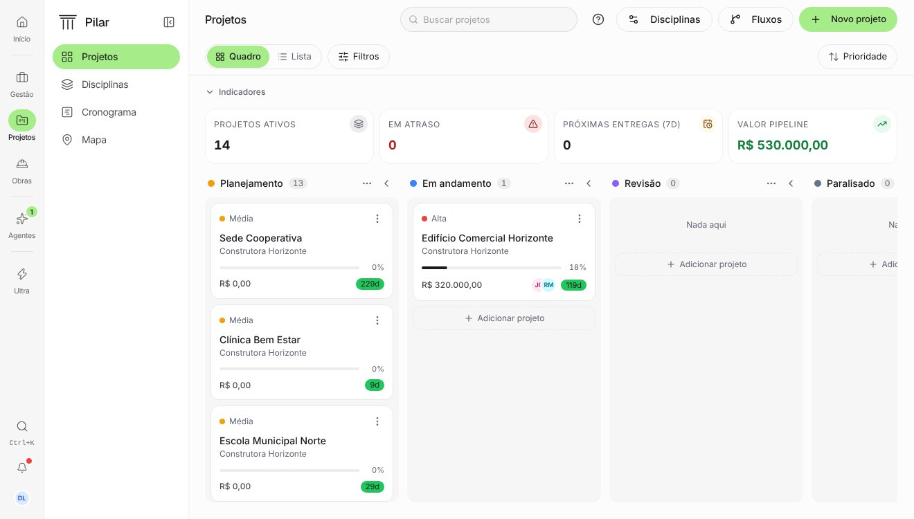 | 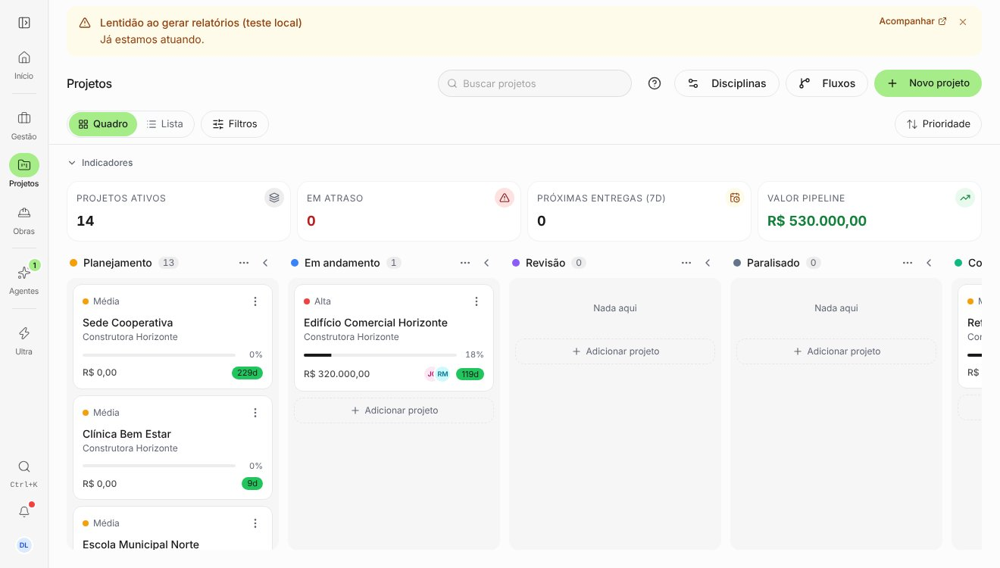 |
| Projetos com aviso ativo            | 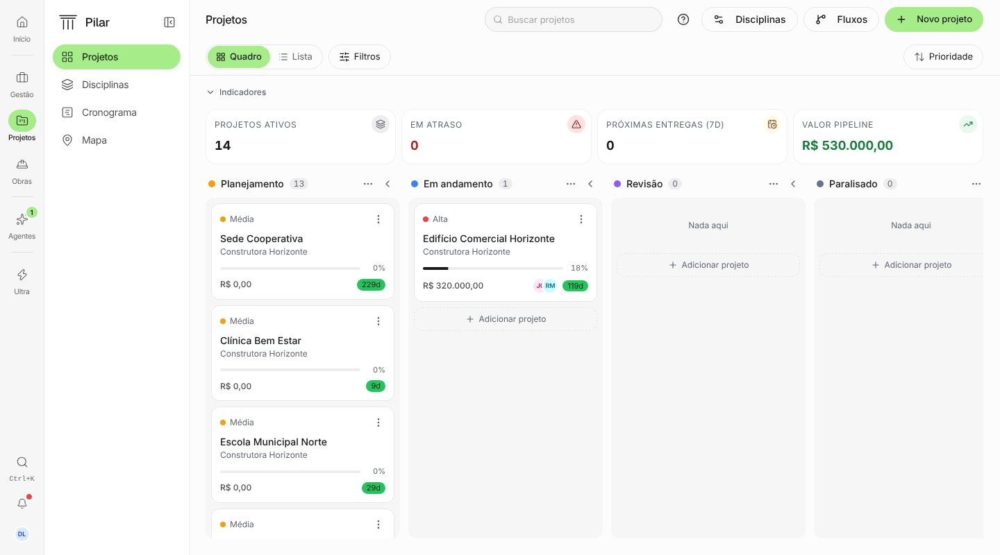      | 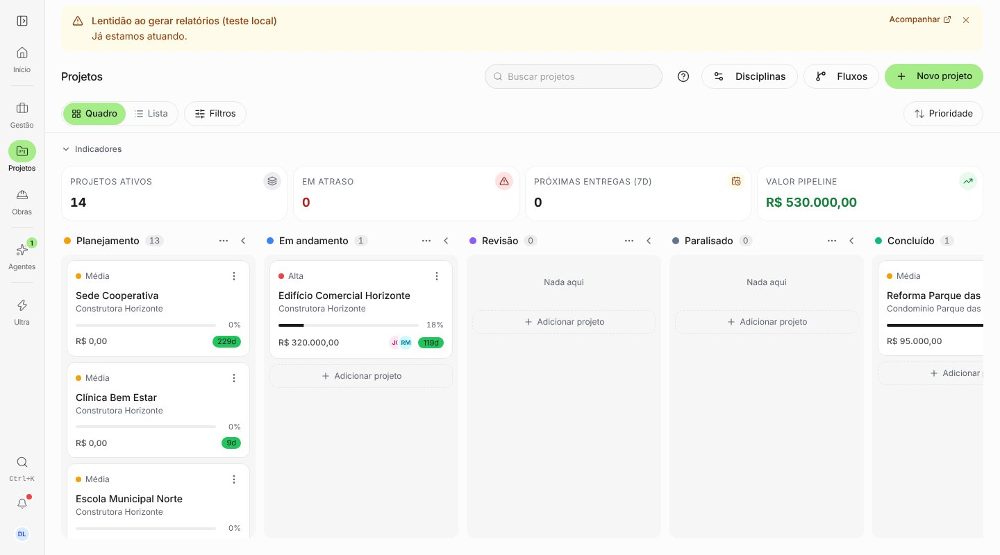      |
| Clicar "Gestão" no trilho, 1320×750 | 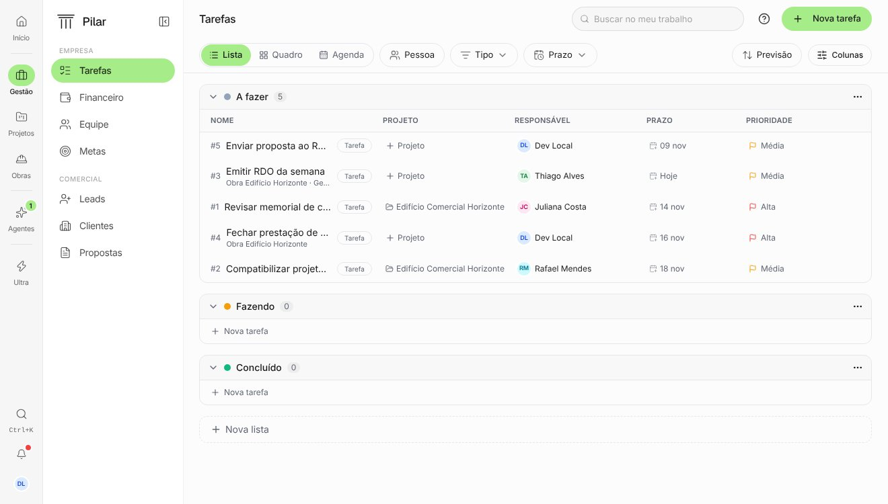 | 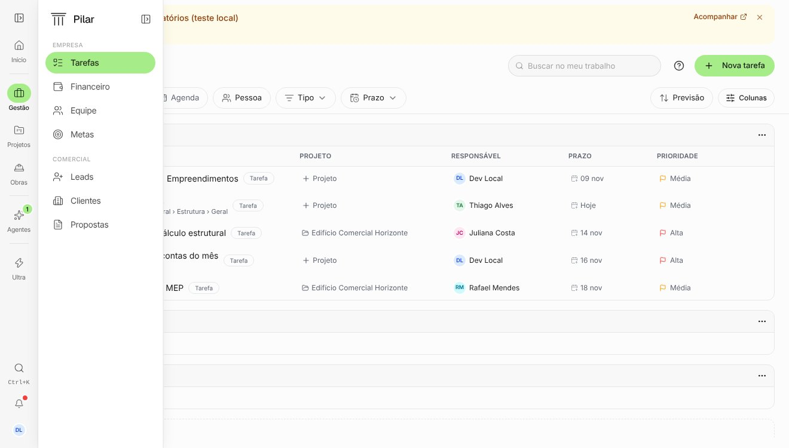 |
| Clicar "Gestão" no trilho           | 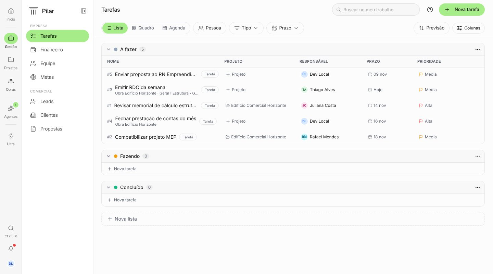      | 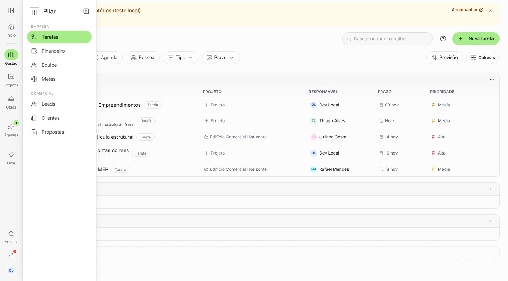      |
| Financeiro › Visão geral            | 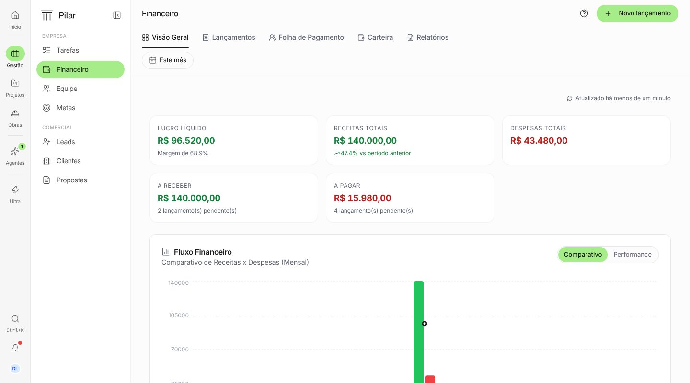    | 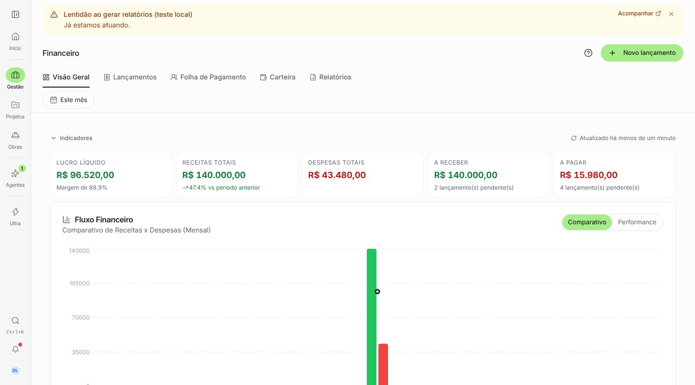    |
| Financeiro › Relatórios             | 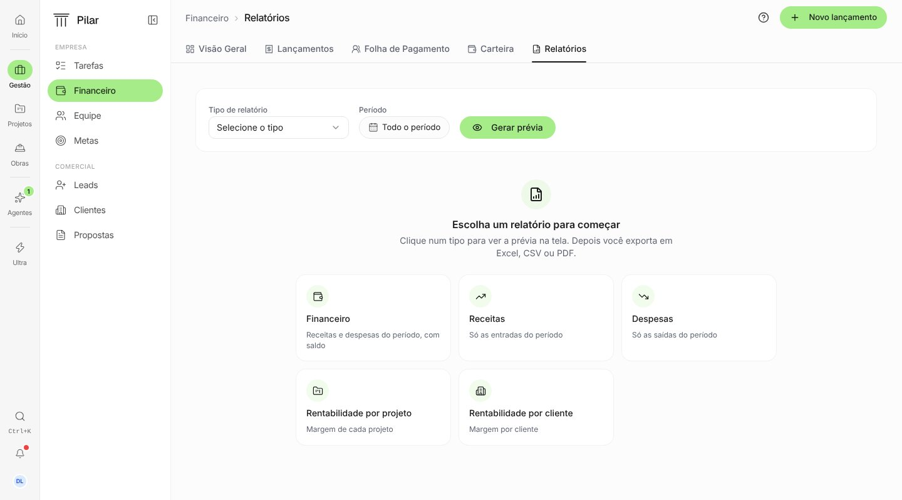          | 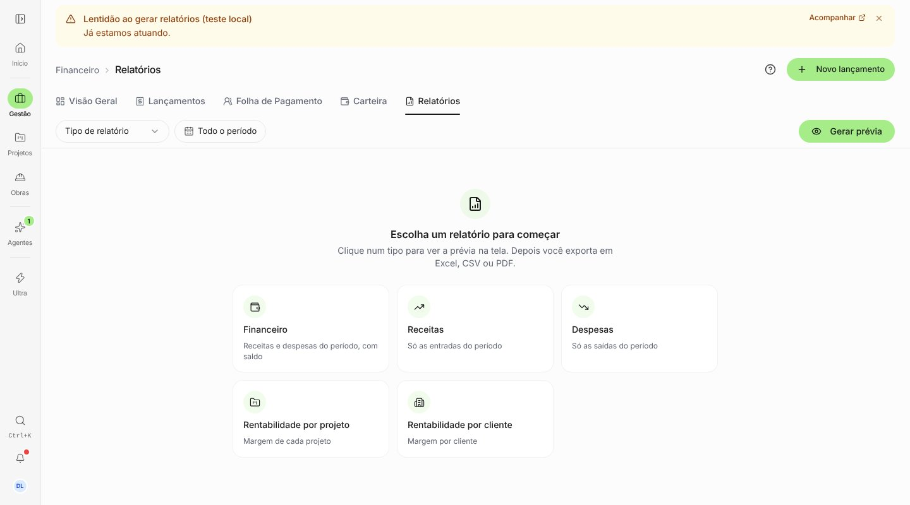          |
| Tarefas › Agenda                    | 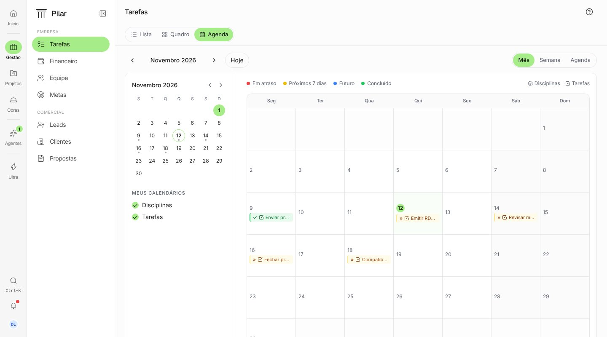      | 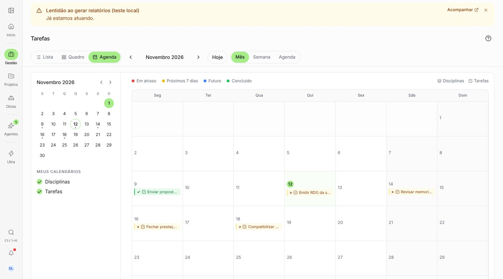      |
| Projetos › Mapa                     | 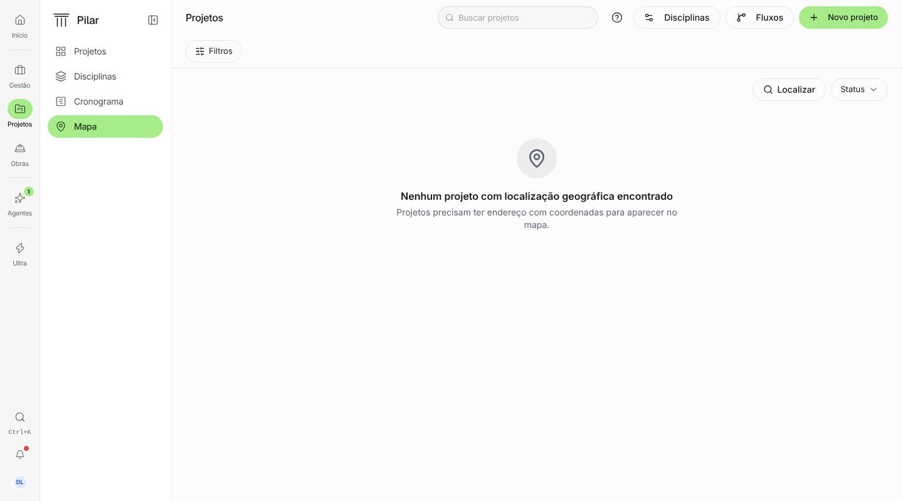                | 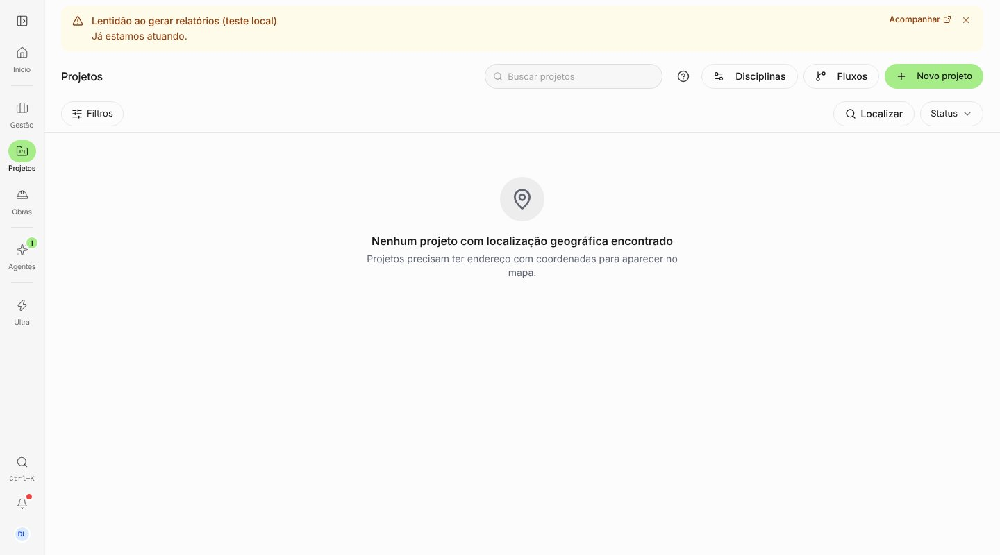                |
| Detalhe do cliente                  | 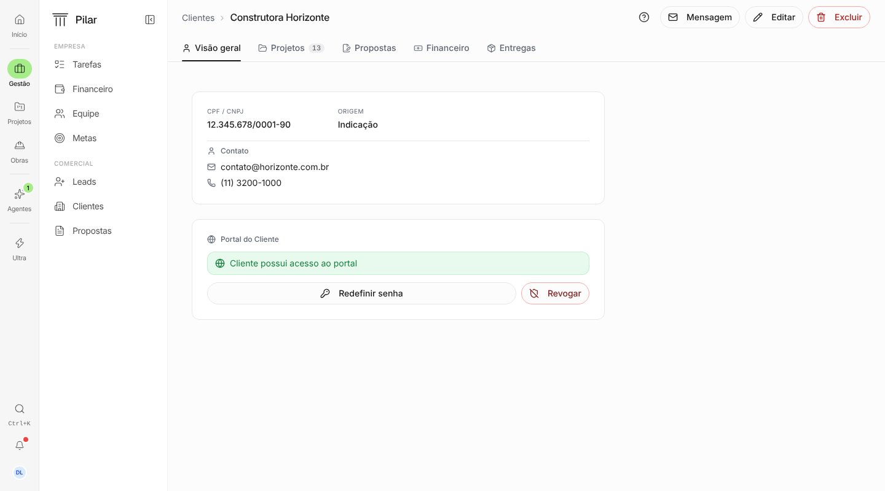     | 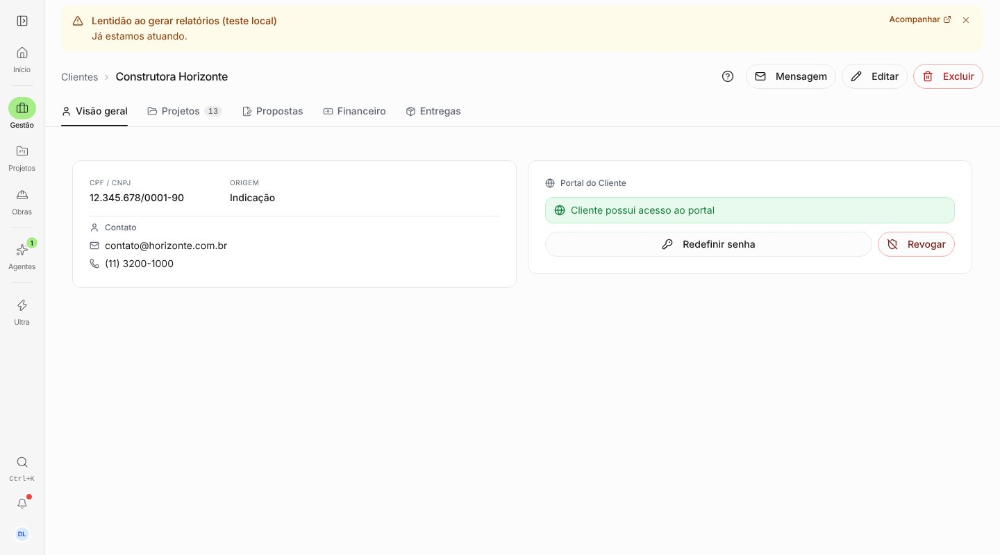     |
