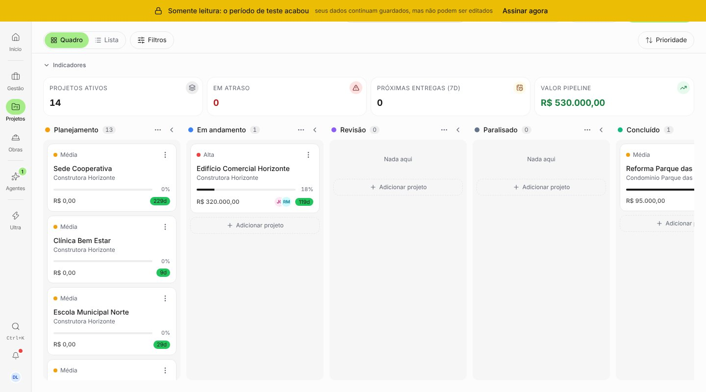
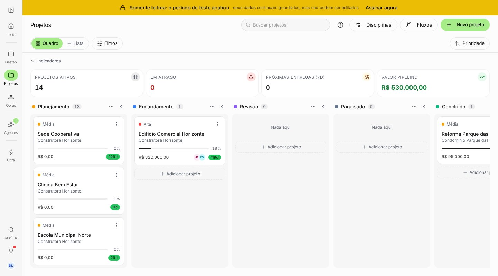
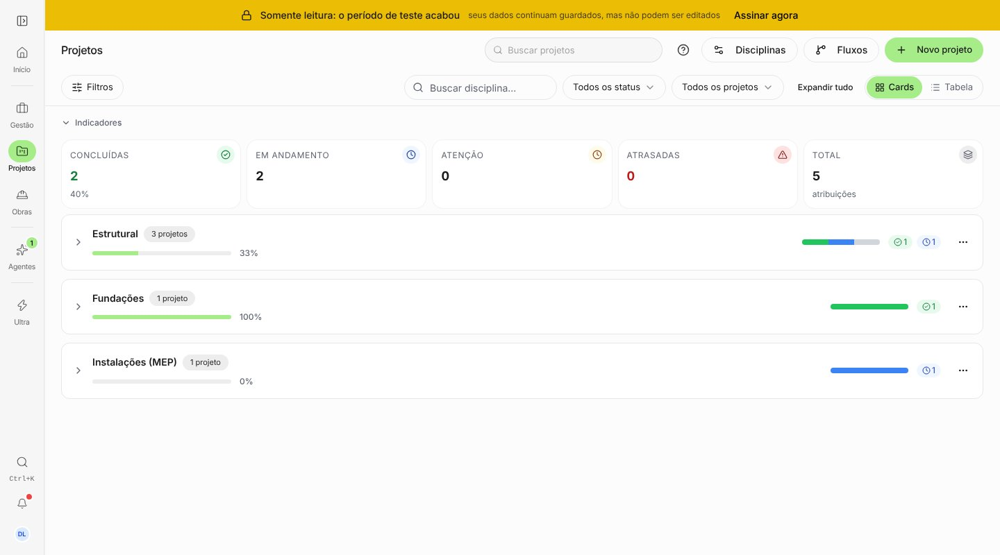

# Auditoria de espaço: pendências finais

Antes = `origin/staging` (c298ce7). Depois = branch do PR. Seed `dev@local.test` mais 12 projetos
fictícios; para a faixa de somente leitura, a empresa de teste foi posta em leitura só no banco
local. Viewport 1440×800.

O que muda:

- **Faixas de sistema** ("Somente leitura" e "Visualizando como"): eram fixas por cima de tudo e
  cobriam o cabeçalho da página (título, busca e a ação principal somem no "antes"). Agora entram
  no bloco de faixas do topo, e a página desce pela altura delas. Fora do app (sem o bloco), seguem
  fixas como antes. A "Visualizando como" usa o mesmo caminho; não dá para iniciar a visualização
  no ambiente local (a função do servidor não sobe), por isso o print é o da somente leitura.
- **Disciplinas:** busca, Status, Projeto, Expandir tudo e Cards/Tabela vão para a barra de filtros
  da página, em vez de uma linha própria acima da lista.

| Tela                        | Antes                               | Depois                                |
| --------------------------- | ----------------------------------- | ------------------------------------- |
| Projetos em somente leitura |  |  |
| Projetos › Disciplinas      |      |      |
