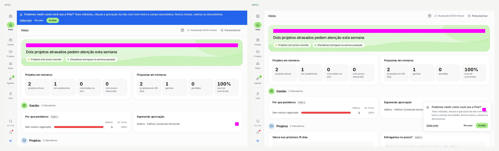
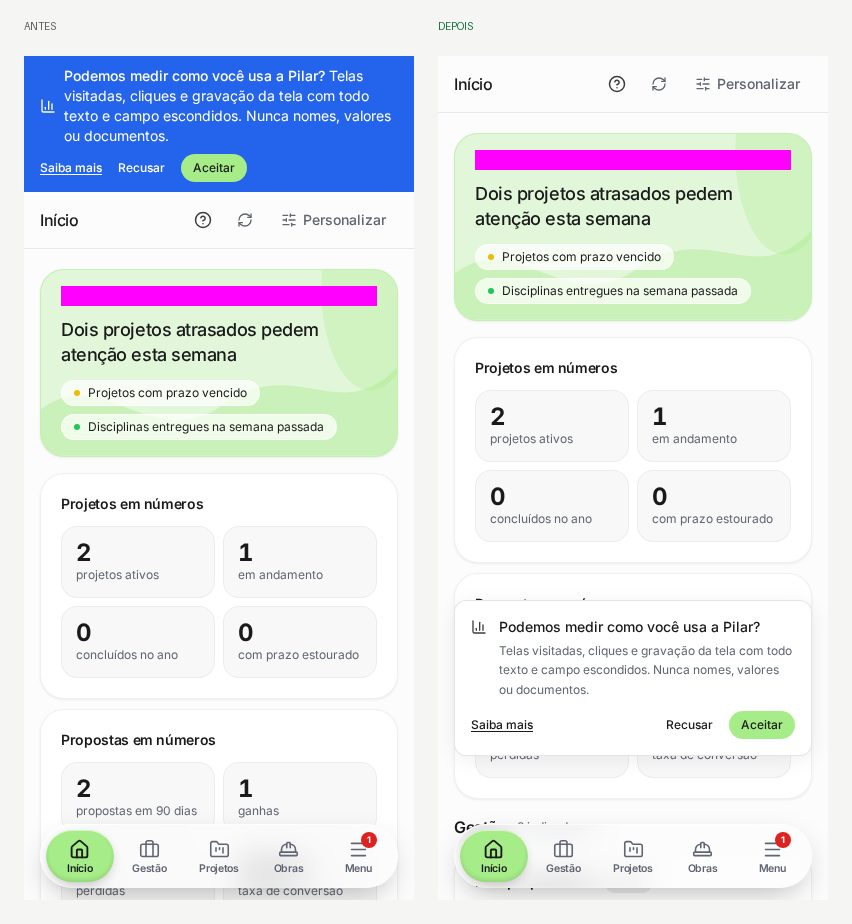
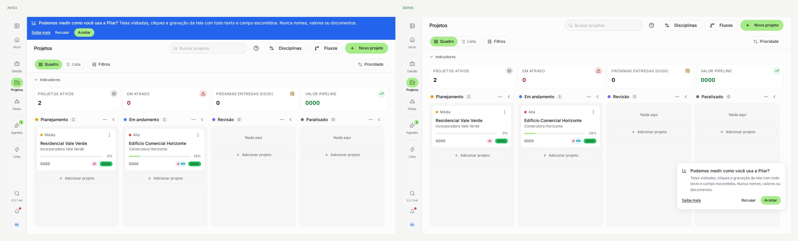

# Avisos no canto inferior direito (PR #844)

A faixa azul do topo (análise de uso e atualização dos Termos) sai. O aviso vira um cartão pequeno no
canto inferior direito. Dado seed (`dev@local.test`), referências regravadas pelo CI (Linux).

| Tela | Antes → Depois |
| --- | --- |
| Início (1440px) |  |
| Início (celular, 390px) |  |
| Projetos (quadro) |  |
