# Estimativa de obra: feedback de 12/11 (celular)

Mesma ficha nos dois lados: a "Casa Canaã" de staging (SP, 459 m², casa térrea, padrão alto, piscina de 29 m²,
5 splits de 12.000 BTU e 4 de 24.000 BTU), com os parâmetros, o CUB de out/2026 e o SINAPI de set/2026 de staging.
Sem dado de cliente.

Como foi capturado: esta sessão não tinha Docker, então o Supabase local não subiu. As telas foram renderizadas
direto dos componentes (aba Custo, aba Cronograma, Gantt da obra e passos do assistente) num harness do Vite, na
base (`origin/staging`, porta 8081) e nesta branch (porta 8080), com a mesma ficha e o mesmo viewport. A moldura da
página (cabeçalho, abas, menu) não aparece.

## Aba Custo

Os avisos viram uma linha com "Ver detalhes". "Material e mão de obra" sobe para logo abaixo do total, com o valor em
reais. A etapa abre e mostra material, mão de obra, equipamentos, despesas e os serviços com as datas. "De onde vem o
preço" desce para depois dos totais.

| Antes                            | Depois                             |
| -------------------------------- | ---------------------------------- |
| 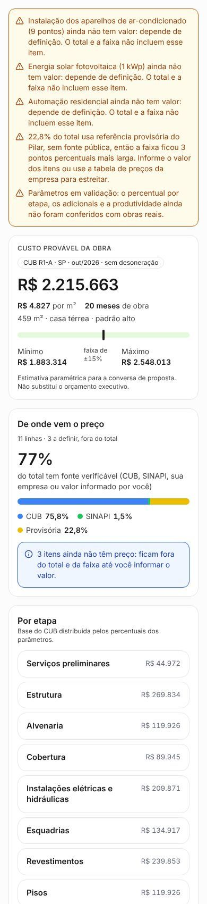 | 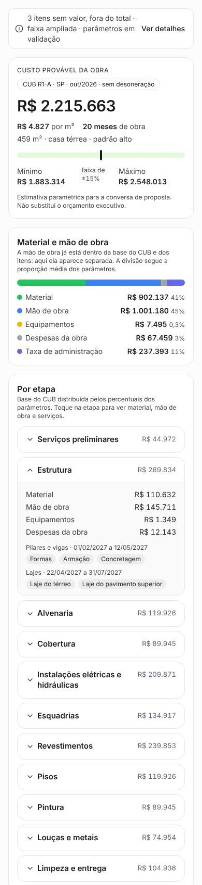 |
| 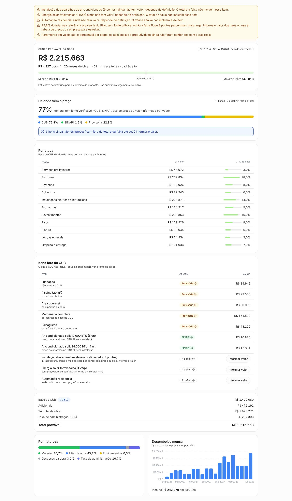        | 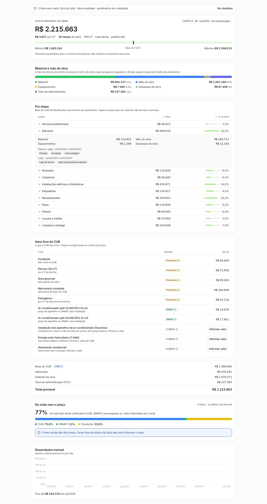        |

## Gantt da estimativa

No celular cabiam dois meses e as barras sumiam. Agora a obra inteira cabe na largura da tela, com a régua em
`dez/26`, um rótulo a cada N meses. No desktop a obra de 20 meses também passa a caber sem rolagem.

| Antes                                       | Depois                                        |
| ------------------------------------------- | --------------------------------------------- |
| 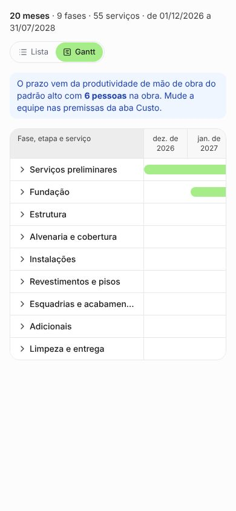 | 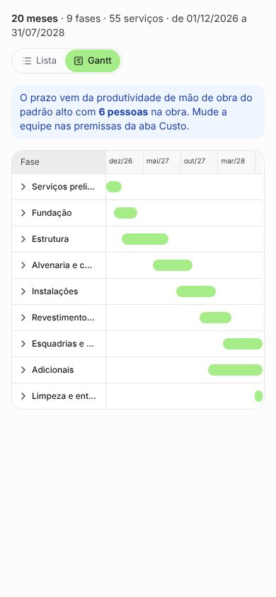 |
| 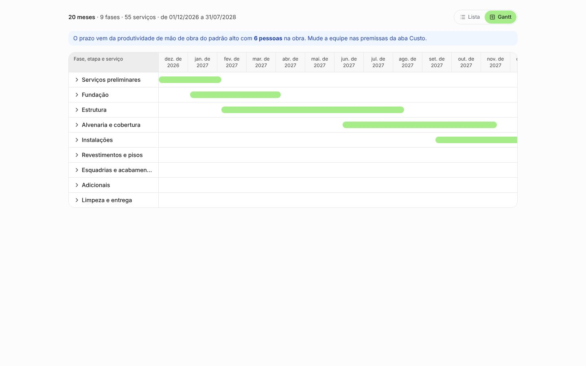        | 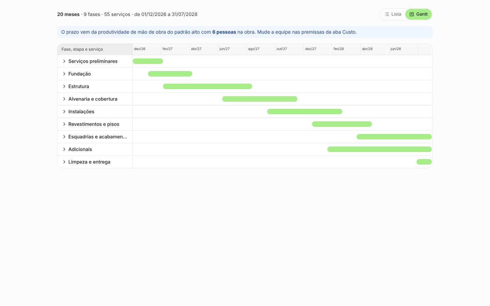        |

## Gantt da obra (celular, zoom em meses)

O mesmo problema. Em meses, a linha do tempo cabe na tela. O zoom em semanas continua com rolagem.

| Antes                                 | Depois                                  |
| ------------------------------------- | --------------------------------------- |
| 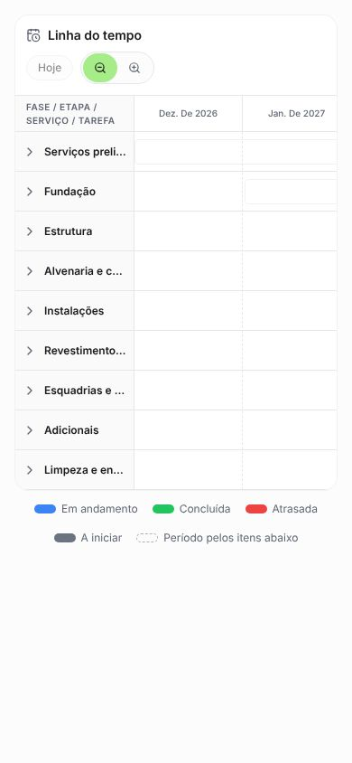 | 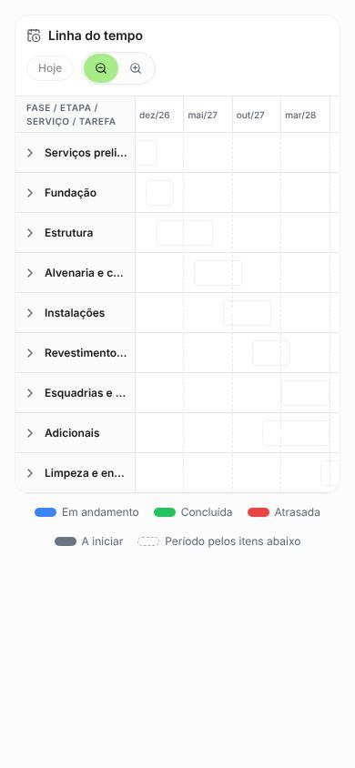 |

## Assistente: local da obra

CEP, endereço e cidade novos: o CEP preenche o endereço, a cidade e o estado. "Início previsto" (lista de meses
futuros) vira "Início da obra", com o seletor de data do app, que aceita data passada.

| Antes                            | Depois                             |
| -------------------------------- | ---------------------------------- |
| 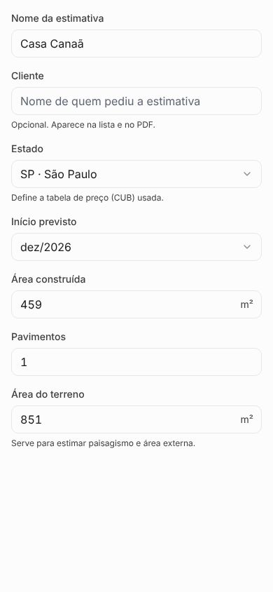 | 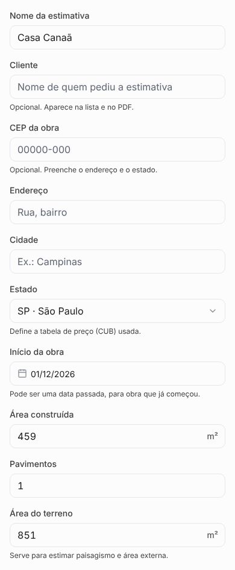 |

## Assistente: climatização

Novo item: split piso-teto de 36.000 BTU (insumo SINAPI 42419). Fica "a definir" até a coleta do SINAPI gravar o
código.

| Antes                            | Depois                             |
| -------------------------------- | ---------------------------------- |
| 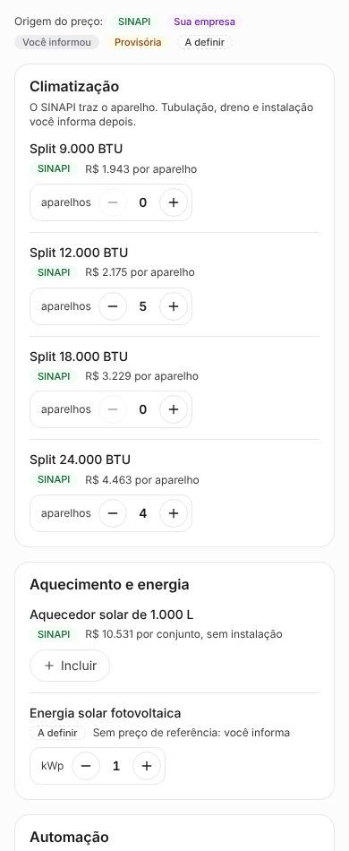 |  |
