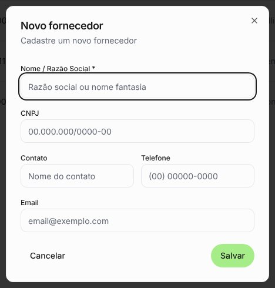
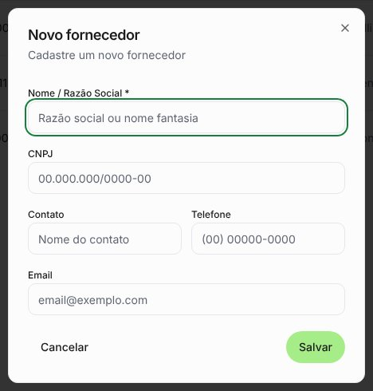
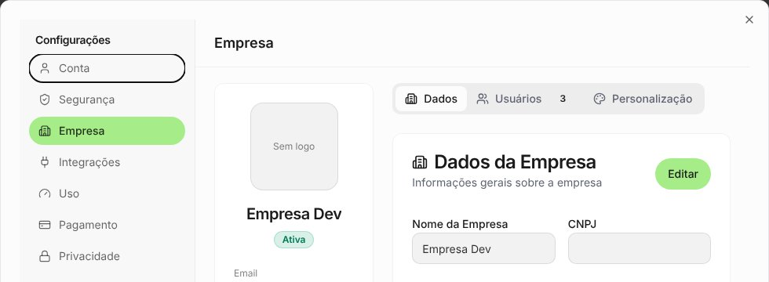
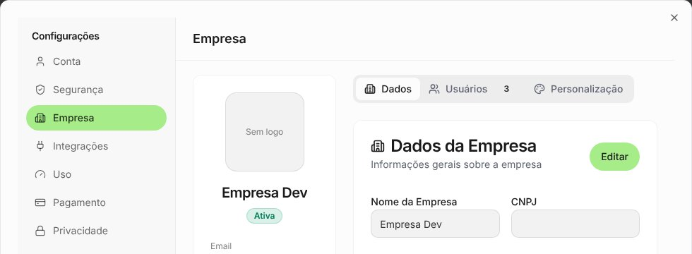

# Anel de foco verde e Configurações sem item "falso selecionado"

Antes = `origin/staging` (8a6937c). Depois = branch do PR. Desktop 1320×750, seed `dev@local.test`.

Achado da varredura de formulários, diálogos e Configurações (10 formulários de criação e as 7
seções das Configurações, no desktop e no celular): não sobrou nenhum fundo preto. O que restou
foi o anel de foco preto e grosso, visível toda vez que um formulário abre (o cursor vai para o
1º campo).

- **Anel de foco** (`--ring`): passa do preto para o verde escuro do sistema (`green-700`, 5:1 sobre
  branco). O verde da marca é claro demais para anel de foco: ficaria abaixo do contraste mínimo
  de 3:1. Vale para todo campo, seletor, botão e caixinha do app.
- **Configurações:** abriam com o foco no 1º item do menu ("Conta"), que ganhava o anel mesmo com
  outra seção aberta e parecia selecionado junto. Agora o foco vai para o próprio diálogo.

| Tela                    | Antes                               | Depois                                |
| ----------------------- | ----------------------------------- | ------------------------------------- |
| Novo fornecedor         |  |  |
| Configurações › Empresa |   |   |
