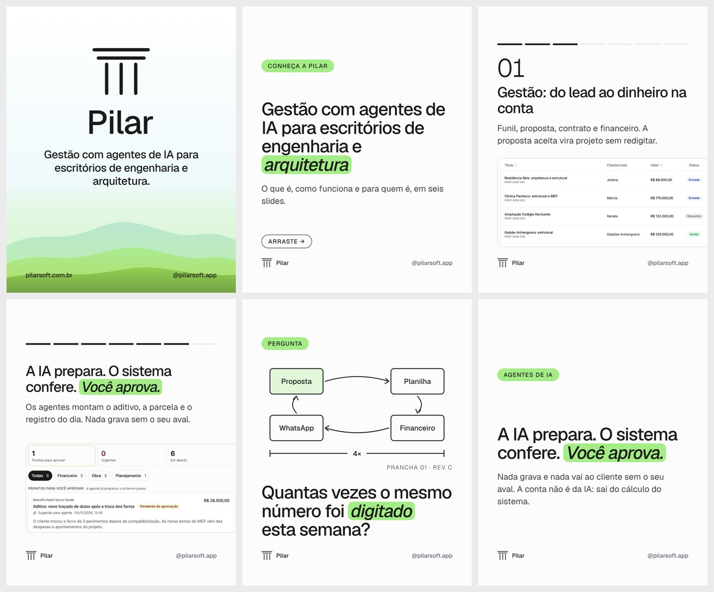
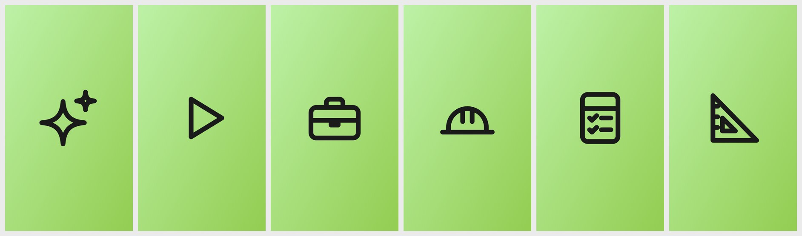

# Kit de lançamento do Instagram

Sem tela do app alterada; são peças de marca (`brand/assets/social/lancamento/`).

Feed (logo, carrossel "Conheça a Pilar", pergunta, agentes):

Capas dos destaques:

