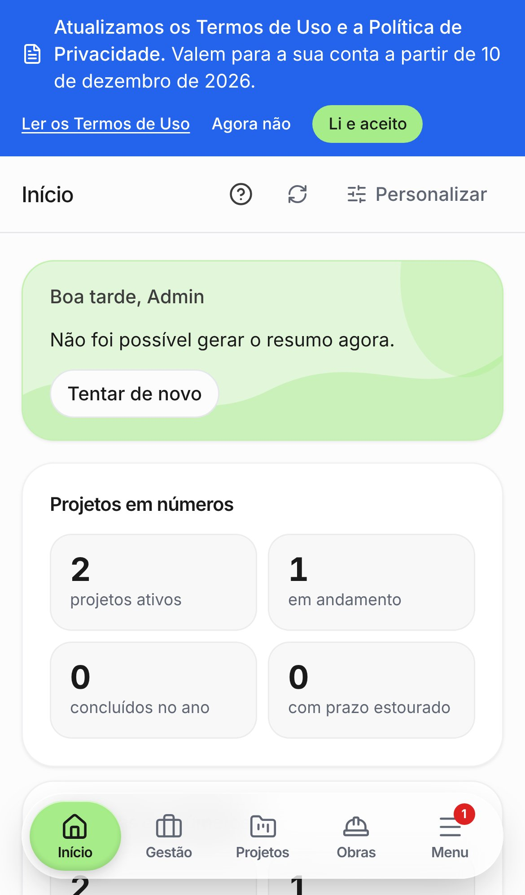
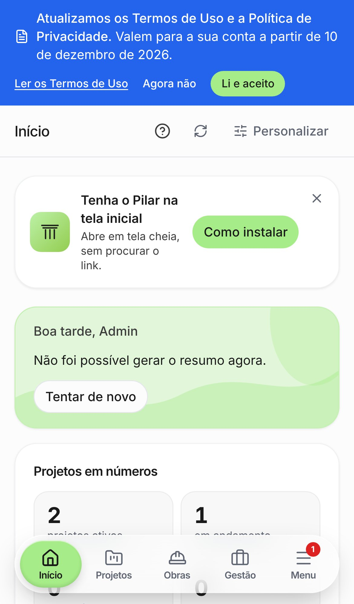
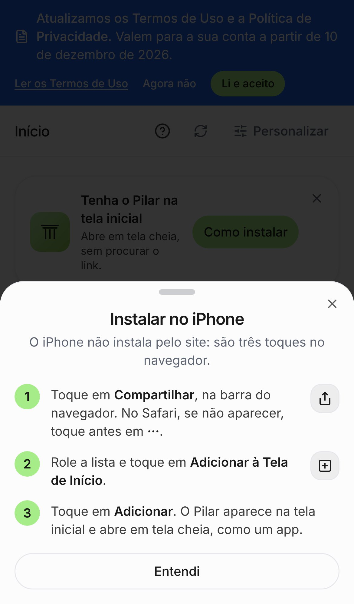
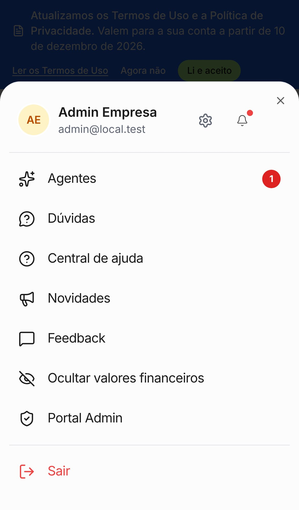
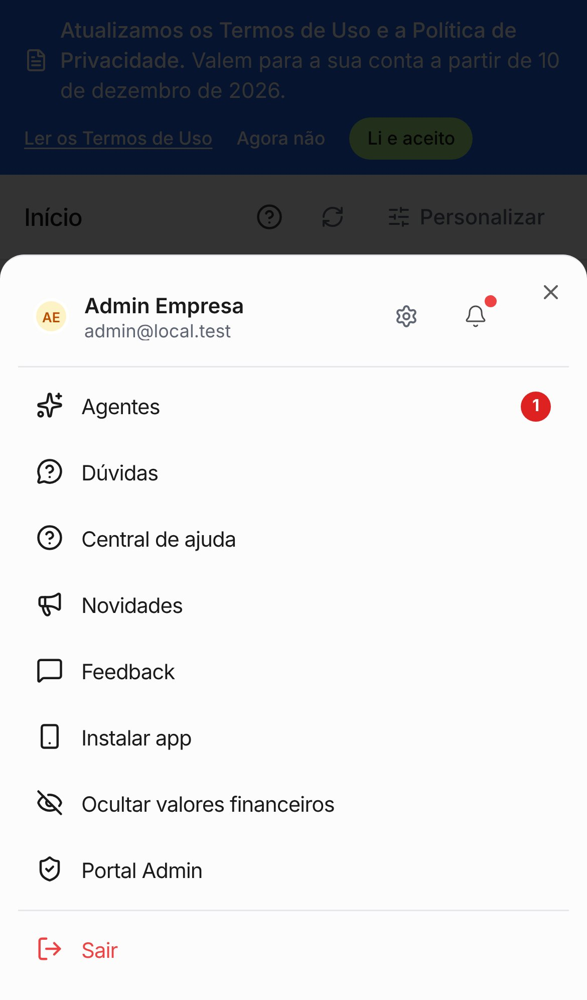
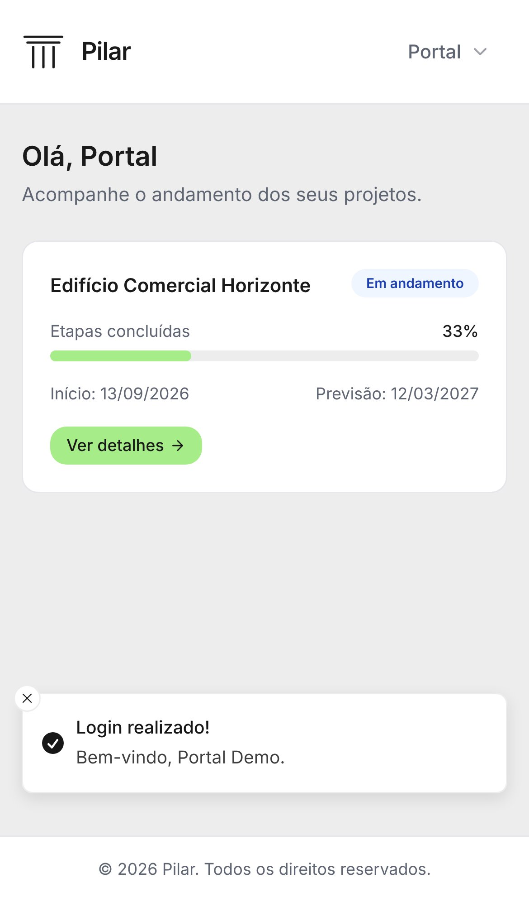
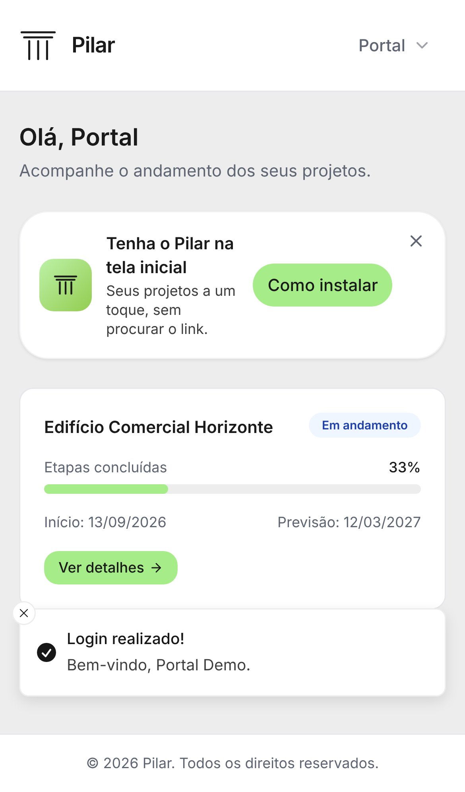

# Instalar o Pilar na tela inicial do celular

Convite para instalar o Pilar como app (PWA), para a equipe do escritório e para o
cliente do portal. Prints em iPhone 13 (390 px), build de produção, Supabase local
com o seed (`admin@local.test` e `portal@local.test`). No computador nada muda: o
convite só aparece no celular aberto pelo navegador.

| Tela                                        | Antes                      | Depois                                     |
| ------------------------------------------- | -------------------------- | ------------------------------------------ |
| Início (escritório)                         |  |                |
| Passos no iPhone (toque em "Como instalar") | (não existia)              |  |
| Menu do celular                             |    |                  |
| Portal do cliente                           |  |                |

No Android com Chrome o botão diz "Instalar" e abre a janela nativa de instalação,
sem passos. O print é do iPhone porque é onde a instalação exige o tutorial.
