# Ajustes do celular (feedback do dono, 12/11)

Celular, 390px. O "antes" é `origin/staging` na abertura do PR; o "depois" é a branch, mesma
rota e mesmo dado. A sessão não tinha a CLI do Supabase para subir o seed `dev@local.test`:
o app real rodou com as respostas do banco simuladas no Playwright, com dados fictícios
no desenho do seed (projetos "Teste 02" e "Teste Projeto 1", cliente "Marson").

| Tela                                      | Antes                                       | Depois                                       |
| ----------------------------------------- | ------------------------------------------- | -------------------------------------------- |
| Projetos: quadro e indicadores recolhidos | 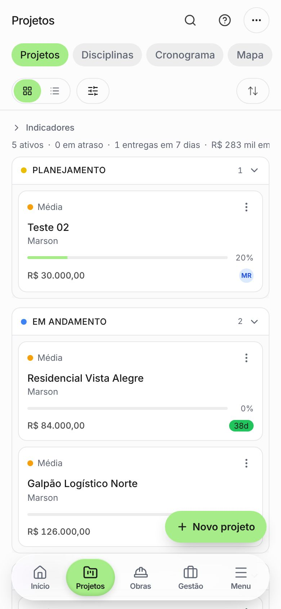         | 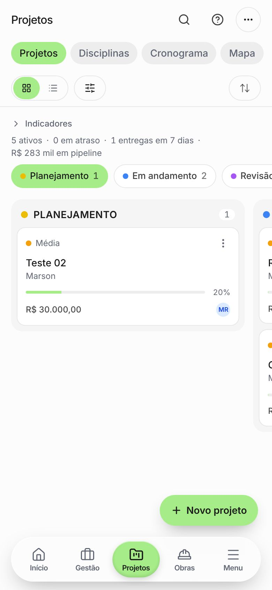        |
| Leads: quadro                             | 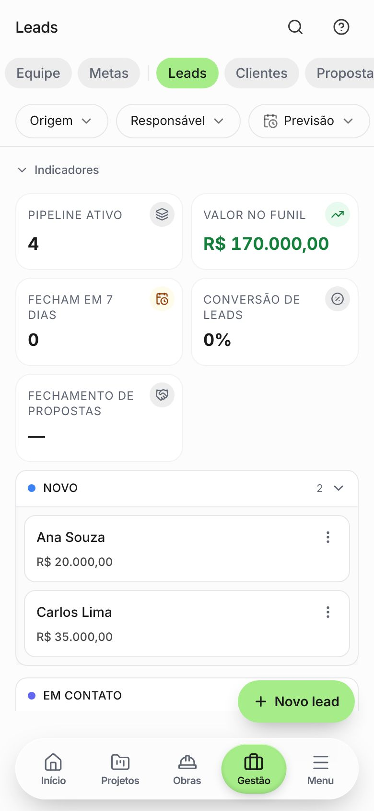                   | 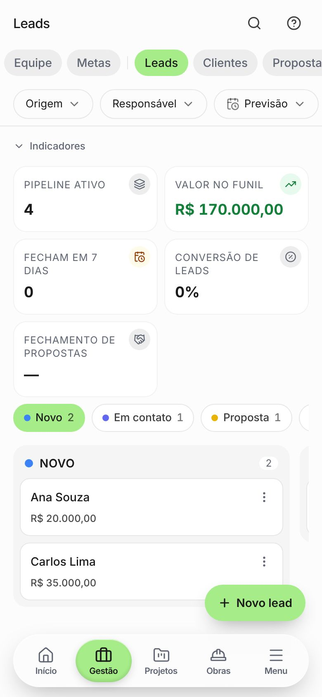                  |
| Menu                                      | 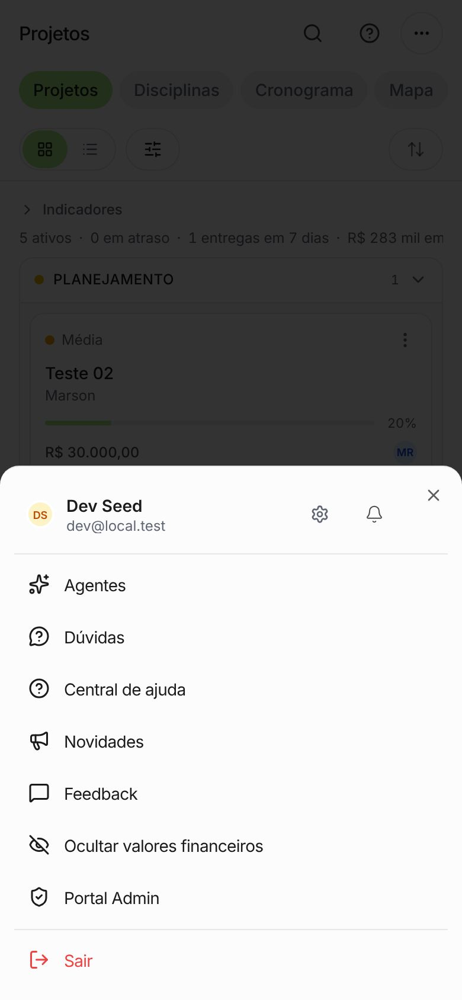                    | 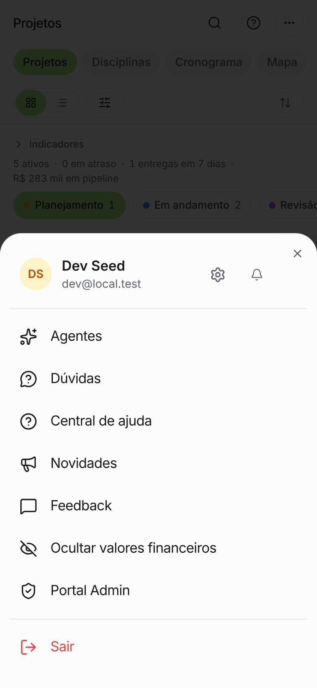                   |
| Card do projeto (painel)                  | 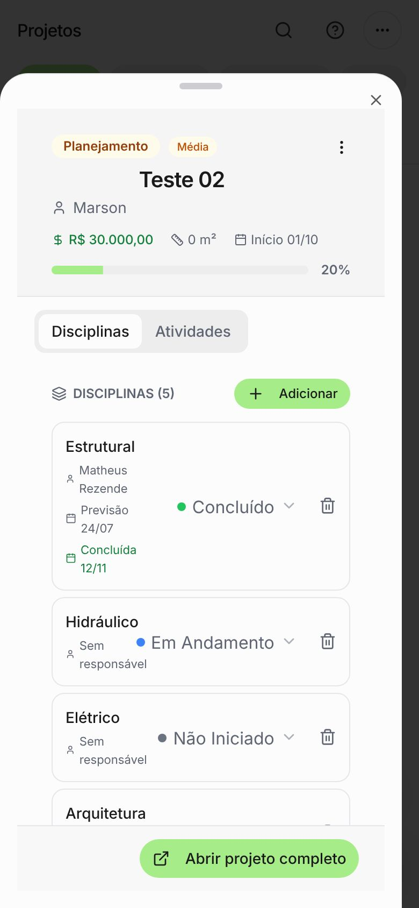          | 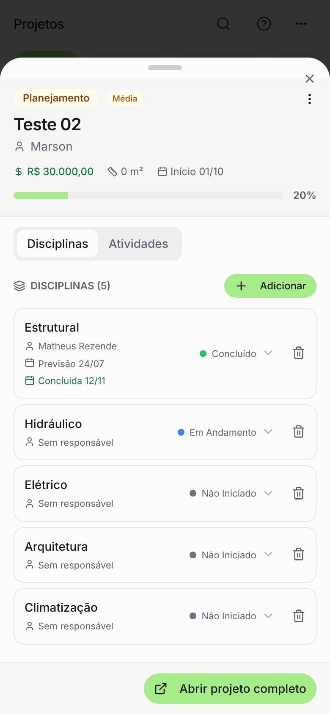         |
| Projeto completo                          | 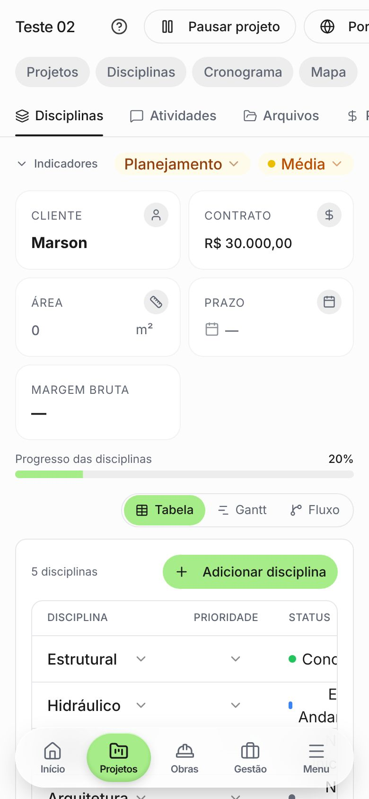        | 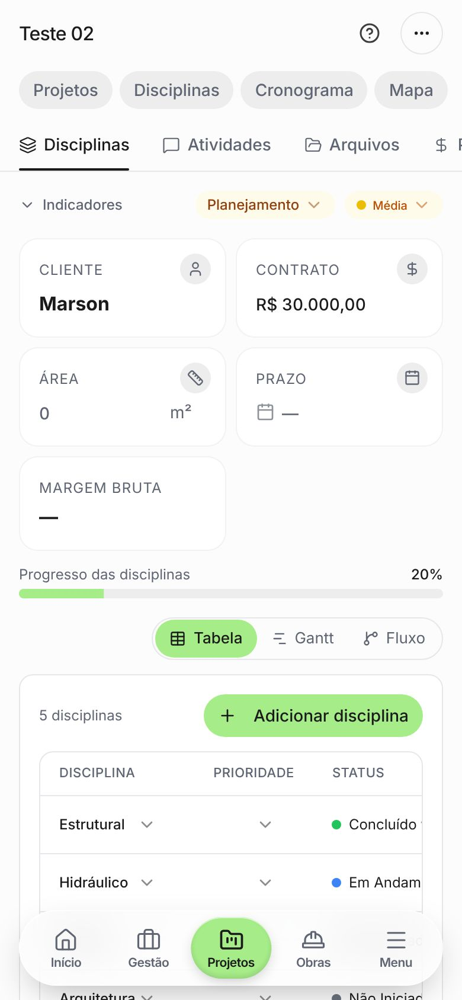       |
| Projeto completo: ações no "⋯"            | (o "Portal do cliente" ficava fora da tela) | 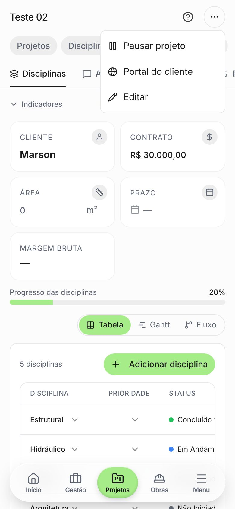 |
| Dúvidas                                   | 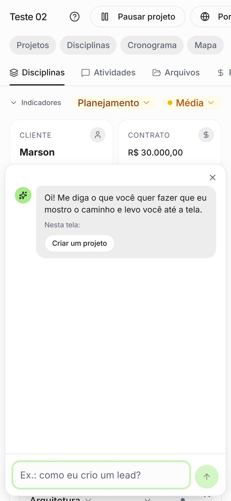                 | 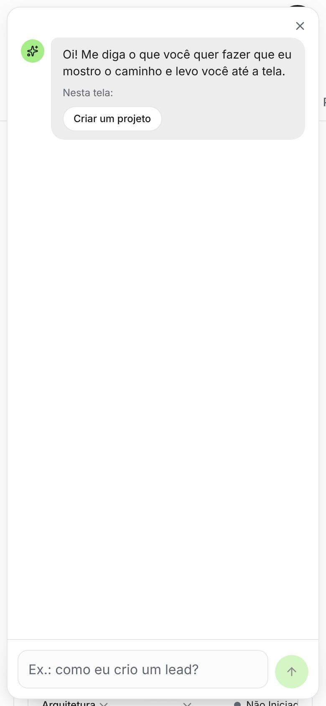                |
| Configurações (perfil)                    | 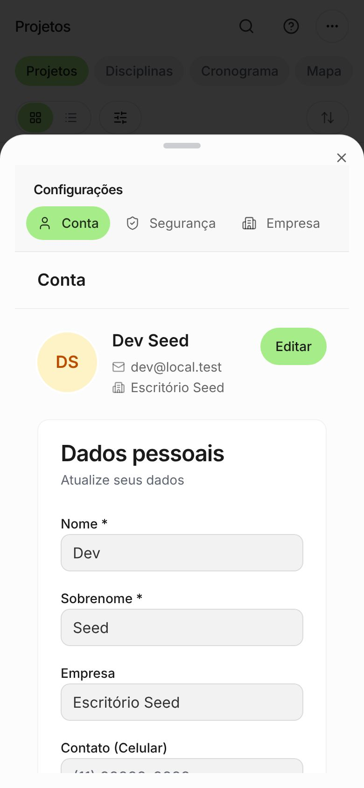                  | 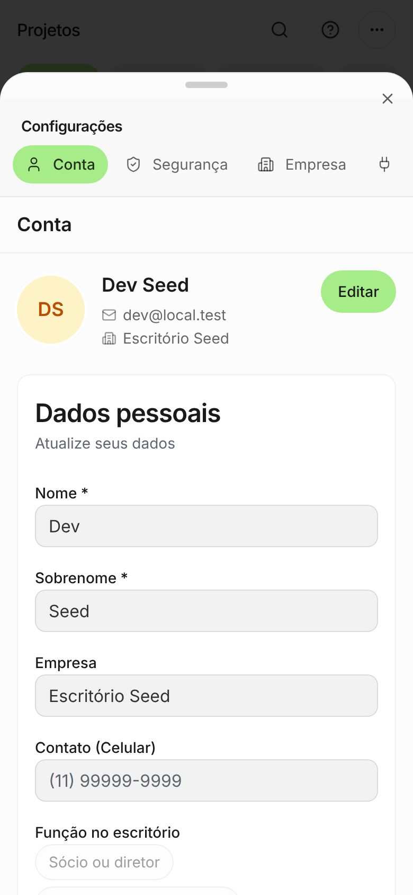                 |

## O que mudou

- **Barra de baixo**: Início, Gestão, Projetos, Obras, Menu (Gestão antes de Projetos).
- **Quadros (Projetos e Leads)**: colunas lado a lado que passam com o dedo, com a ponta da
  próxima aparecendo e uma faixa de colunas no alto (`KanbanMobile`). Antes eram acordeões
  empilhados.
- **Indicadores recolhidos**: o resumo desce para uma linha inteira e quebra, em vez de vazar.
- **Menu**: linhas no tamanho de lista do sistema (17px, ícone 22px, ~52px de altura) e o
  painel sobe mais.
- **Card do projeto / Disciplina / Tarefa**: o painel ocupa a largura toda (sumiu a faixa
  escura à direita) e não soma o padding dele ao do conteúdo. Seletores compactos (status da
  disciplina, prioridade) voltaram ao tamanho de texto deles: no celular todos viravam 16px.
- **Projeto completo**: Retomar/Pausar, Portal do cliente e Editar vão para o "⋯" do cabeçalho.
- **Dúvidas**: ocupa a área visível e encolhe junto com o teclado (o campo fica colado acima
  dele), e não abre o teclado sozinho. O teclado não aparece no navegador da captura; a prova
  é no aparelho.
- **Configurações**: menos margem dupla em volta dos formulários.
