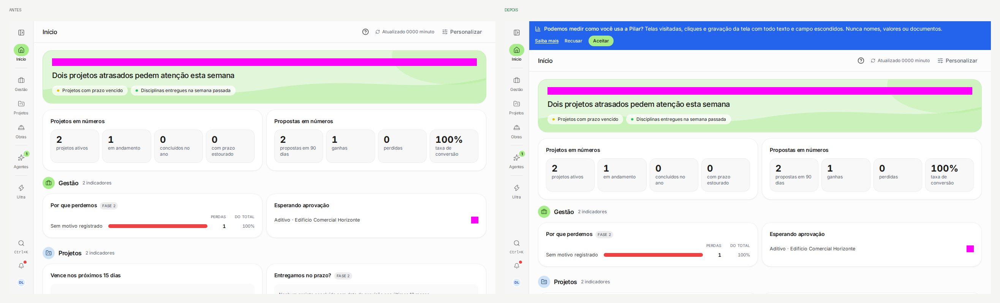
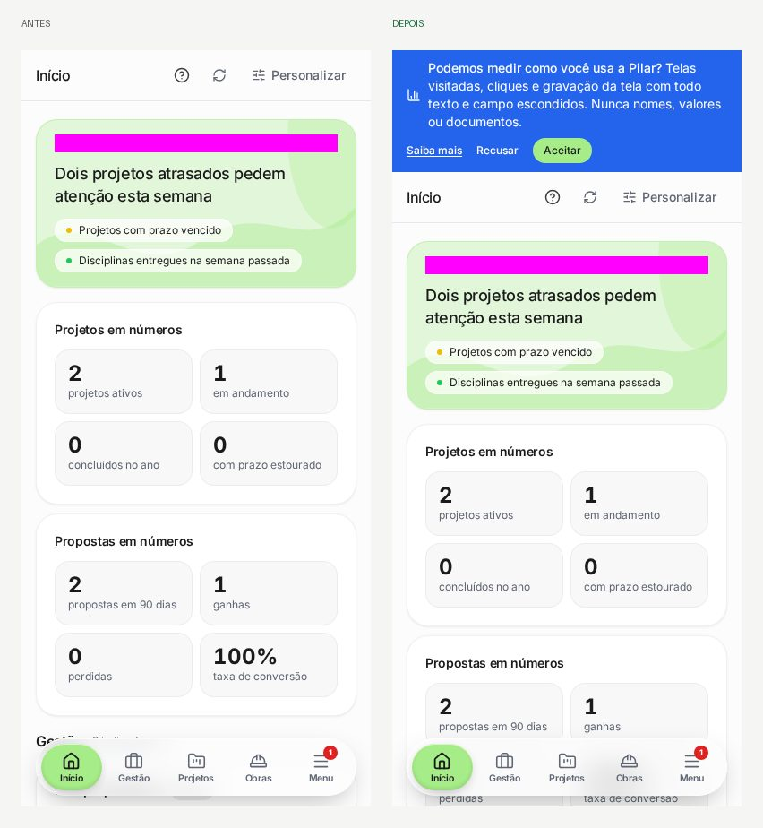
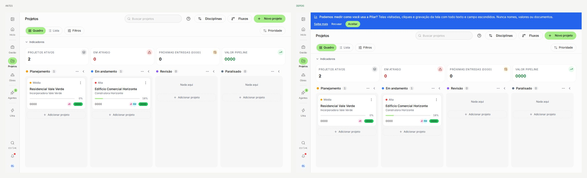

# Aviso de análise de uso no app (PR #842)

Faixa nova no topo do app para quem está logado e ainda não decidiu sobre a análise de uso (PostHog).
Mesmo estilo da faixa de Termos. Dado seed (`dev@local.test`), referências regravadas pelo CI (Linux).

| Tela | Antes → Depois |
| --- | --- |
| Início (1440px) |  |
| Início (celular, 390px) |  |
| Projetos (quadro) |  |

As demais telas do teste visual mudam só pela mesma faixa no topo.
