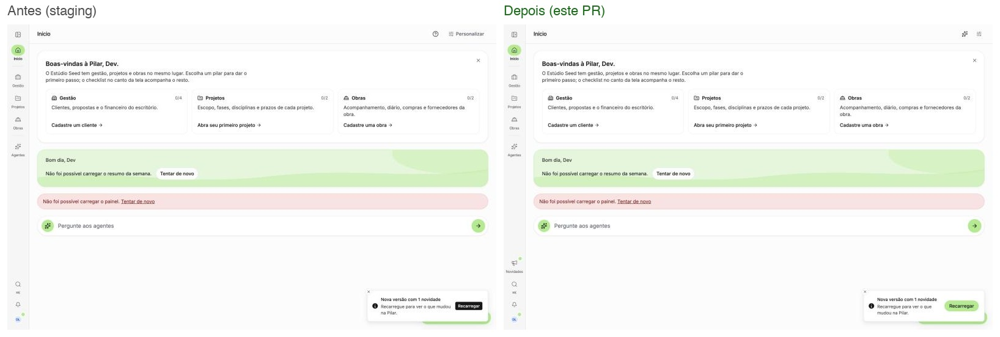

# PR 846: novidades na sidebar, aviso de versão e botões minimalistas

Início, 1440px, dado seed (Supabase simulado). Em cada lado: botão de dúvidas, Personalizar,
item Novidades no trilho e botão do aviso de nova versão.

