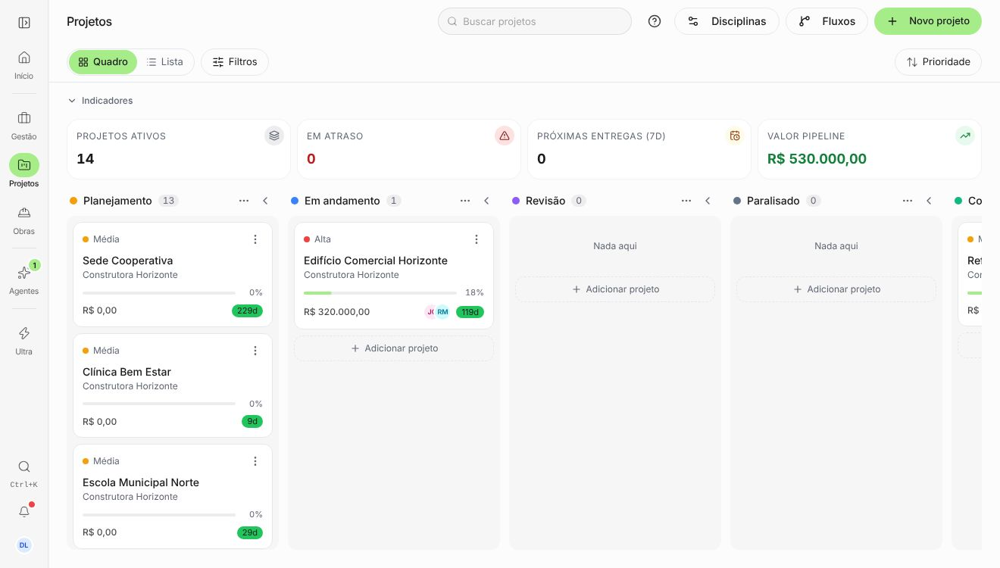
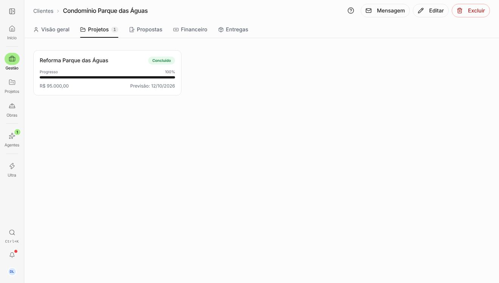
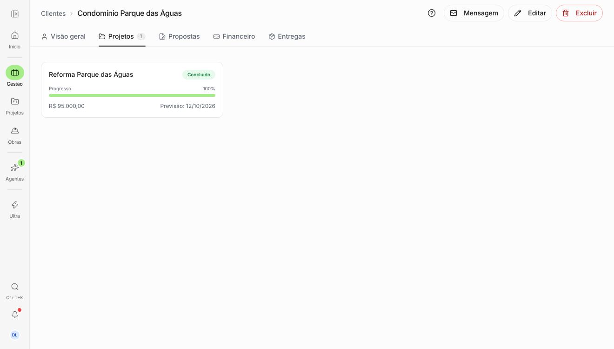
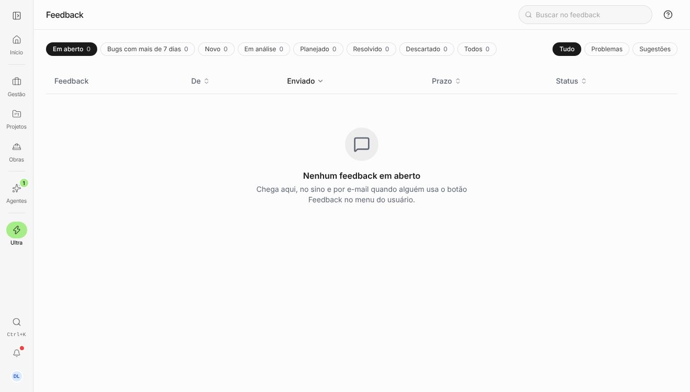
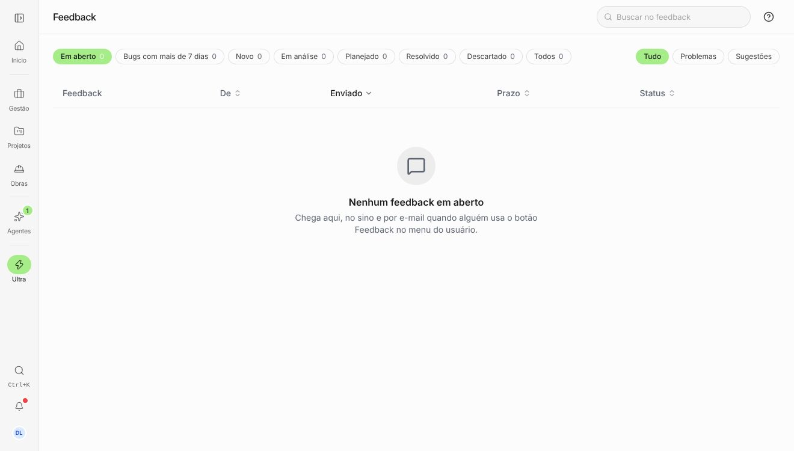
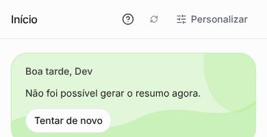

# Preto para o verde da marca

Pedido do Matheus (12/11): barra de progresso e botão de adicionar em preto, e o botão de atualizar
cortado no cabeçalho do celular. Antes = branch do PR #826 antes desta mudança. Depois = esta
mudança. Viewport 1320×750 e 390×844. Seed `dev@local.test`.

A causa: `--primary` é o preto (ink), e os componentes base usavam `bg-primary` por padrão. Uma
varredura de todas as telas e abas (fundo renderizado preto) mais a busca no código acharam:

- **Componentes base** (valem para o app inteiro):
  - botão sem variante, inclusive o botão de confirmar dos diálogos ("Aprovar", "Continuar",
    "Reabrir projeto", "Ver planos");
  - barra de progresso (`Progress`);
  - `Switch` e `Checkbox` marcados;
  - dia escolhido no calendário;
  - `Badge` padrão;
  - botão de ação do toast.

  Todos passam para o verde da marca com texto `ink`.

- **Barras de progresso:** card de projeto, detalhe do projeto, obras, projetos do cliente e
  checklist de primeiros passos.
- **Botões em preto:** Importar lançamentos ("Escolher arquivo", "Extrair com IA", "Importar N
  lançamentos"), "Editar" da folha, "Vincular" (fornecedores), "Abrir projeto" (mapa), "Usar esta
  lista" (estimativa).
- **Converter lead:** "Criar cliente", "Transformar em cliente" e "Converter em projeto" usavam
  outro verde (o de sucesso, com texto branco). Agora usam o da marca.
- **Seleção e contadores em preto** passam a verde:
  - chips de filtro do Ultra, da Carteira e do formulário (`EscolhaChips`);
  - filtros de Projetos e Mapa;
  - aba de notificações e nota do NPS;
  - contador de filtros da barra;
  - passo atual da nova estimativa;
  - selo do cartão de boas-vindas.
- **Outros:** o botão "Marcar pago" ao deslizar um lançamento no celular e o balão da pergunta no
  painel de Dúvidas, que agora é verde como no chat dos Agentes.
- **Atualizar no cabeçalho do celular (Início):** só o ícone, maior (16 px) e com área de toque de
  32 px.

Ficaram pretos de propósito, por não serem ação nem seleção:

- o sublinhado fino da aba ativa;
- o painel lateral das telas de login;
- as telas públicas de planos e checkout;
- o modo campo (contraste para uso no sol);
- o marcador da faixa de custo;
- a cor cadastrada de um cartão.

Um teste de varredura (`src/components/ui/semPretoDeAcao.test.ts`) reprova `bg-primary` de volta
nos componentes base.

| Tela                              | Antes                                | Depois                                 |
| --------------------------------- | ------------------------------------ | -------------------------------------- |
| Projetos › Quadro (barra no card) |   |   |
| Cliente › Projetos                |  |  |
| Ultra › Feedback (chips)          |    |    |
| Início, celular (atualizar)       |        |        |

No "antes" do Início no celular o "At" cortado já tinha saído (P6, mesmo PR). Esta mudança
aumenta o ícone e a área de toque.
