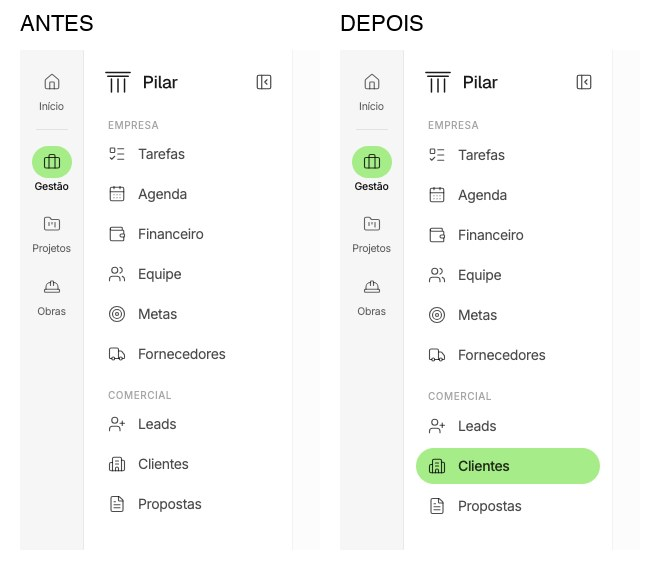

# Sidebar: item ativo em rota filha

Rota `/gestao/clientes/:id` (detalhe do cliente), viewport do menu lateral, dado de harness (sem dado real).
Antes: nenhum item marcado. Depois: "Clientes" continua verde.

