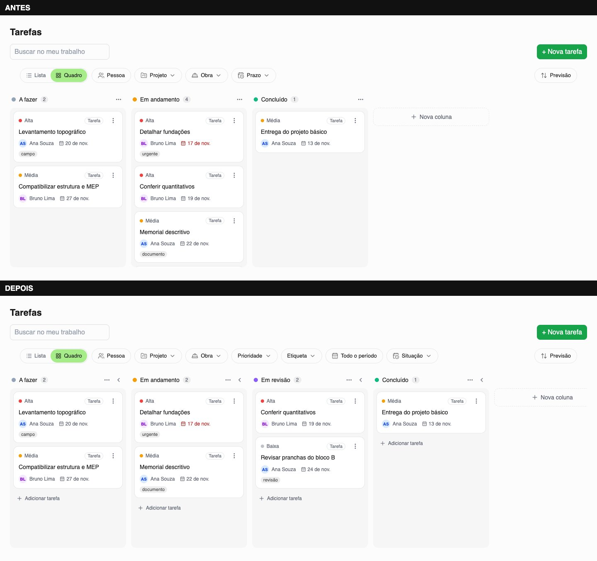

# Quadro de Tarefas: Em revisão, filtros e coluna recolhível

Antes (`origin/staging`) e depois (esta branch), 1440px, dado fictício (mock do Supabase).
Antes: 3 colunas, filtro "Prazo" simples. Depois: coluna "Em revisão", filtros de Prioridade,
Etiqueta, Período do prazo e Situação, e cada coluna com "Adicionar tarefa" e botão de recolher.

