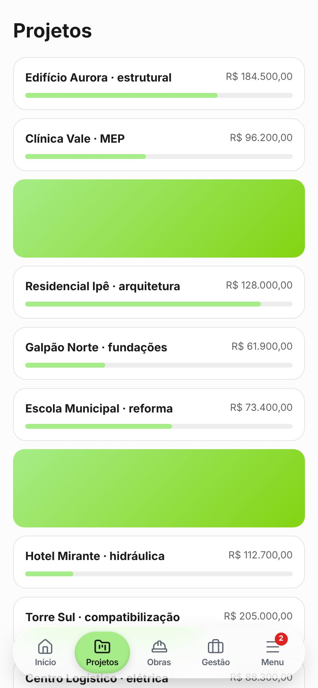
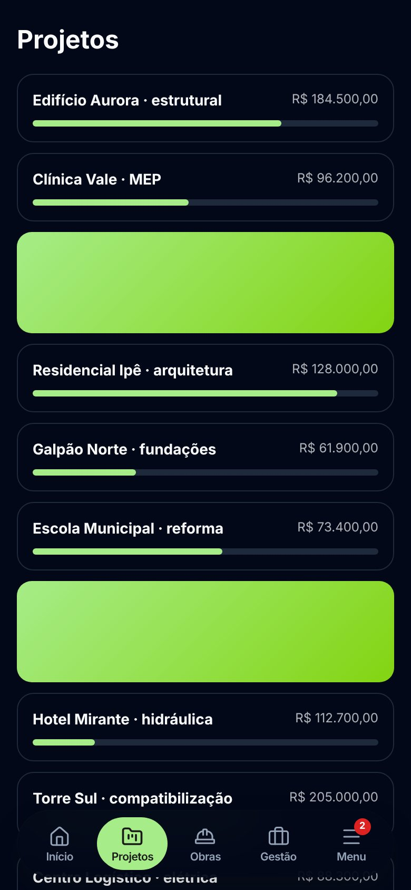
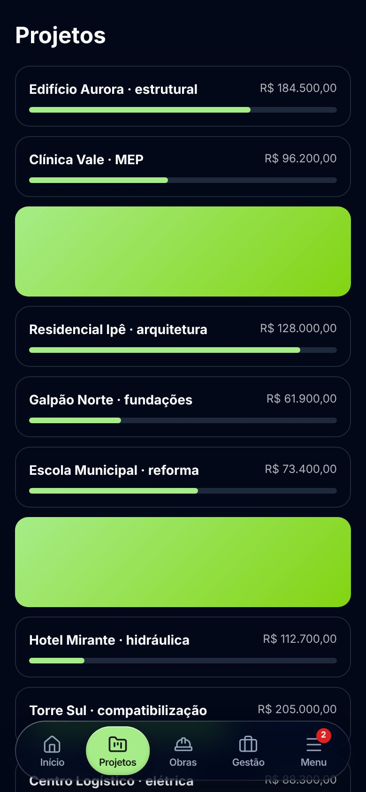

# Vidro líquido na barra mobile (PR #812)

Barra de navegação do celular (`BottomNav`), 390px. O "antes" é `origin/staging` na
abertura do PR; o "depois" é a branch. Capturas com a barra real sobre uma lista de
projetos fictícios (a sessão não tinha Docker para subir o seed `dev@local.test`).

| Tema   | Antes                                          | Depois                                           |
| ------ | ---------------------------------------------- | ------------------------------------------------ |
| Claro  |    |    |
| Escuro |  |  |
