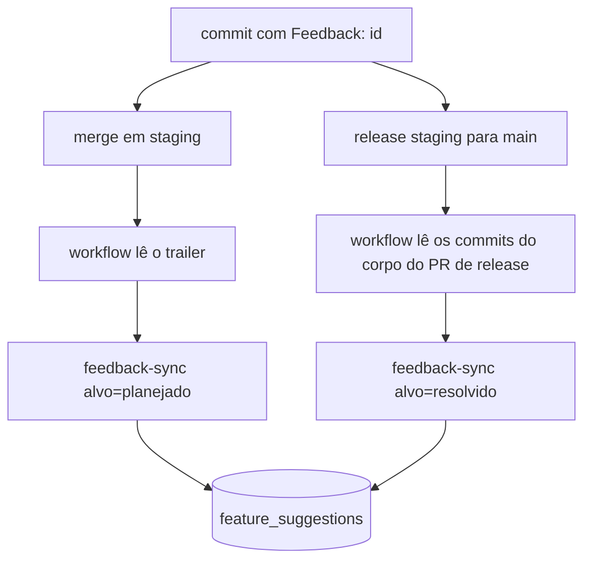

# SPEC: Feedback fecha pela PR

**Data:** 2026-10-29
**Status:** Em implementação
**Autor:** Matheus Rezende
**Módulo:** ultra-admin (feedback)
**Origem:** card BEZ-486 (https://app.clickup.com/t/1dfhfaq8eeu). O feedback tratado continuava "em aberto" até alguém mudar o status na mão.

## Problema

Quem corrige um feedback já abre a PR, mas o status no portal Ultra admin só muda se alguém lembrar de
abrir o detalhe e trocar. Quatro feedbacks corrigidos seguiram em aberto, e a fila "Em aberto" deixa de
dizer o que ainda falta tratar.

## Objetivo

Um commit com a linha `Feedback: <id>` move o feedback sozinho: `planejado` quando entra em `staging`,
`resolvido` quando chega em produção. Sem ação manual no portal.

**Fora de escopo:**

- Avisar quem enviou o feedback quando resolve (card de seguimento).
- Reabrir feedback quando a PR é revertida (fica manual).

## Requisitos

1. O detalhe do feedback no Ultra tem o botão "Copiar linha do commit", que copia `Feedback: <id>`.
2. Push em `staging`: para cada commit novo com a linha `Feedback: <uuid>` na mensagem, o feedback vai para
   `planejado` (só se estiver `novo` ou `em_analise`).
3. Push em `main` (release): os feedbacks dos commits listados no corpo do PR de release vão para
   `resolvido` (só se estiverem `novo`, `em_analise` ou `planejado`).
4. `descartado` e `resolvido` nunca são alterados pela automação. Rodar duas vezes dá o mesmo resultado.
5. A chamada exige `Authorization: Bearer <FEEDBACK_SYNC_TOKEN>`; sem token configurado, nada é autorizado.
6. Id que não existe é ignorado e aparece na resposta, sem derrubar a chamada.

## Fluxo

## Decisões

- O vínculo vai no **commit**, não no corpo da PR: o merge de feature é rebase e preserva a mensagem; o
  release vira um commit só, mas o corpo do PR de release já lista os hashes dos commits.
- O feedback mora no banco de produção, então os dois passos chamam a função de produção.
- Segredos só no GitHub Actions (`FEEDBACK_SYNC_URL`, `FEEDBACK_SYNC_TOKEN`): o repo é público.

## Critérios de aceite

- [x] `entrada.test.ts` cobre validação do corpo e as transições permitidas.
- [x] `scripts/feedback-ids.sh` extrai ids de trailers e ignora o que não é uuid.
- [ ] Depois do primeiro release com isto: um commit de teste com `Feedback: <id>` leva um feedback de `novo` a `planejado` no merge e a `resolvido` no release.

Primeiro uso real: 2026-10-29 (BEZ-487), com os 4 feedbacks do Ultra tratados antes de o trailer existir.
