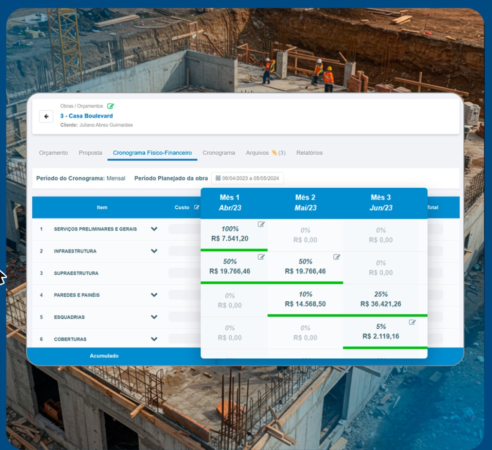
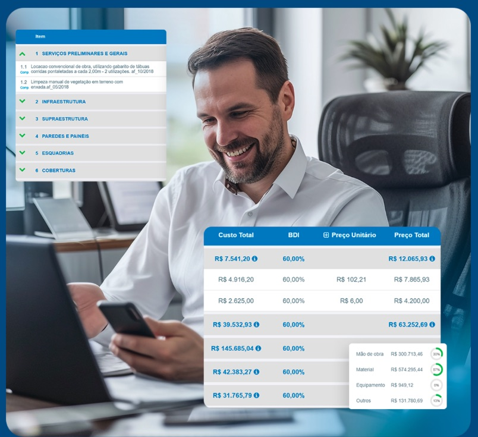
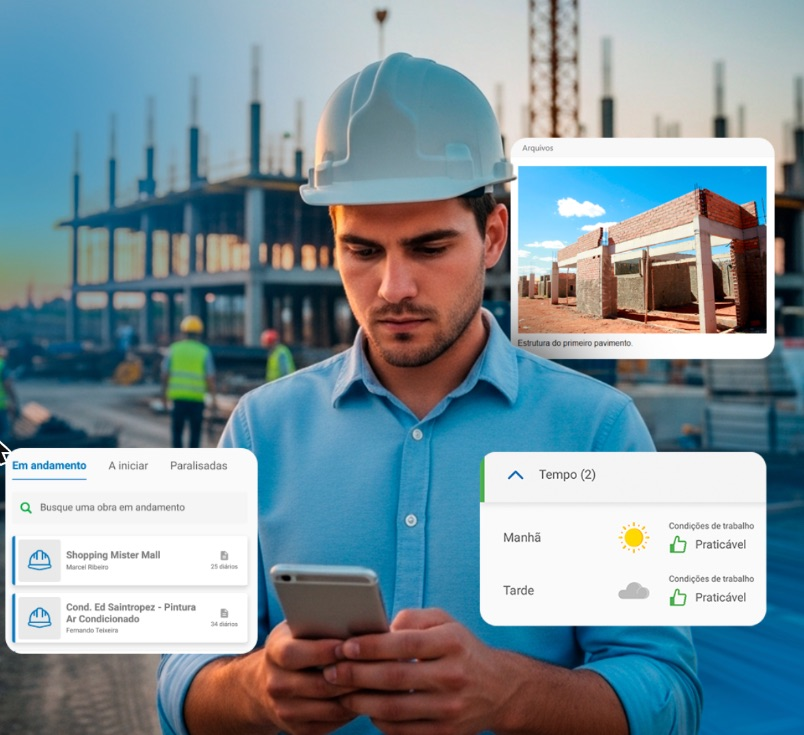
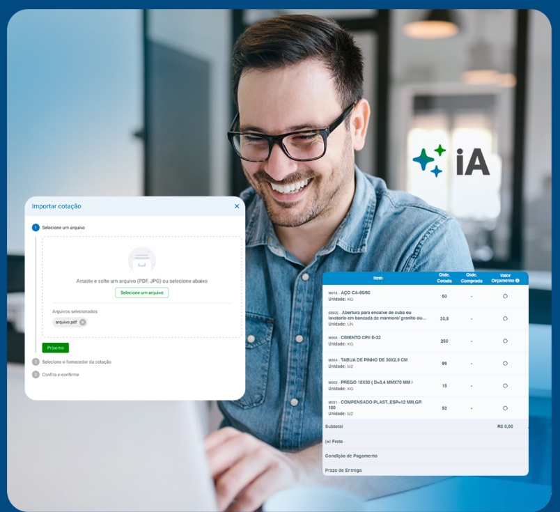
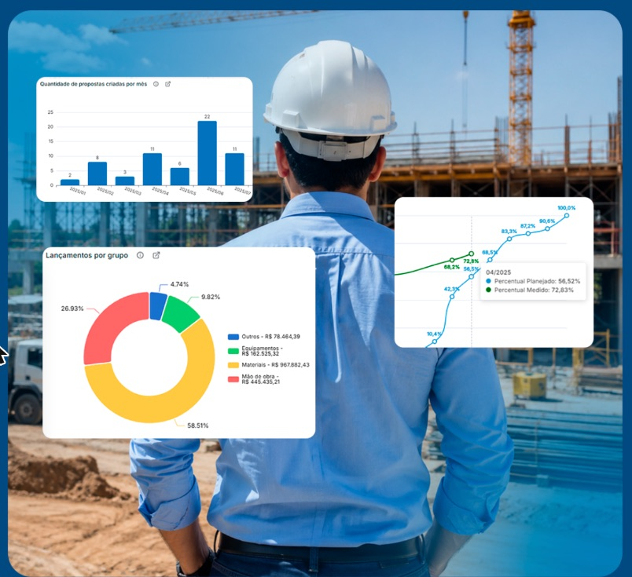
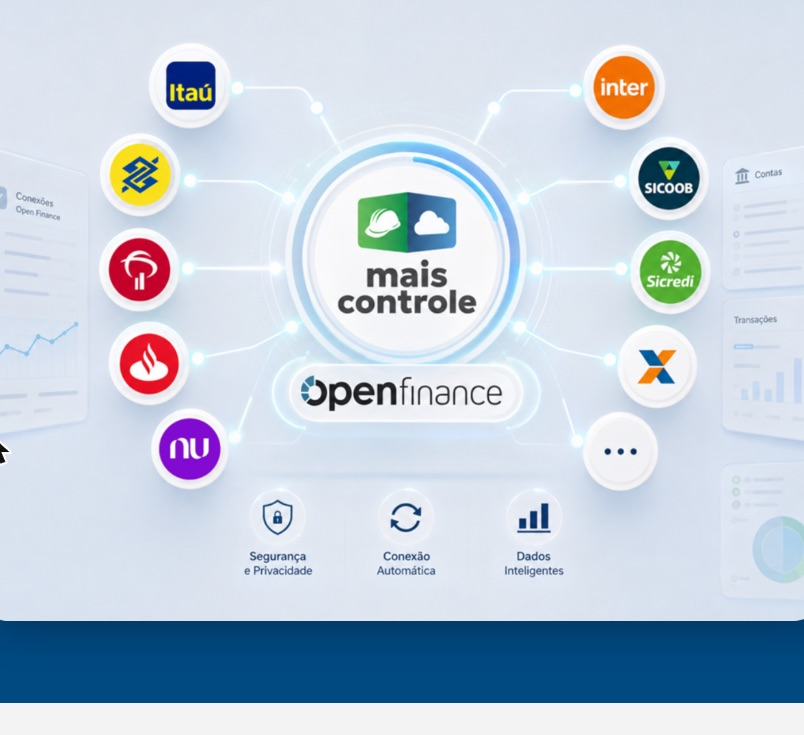
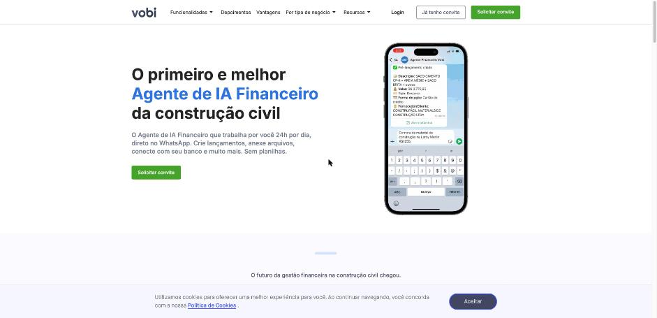
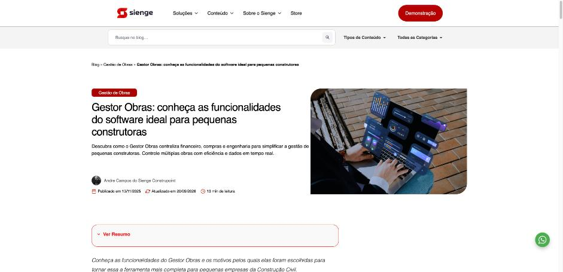

# Análise competitiva: Mais Controle, Vobi, Sienge e outros (2026-11-16)

> Complementa `ANALISE_COMPETITIVA_VOBI.md` (jul/2026). Dados coletados em 16/11/2026 nos sites dos
> concorrentes, no Google Maps e no Reclame Aqui. Onde não achei dado público, está escrito.

## Limites da pesquisa (leia primeiro)

- **Google Maps sem login mostra só 5 de 69 avaliações** do Mais Controle (e 5 da Vobi). Li as 5 completas, com a
  resposta do dono. Não entrei com conta. Para ler as 64 restantes é preciso abrir logado.
- Capterra, G2 e a página de reviews da App Store bloquearam (HTTP 403). Reclame Aqui: só a Vobi tem página; do
  Mais Controle não achei.
- **Preço público confirmado: só Mais Controle.** Vobi (convite), Sienge e Gestor Obras não publicam. O que há de
  preço da Vobi é matéria antiga (R$ 69 a R$ 199, sem data), não confie.
- "Cienge" assumi como **Sienge**. Se for outra empresa, me diga o link.
- Prints de tela: os sites dos concorrentes ficam atrás de demonstração. Capturei só a ficha do Google Maps. Dá
  para tirar prints das páginas públicas de funcionalidade se você quiser.

## 1. Mais Controle (Juiz de Fora, MG)

**Posicionamento:** ERP de gestão de obras para construtoras, incorporadoras e empresas de serviço de engenharia
(elétrica, hidráulica, pintura, reforma). Nuvem, app iOS/Android, IA em vários módulos. Google: **4,7 (69
avaliações; 61 de 5 estrelas, 4 de 4, 3 de 1 estrela)**.

### Preço e cobrança (confirmado em /planos)

| Item | Valor |
|---|---|
| Plano base | **R$ 269/mês, válido só no plano anual** (preço do mensal não é publicado) |
| Inclui | 2 usuários (avaliador diz 3), 25 GB, obras e orçamentos ilimitados, SINAPI, proposta, Gantt e físico-financeiro, Curva ABC/S, conciliação Open Finance, boleto, NF XML, emissão/captura de NF, pré-lançamento por WhatsApp, tarefas |
| Usuário extra | + R$ 40/mês cada |
| Medição de contratos / Diário de obras / Medição de obras | + R$ 60 cada |
| Compras (IA) | + R$ 90 |
| Venda de unidades | + R$ 90 |
| Portal do cliente | + R$ 69 |
| BI (IA) | + R$ 99 |
| Estoque | + R$ 99 |
| Multiempresa | + R$ 99 por CNPJ |
| Implantação | cobrada, "70% off" no anual (valor não publicado) |
| Teste grátis | não aparece; demonstração |

Conta realista: base + diário + medição de obras + compras + portal + 5 usuários extras ≈ **R$ 269 + 60 + 60 + 90 +
69 + 200 = R$ 748/mês** com só 7 pessoas. O preço de vitrine (R$ 269) é âncora; o real sobe com módulo e usuário.

### Funcionalidades (resumo do catálogo)

Obras: gestão, diário (IA), medição, Gantt, físico-financeiro com Curva S, app de canteiro, orçamento (IA), base
SINAPI. Comercial: funil, proposta (IA), contrato, portal do cliente. Financeiro/fiscal: fluxo de caixa, Open
Finance (IA), pré-lançamentos (IA), cobrança, emissão e captura de NF, venda de unidades com reajuste INCC/CUB/IGPM,
multiempresa. Suprimentos: compras, cotação com mapa por IA, ordem de compra com alçada, estoque. Análise: relatório
gerencial, BI com IA, Curva ABC/S, API de relatórios.

### O que os clientes dizem (5 avaliações lidas, íntegra)

| Tema | Evidência |
|---|---|
| **Contrato anual rígido, sem cancelamento** | Giovana Z. (1★): "não tem cancelamento a qualquer momento e cobrança proporcional ao tempo de uso... não estamos mais usando e teremos que pagar até o final". O dono respondeu: é compra anual parcelada no cartão, parcelas restantes não são mensalidade nem multa; só desativou a renovação |
| **Licença por usuário cara** | Janaina A. (3★, "ótimo em usabilidade"): só 3 usuários inclusos, R$ 40 por acesso extra; "deveria incluir 10" |
| **Suporte só por WhatsApp/bot** | Caito T. (1★): "não têm suporte nenhum, tudo pelo WhatsApp que nem funciona". Dono: contato passa por bot e depois vai ao time de CS |
| **Venda prometeu mais que o produto** | LM Construtora (1★): vendido como solução pronta; na prática exigiu lançamento manual e planilhas, sem migração automática de 8 anos de dados; negaram reembolso. Dono: migração era por planilha; estorno integral foi autorizado depois, mas o cliente contestou no cartão |
| Elogios | "Melhor e mais completo sistema de gestão de obras" (Pedro V., 5★). Usabilidade elogiada até pelos críticos |

Leitura: **o produto é bem avaliado; o que gera reclamação é o contrato (anual sem saída), o preço por usuário, o
suporte via bot e a promessa de implantação/migração.** O padrão "plano anual parcelado" é o que o cliente chama de
"não tem cancelamento".

### Pontos fortes
Catálogo muito amplo e fiscal/financeiro brasileiro (SINAPI, NF-e, Open Finance, INCC); obras ilimitadas; IA em
lançamento por WhatsApp e cotação; app de canteiro; presença em feiras (FEICON).

### Pontos fracos
Contrato anual sem saída; cobrança por usuário e por módulo (preço imprevisível); suporte por bot; migração de
dados manual; foco em construtora/incorporadora (engenharia de serviço aparece como terceiro público).

## 2. Vobi

**Posicionamento:** "software de gestão de obras com agentes de IA", entrada por convite, sem preço público.
Público: construtoras, reforma, engenharia, incorporadoras, empreiteiros, **escritórios de arquitetura e interiores**.
Google: **4,7** (ficha em São Paulo).

**Catálogo (site atual):** projetos (cronograma, tarefas, orçamento, extensão de captura, biblioteca de produtos,
templates, arquivos, financeiro do projeto); obras (diário, orçamento, composição de custos, planejamento, Curva ABC,
medição, templates, compras, financeiro, **estoque**); negócio (financeiro, equipes, app, **Vobi Cobranças**,
relatórios); cliente (**gerador de documentos**, portal, portfólio digital, CRM); **agentes de IA: Financeiro,
Compras, Diário de Obra, Busca Inteligente de NF**.

**Avaliações Google (5 lidas):** todas positivas: "plataforma completa e intuitiva", "atendimento ágil", "agente de
IA do diário ajuda muito", "saber o que me dá lucro ou prejuízo" (Henrique A.), "revolucionário" (Kaiky R.).

**Reclame Aqui (24 reclamações, sem reputação definida, não verificada, 100% respondidas, ~3 dias 15h para
responder):**

| Tema | Caso |
|---|---|
| **Cancelamento difícil** | "Impossibilidade de cancelamento... em 3 etapas com opções não solicitadas" (abr/2026, resolvida); "dificuldade excessiva... insistência em reter"; 3 reclamações marcadas "não consigo cancelar" e 2 de "estorno" |
| **Funcionalidade retirada no meio do contrato** | Escritório de arquitetura em BH: Diário de Obras liberado por 4 meses e bloqueado em outubro "por não fazer parte do pacote" (dez/2025). Outra: "Excluíram função do nada" (jun/2026, não resolvida) |
| **Falha técnica no cronograma** | Tarefas: vínculos e prazos que somam ou subtraem dias sozinhos (mar/2026), resolvida em 2 meses, nota 7 |
| **Cobrança** | "Assinatura não funciona e a cobrança continua integral" após downgrade (set/2026); "não consigo resolver problema no sistema de cobrança" (out/2026); falha no módulo de NF |
| **E-mail** | Marketing/"phishing" que não para após descadastro (abr/2026, não resolvida) |
| App iOS | 3,9 com 18 avaliações; elogios a relatório com foto e acompanhar de qualquer lugar; reclamação de bugs e travamento ao editar checklist |

Leitura: **a Vobi ganha em avaliação pública de produto; perde em cancelamento, estabilidade do cronograma e
"mexer no pacote no meio do contrato".** Mesmo tema do Mais Controle: sair é difícil.

## 3. Sienge / Gestor Obras / Prevision (Softplan)

- **Sienge Plataforma:** ERP para construtora e incorporadora de médio e grande porte (engenharia, suprimentos,
  financeiro, fiscal, contábil, comercial). Sem preço público; venda por proposta.
- **Gestor Obras:** versão para pequenas construtoras (financeiro, compras, cotações por link, engenharia/SINAPI,
  cronograma físico-financeiro, **"Funcionário Digital"** IA que sinaliza inconsistência, atraso e variação de
  custo, integração com eCustos). Demonstração gratuita; preço não publicado.
- **Construmanager:** gestão de projetos de engenharia/arquitetura com BIM e comunicação escritório x canteiro
  (concessões, energia). **É o concorrente do Sienge mais próximo do escritório de projeto**, mas voltado a obra
  grande.
- **Prevision:** planejado x realizado x previsto, antecipa estouro por avanço físico.
- Reviews: só depoimentos do próprio site (Quaresma Engenharia, Cacto). Nenhuma avaliação independente carregou.
  Alegações do fornecedor (15% de economia em compras, 14h/semana) sem fonte.

## 4. Outros mapeados (dado parcial)

| Concorrente | O que é | Preço/obs |
|---|---|---|
| **OrçaFascio** | Orçamento de obra com base SINAPI/TCPO | Faixa citada R$ 599 a R$ 2.097/mês (artigo sem data, não confirmado). Adicionais por composição e cotação |
| **Obra Prima** (01 Tecnologia/Senior) | App de gestão para pequena construtora | Preço não encontrado. Obs: o site obraprima.com.br é uma incorporadora homônima, não o software |
| **Mobuss Construção** | App de canteiro e portal do fornecedor | Sem preço público |
| **ObraFácil** | App simples (App Store) | US$ 14,99/mês, US$ 129,99/ano, módulo de acesso do cliente US$ 2,99 |
| **ArchAdministrator** | Gestão de escritório de projeto de arquitetura/engenharia (BR) | Sem preço no que li; **é o concorrente mais próximo do ICP do Pilar** |
| **Monograph** (EUA) | Gestão financeira de escritório de A&E: forecasting, staffing, accounting | **US$ 45 a US$ 490/mês**, mensal, cancelamento no app, onboarding incluso, Pipeline pago à parte |
| **Procore, Deltek, BQE CORE** | Enterprise EUA | Já em `ANALISE_COMPETITIVA_VOBI.md` |

## 5. Comparação de modelo de cobrança

| | Pilar | Mais Controle | Vobi | Monograph |
|---|---|---|---|---|
| Preço de entrada | R$ 299/499/899 | R$ 269 (anual) + módulos | convite, sem tabela | US$ 45 a 490 |
| Usuários | **ilimitados** | 2 + R$ 40 cada | n/d | por porte do escritório |
| Módulos | **todos em todo plano** (plano muda "quanto") | ~10 pagos à parte | pacotes | features cheias, Pipeline à parte |
| Régua | projetos/obras/leads ativos | usuário + módulo | n/d | funcionários |
| Contrato | ver nota abaixo | anual parcelado, sem saída | queixas de cancelamento | mensal, cancela no app |
| Entrada | demonstração + convite | demonstração | convite | demonstração |

> Termos do Pilar conferidos em `apps/marketing/src/pages/Termos.tsx` (linhas 180-197): ciclo mensal, renova até
> cancelar, **cancelamento a qualquer momento, vale ao fim do ciclo já pago, sem reembolso proporcional**; **7 dias
> da primeira cobrança com estorno integral**; sem fidelidade (`Planos.tsx`). Ver seção 9.

## 6. Pilar x concorrência: o que temos, o que falta

**Já temos (confirmado no código/specs):** projetos com escopo e aditivo; propostas com níveis de detalhe; leads e
funil com etapas editáveis; clientes; financeiro com títulos/baixas, fluxo, folha, importação de extrato por
arquivo; obras (RDO, RDO por voz, cronograma em níveis com Gantt, **Curva S**, cotações por link, estoque, conta da
obra, estimativa paramétrica com IA, clima); **app de campo (Pilar Campo)**; portal do cliente; **guardião de
margem** e agente de pendências; chat do agente e **conector MCP para ChatGPT/Claude**; billing com Pix automático
e régua de inadimplência; notificações, central de ajuda; usuários ilimitados.

**Não temos (busca no código sem resultado):** emissão/captura de **nota fiscal**; **Curva ABC**; **conciliação
Open Finance** (decisão consciente de 04/11); **multiempresa/multi-CNPJ**; **portfólio digital**; reajuste por
INCC/CUB; venda de unidades; extensão de captura e biblioteca de produtos (Vobi); OFX; BI dedicado. Medição de
obra e contrato: existem referências no código, falta confirmar se é módulo completo.

## 7. Onde o Pilar ganha

1. **ICP que ninguém atende bem.** Mais Controle e Vobi vendem para construtora; Sienge, para médio/grande. O
   escritório de projeto técnico (engenharia multidisciplinar e arquitetura) só tem ArchAdministrator e ferramentas
   americanas. Projetos com escopo e aditivo, e margem por disciplina, não aparecem no catálogo dos três.
2. **Preço previsível.** Usuário ilimitado e plataforma inteira em todo plano atacam as duas reclamações mais
   concretas do Mais Controle (R$ 40 por usuário, módulo à parte). Uma equipe de 7 paga ~R$ 748 lá; no Pilar
   Profissional, R$ 499 com tudo.
3. **Agente proativo de margem.** A IA dos concorrentes lança nota, concilia e resume diário (reativo/automação). O
   guardião de margem que empurra alerta é o nível 3 e continua aberto no nicho.
4. **Saída sem atrito** (se os termos confirmarem): as duas empresas têm o mesmo problema reclamado em público.
5. **Conector MCP / IA aberta**: nenhum concorrente nacional mostrou isso.

## 8. O que vale implementar (ordem sugerida)

| # | Item | Por quê | Esforço |
|---|---|---|---|
| 1 | **Política de cancelamento clara e mensal** (e usar como argumento) | Reclamação nº 1 nos dois concorrentes | Baixo (copy + termos) |
| 2 | **Migração assistida de planilha/outro sistema** | Caso LM: venda prometeu, importação não entregou | Médio |
| 3 | **Curva ABC** | Presente em Vobi, Mais Controle e Gestor Obras; dado já existe nas cotações/conta da obra | Baixo |
| 4 | **Emissão/captura de NF-e (XML)** | "Mais usada" do Mais Controle; Vobi tem busca de NF por IA | Médio a alto |
| 5 | **Suporte humano com canal claro** | "Suporte só por bot" é reclamação direta | Operação |
| 6 | **Portfólio digital** | Fecha contrato; só a Vobi tem | Baixo |
| 7 | Multiempresa | Para escritório com mais de um CNPJ | Médio |
| 8 | Reabrir Open Finance | Só se 3 a 4 clientes pedirem (decisão de 04/11); Mais Controle vende como destaque | Alto |

**O que NÃO copiar:** cobrança por módulo e por usuário; contrato anual parcelado; retirar funcionalidade de plano
em vigor (caso Vobi); marketing por e-mail sem descadastro funcional.

## Fontes

- [Mais Controle (site)](https://maiscontroleerp.com.br/), [planos](https://maiscontroleerp.com.br/planos),
  [depoimentos](https://maiscontroleerp.com.br/depoimentos)
- [Google Maps: Mais Controle](https://www.google.com/maps/place/Mais+Controle/@-21.772011,-43.369776,17z)
- [Vobi (site)](https://www.vobi.com.br/), [Vobi no Reclame Aqui](https://www.reclameaqui.com.br/empresa/home-hero/lista-reclamacoes/),
  [corte do Diário de Obras](https://www.reclameaqui.com.br/home-hero/vobi-corta-servico-essencial-apos-meses-de-uso-e-muda-contrato-de-forma-unilateral-e-irregular_7FzVBc-V5q6OhkeM/),
  [falhas em tarefas](https://www.reclameaqui.com.br/home-hero/falhas-recorrentes-na-ferramenta-de-tarefas-vobi-prazos-e-vinculos-incorretos-impactam-cronograma-de-projetos_He7CZ3f76C7qImis/),
  [App Store Vobi](https://apps.apple.com/br/app/vobi/id1604435355)
- [Sienge Gestor Obras](https://sienge.com.br/gestor-obras/), [Monograph pricing](https://www.monograph.com/pricing)

## 9. Termos de cancelamento do Pilar (conferido)

| Ponto | O que está escrito | Onde |
|---|---|---|
| Ciclo | Recorrente, por ciclo do plano, renova sozinho até cancelar | `Termos.tsx:180` |
| Cancelar | A qualquer momento, vale ao fim do ciclo já pago | `Termos.tsx:189` |
| Reembolso | Sem proporcional, salvo lei; **7 dias da 1ª cobrança = estorno integral** | `Termos.tsx:190` |
| Créditos de IA | Compra avulsa desfaz em 7 dias; cota do plano expira na virada do ciclo | `Termos.tsx:193-197` |
| Mudança de termos | Direito de cancelar sem multa antes de valer | `Termos.tsx:274` |
| Fidelidade | "sem fidelidade", cartão, Pix ou boleto | `Planos.tsx:62` |
| Trial | Ativar plano cobra no dia 14, com aviso D-3/D-1 e arrependimento de 7 dias | DECISOES 2026-09-08 |
| No app | Existe `CancelDialog` (`src/pages/billing/components/CancelDialog.tsx`) e a função `pilar-subscription-manage` | código |

**Veredito:** o Pilar já é mensal e sem fidelidade, o oposto do anual parcelado do Mais Controle. Dois cuidados:

1. `docs/legal/TERMS_OF_SERVICE.md` ainda diz "não há reembolso proporcional" sem citar os 7 dias; a versão do site é mais completa. Alinhar os dois.
2. O mesmo "sem reembolso proporcional" gerou a reclamação do Mais Controle quando o ciclo é anual. Como o ciclo do Pilar é
   mensal (anual saiu, `Planos.tsx:17`), o risco é pequeno. **Se o anual voltar, o termo precisa de saída clara.**

Para virar argumento de venda, falta um texto na página de planos: "Cancele em um clique, pague só o mês que já
começou". Hoje a página só diz "sem fidelidade".

## 10. Avaliações do Google lidas no Chrome logado

### Mais Controle: 69 avaliações, nota 4,7 (todas lidas)

| Nota | Qtde | Conteúdo |
|---|---|---|
| 5 | 61 | Custo-benefício (várias), "pós-venda excelente", fácil e intuitivo, serve para pequena e média construtora, "melhora a cada ano" (cliente de 4 anos), atendimento do vendedor |
| 4 | 4 | Só uma com texto: módulo financeiro "não permite configurações próximas de uma gestão financeira tradicional", crítica construtiva |
| 2 | 1 | Preço por usuário (Janaina) |
| 1 | 3 | Contrato anual sem saída (Giovana), suporte por WhatsApp/bot (Caito), venda x entrega e reembolso (LM) |

**O que isso diz:** quem usa elogia custo-benefício e atendimento comercial; as 4 notas baixas são sobre **contrato,
preço por usuário, suporte e financeiro raso**. O financeiro "fora do padrão tradicional" (4★) é uma brecha: o
Pilar tem títulos, baixas, fluxo, mensal e folha.

### Vobi: nota 4,7, 150 avaliações (lidas todas as de 1 a 3 estrelas)

Nove avaliações de 1 estrela, 1 de 3. Temas, com frequência:

| Tema | Relatos |
|---|---|
| **Suporte lento ou inexistente** | 4: sem telefone, WhatsApp demora horas; "tentando comprar há 3 meses e ninguém respondeu"; "suporte ruim (não tem)" |
| **Vendido diferente do entregue** | 3: "funcionalidade muito diferente da vendida em reunião"; "me venderam uma facilidade"; "plataforma difícil de usar" |
| **Cancelamento e cobrança** | 3: renovação automática sem uso e dificuldade para cancelar; cancelou e cobraram **um ano antecipado** no cartão horas depois; "sem período de avaliação e continuam cobrando após cancelar" |
| Elogios (5★) | "completa e intuitiva", agente de diário, relatório, "saber o que dá lucro ou prejuízo" |

**Conclusão cruzada (Mais Controle + Vobi, Google + Reclame Aqui):** os três problemas se repetem nos dois concorrentes e
são a mesma lista: **(1) suporte por bot/WhatsApp lento, (2) venda promete mais que a implantação entrega, (3)
cancelamento e cobrança anual**. Isso é posicionamento: o Pilar pode vender o oposto das três.

### Sienge/Softplan
Ficha do Google da Softplan: 4,8 com 940 avaliações, mas é a empresa inteira (vários produtos), então não serve para
julgar o Sienge sozinho. Não analisei por produto.

## 11. Telas e funcionalidades, uma a uma

Imagens em `docs/strategy/concorrentes-2026-11/`. São as imagens públicas das páginas de funcionalidade (os
sistemas só abrem para cliente ou demonstração; não entrei em conta de ninguém).

### 11.1 Cronograma físico-financeiro (Mais Controle)

- Tela da obra com abas: Orçamento, Proposta, **Cronograma Físico-Financeiro**, Cronograma, Arquivos, Relatórios.
- Grade: linhas = etapas do orçamento (serviços preliminares, infra, supra, paredes, esquadrias, coberturas); colunas = meses
  (Abr/23, Mai/23, Jun/23). Cada célula mostra **% do item no mês e o valor em R$**, com barra verde de preenchimento.
- Periodicidade configurável ("Mensal") e período planejado da obra.
- Distribui o custo do orçamento no tempo pela duração de cada etapa, gera a **Curva S de desembolso antes de a obra
  começar**, aceita preenchimento manual e **exporta Excel em 3 níveis de detalhe** para banco/financiadora/sócio.
- Valor para o cliente: "saber quando vai precisar do dinheiro". Nasce do orçamento, não de planilha.
- **No Pilar:** temos Curva S da obra (SPEC 063), cronograma em 4 níveis com Gantt (SPEC 111) e desembolso
  realizado por período (SPEC 066). **Falta a visão de desembolso planejado por mês a partir do orçamento e o
  Excel para financiadora.** É a feature mais clara para copiar.

### 11.2 Orçamento com SINAPI e BDI (Mais Controle)

- Árvore de etapas (1.1, 1.2 com composição SINAPI) e colunas Custo Total, **BDI (60%)**, Preço Unitário, Preço Total.
- Resumo por natureza: mão de obra, material, equipamento, outros, com percentual em anel.
- Base SINAPI com 5 mil+ insumos, composições próprias, proposta comercial gerada do orçamento, compras alimentando o
  orçamento ("margem real só no final da obra" é a dor que vendem).
- **No Pilar:** estimativa paramétrica de obra (SPEC 136 a 139, com IA e origem do preço) e importação SINAPI/CUB no
  ultra-admin. Temos orçamento vivo por disciplina (SPEC 083). Não é orçamento analítico com composição e BDI; **foi
  escolha do ICP (projetista, não construtora)**, mas a estimativa paramétrica cobre o que o escritório precisa.

### 11.3 Diário de obras (Mais Controle)

- App: lista de obras "Em andamento / A iniciar / Paralisadas", nº de diários por obra; registro de atividades, mão de
  obra, equipamentos, **clima manhã/tarde com "condições de trabalho: praticável"**, fotos com legenda, relatório
  por link único. Módulo pago à parte (+R$ 60).
- **No Pilar:** RDO em registros, **RDO por voz**, feed estilo Instagram, clima e impedimento de visita (SPEC 040, 062,
  080, 087). Estamos à frente em captura (voz); **falta relatório por link único para o cliente final**, que o portal
  da obra pode cobrir (SPEC 030).

### 11.4 Mapa de cotação com IA (Mais Controle)

- Assistente em 3 passos: selecionar arquivo (PDF/JPG), selecionar fornecedor, conferir e confirmar. A IA lê e preenche
  preço por item (unidade, qtd cotada) no mapa comparativo. Compras (IA) custa +R$ 90.
- **No Pilar:** cotação em cesta multi-item com import por IA (SPEC 023), cotação por link com nota do fornecedor
  (SPEC 144), fila de cotações cross-obra (064) e inteligência de fornecedor (026). **Paridade, com o link do fornecedor
  como diferencial.**

### 11.5 BI e Curva S medido x planejado (Mais Controle)

- Painéis: propostas criadas por mês (barras), lançamentos por grupo (anel: materiais 58,5%, mão de obra 26,9%),
  **Curva S com percentual planejado x medido por mês** (56,5% x 72,8% em abril). Visão consolidada de todas as obras,
  IDC, variação de custo e saldo por etapa, top insumos e fornecedores, prazo entre solicitação e entrega. +R$ 99.
- **No Pilar:** painel de gestão no início (SPEC 092), drill-down de margem (037), Relatórios. **Falta um BI
  multi-obra "planejado x medido" numa tela só**; a Curva S existe por obra.

### 11.6 Open Finance (Mais Controle)

- Conexão direta com Itaú, BB, Bradesco, Santander, Nubank, Inter, Sicoob, Sicredi, Caixa. Substitui baixar OFX por
  conta. Plano base inclui conciliação.
- **No Pilar:** só CSV/PDF/XLSX por arquivo (decisão de 04/11). O custo do agregador (a partir de R$ 2.500/mês) é a
  razão. Reabrir se 3 a 4 clientes pedirem.

### 11.7 Agente financeiro no WhatsApp (Vobi)

- Chat no WhatsApp: foto de nota, documento ou áudio vira **pré-lançamento** (descrição, valor, forma de pagamento,
  fornecedor) com botão "Abrir lançamento". Promessa: "financeiro atualizado com uma mensagem, 24h". O Mais Controle
  tem o mesmo ("IA no WhatsApp", pré-lançamentos).
- **No Pilar:** agentes e chat com ferramentas no app (SPEC 147), RDO por voz no app de campo, conector MCP para
  ChatGPT/Claude (151). **Não temos o canal WhatsApp** (estudo em `DISCOVERY_AGENTE_WHATSAPP.md`). Os dois
  concorrentes diretos vendem isso como destaque; é a lacuna de IA mais visível na vitrine.

### 11.8 Vobi para escritório de arquitetura e design
Página `vobi.com.br/gestao-escritorio-arquitetura`: financeiro (cobranças profissionais, contas), **extensão
(captura de produto de qualquer site), cronograma digital, lista de compras online, orçamento inteligente, portal
do cliente, gestão de projetos, catálogo de produtos digital**. Foco em arquiteto que especifica e compra
mobiliário, não em engenharia de projeto técnico.

### 11.9 Gestor Obras (Sienge)

Material de blog e demonstração; o produto fica atrás de demo. Já listado na seção 3. Diferencial: "Funcionário
Digital" (IA que sinaliza inconsistência e variação de custo), que é parente do nosso guardião de margem.

### 11.10 Resumo dos insights por tela

| Insight | De onde | Vale no Pilar? |
|---|---|---|
| Desembolso planejado por mês saindo do orçamento + Excel para financiadora | Mais Controle CFF | **Sim, alto valor, esforço médio** |
| Relatório do diário por link único | Mais Controle | Sim, baixo esforço |
| Célula de grade com % e R$ lado a lado | CFF | Padrão de UI para o desembolso |
| Comparar planejado x medido na Curva S multi-obra | BI | Sim, médio |
| Canal WhatsApp para despesa | Vobi e Mais Controle | Decidir (custo da API do WhatsApp) |
| Catálogo/extensão de captura | Vobi | Não: é do arquiteto que compra produto |
| Composição SINAPI + BDI analíticos | Mais Controle | Não agora (ICP) |

## 12. Como migrar de outro sistema para o Pilar

**O que existe hoje (no código):**

| Dado | Como entra | Onde |
|---|---|---|
| Lançamentos financeiros (extrato, fatura, planilha, PDF) | Importar arquivo, com IA para ler PDF; revisa linha a linha, **com desfazer** | `ImportarLancamentosDialog`, `ai-import-financeiro` (SPEC 017) |
| Cronograma da obra | Importar cronograma | `ImportarCronogramaDialog` |
| Cotações (PDF de fornecedor) | Import por IA | `ai-cotacao-import` (SPEC 023) |
| Clientes, projetos, propostas, leads | **Cadastro manual hoje; sem importador em massa** | confirmado: sem tela de import |

**Por que isso importa:** o caso LM do Mais Controle e as 3 reclamações "vendido x entregue" da Vobi são sobre
migração. Quem troca de sistema tem 5 a 9 anos de dado. O Mais Controle admitiu: "importação por planilha, não
integração automática".

**Plano em 3 degraus (do mais barato ao mais caro):**

1. **Migração assistida por nós, sem código novo** (1 semana): o escritório manda as planilhas e o export do sistema
   anterior; a gente normaliza e carrega por script no ambiente dele. Vira serviço de implantação do plano
   Escala/Enterprise (a auditoria de 17/08 já sugeria implantação assistida como diferenciador).
2. **Importador de planilha com modelo** (2 a 3 semanas): botão "Importar" em Clientes, Projetos e Leads, com modelo
   .xlsx para baixar, pré-visualização, validação por linha e desfazer. Reaproveita o padrão do
   `ImportarLancamentosDialog` (revisão por linha, hash anti-duplicidade, desfazer). **Recomendado como primeira entrega.**
3. **Importador com IA** (depois): o cliente sobe o export do concorrente (CSV/XLSX/PDF, qualquer layout) e a IA
   mapeia colunas para o modelo do Pilar, com tela de conferência. Mesmo motor de `ai-import-financeiro`, gasta
   créditos de IA.

**Regra para não repetir o erro deles:** só prometer na venda o que o importador entrega. Documentar por escrito o
que entra (clientes, projetos, lançamentos dos últimos 24 meses) e o que não entra (histórico de diário e anexos).
Mostrar na demonstração com o dado dele. **Migrar concorrente por concorrente só se um cliente real pedir**: os
exports do Mais Controle e da Vobi não são públicos; precisamos de um arquivo de exemplo de cada para mapear.

## 13. Lacunas desta rodada

- Avaliações do Google de Sienge, Prevision, OrçaFascio, ArchAdministrator e Mobuss **não foram lidas**: a
  ficha do Google é por empresa, e para vários nem encontrei listagem própria. Posso fazer.
- Monograph e Procore: não capturei telas (o site redireciona de domínio e bloqueia a captura).
- Preço da Vobi e do Sienge continua sem fonte pública.
