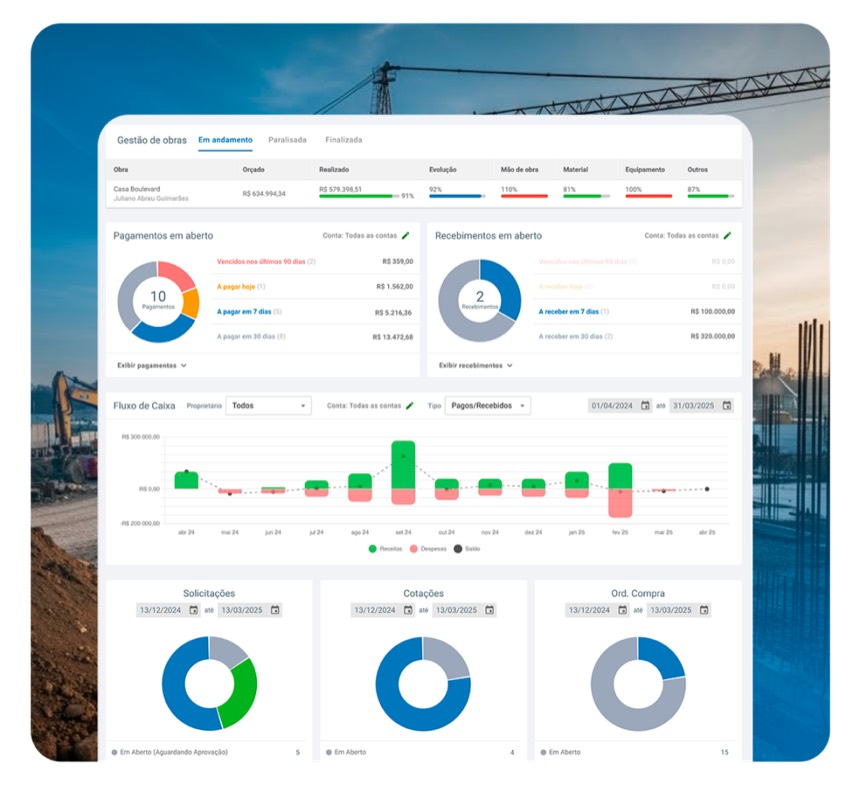
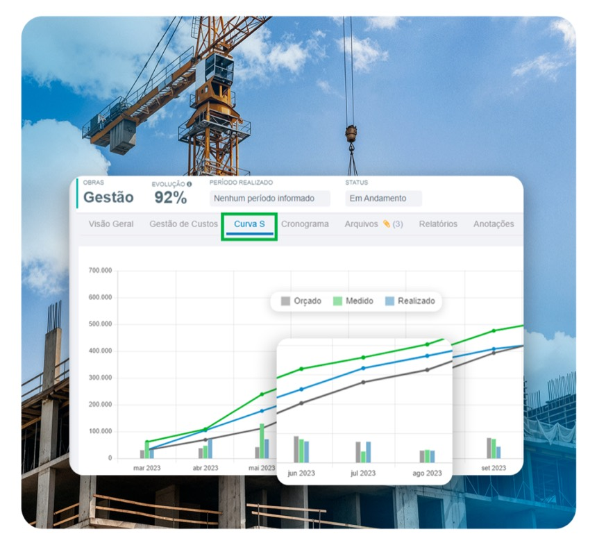
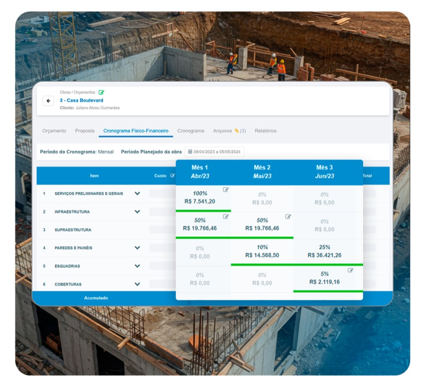
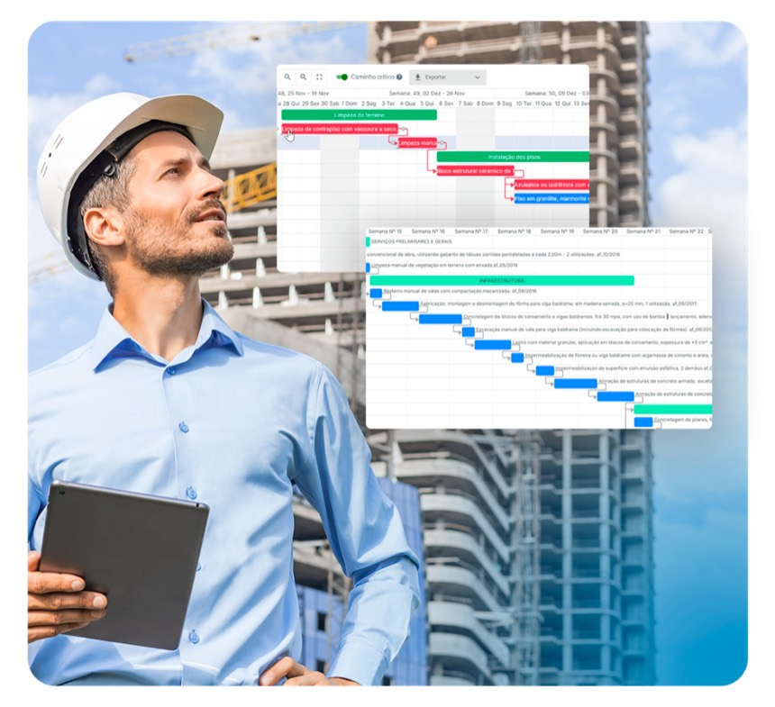
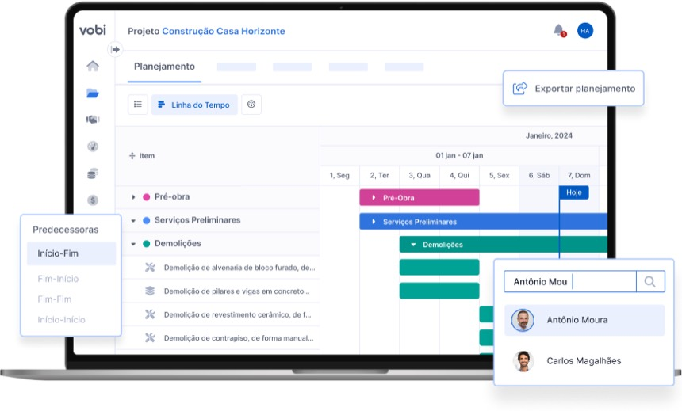
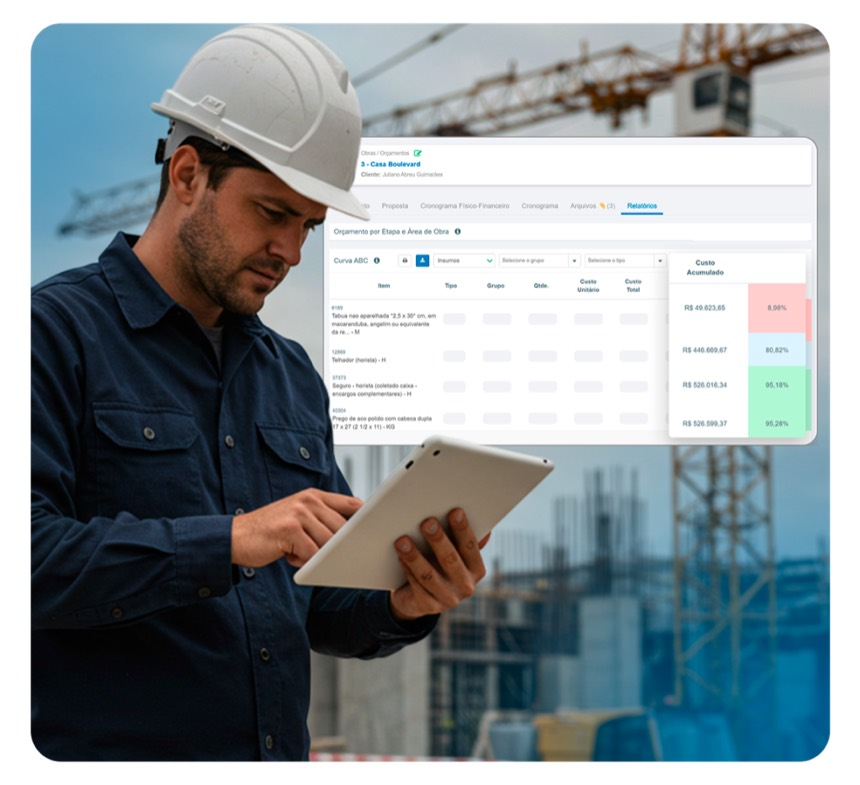
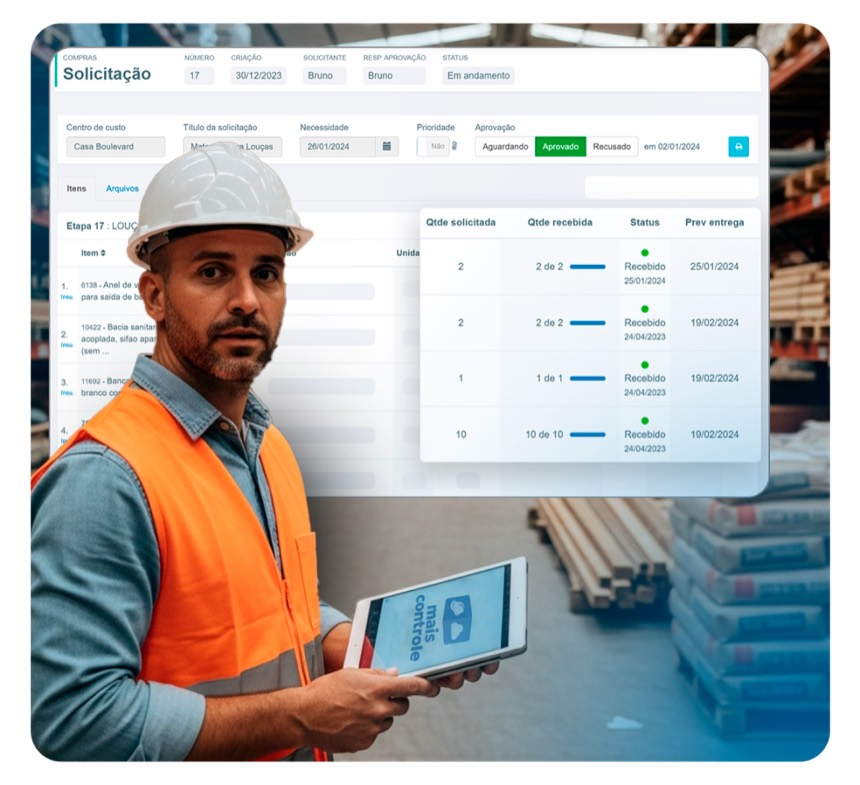
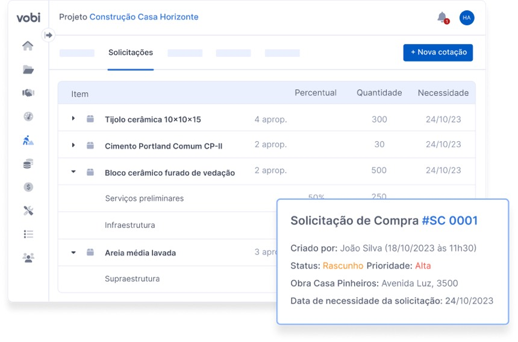
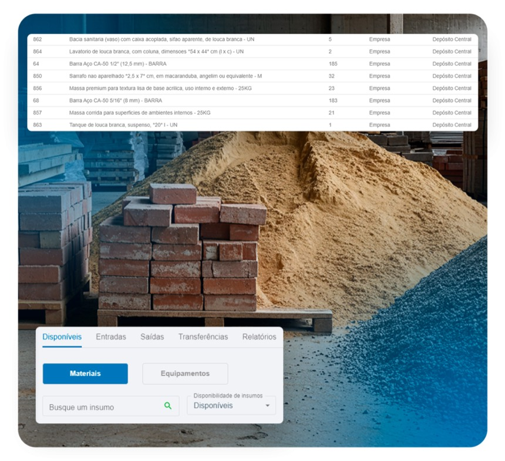
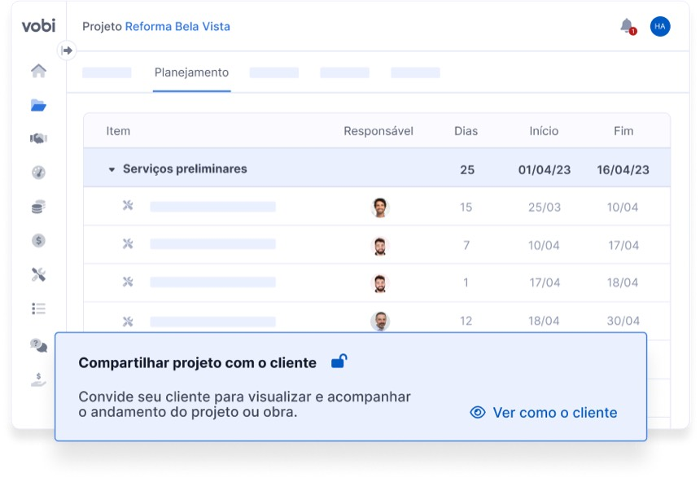

# Análise de UI das telas de Obras: Pilar x Mais Controle x Vobi (2026-11-16)

> Base: código do Pilar em `src/pages/obras/` (lido nesta data, inclui alterações ainda não commitadas) e o texto e as imagens públicas das páginas de funcionalidade do Mais Controle e da Vobi (`docs/strategy/concorrentes-2026-11/`). Não vi o interior dos sistemas dos concorrentes; o que está aqui é o que eles publicam.

Esforço: S = dias, M = 1 a 2 semanas, L = mais de 2 semanas. Impacto: efeito percebido pelo cliente.

## Estado de implementação (atualizado em 2026-11-16)

| Melhoria | Situação |
|---|---|
| 1. Físico-financeiro (grade, curva planejada x realizada, edição de célula) | Em implementação, [SPEC 165](specs/165-fisico-financeiro-da-obra.md): cálculo, tabela, hooks, grade, gráfico e edição prontos; faltam exportação Excel/PDF, lista no celular e telemetria. Sem commit. |
| 5. Relatório do diário e gerencial por período | Parte feita por outra sessão, sem commit: "Relatório do cliente" na conta da obra (imprimir ou PDF e portal). Falta o relatório do diário por período e a aprovação antes do envio. |
| 7. Gantt: custo e ferramentas | Parte feita por outra sessão, sem commit: Gantt com custo, sombra do pai, travas e colunas Orçado e Realizado no cronograma; o custo por período usa `montarFisicoFinanceiro` (inclui o ajuste manual). Falta zoom de escala, setas de dependência, caminho crítico no Gantt, linha de base e exportação. |
| Cores por nível, importar planilha, fluxos de obra | Feitas na outra sessão, sem commit (não estavam na análise original). |

## As 8 melhorias de maior retorno

| # | Melhoria | Esforço | Impacto | Por quê |
|---|---|---|---|---|
| 1 | Físico-financeiro (grade etapa x mês + curva planejada + Excel) | M | Muito alto | Maior lacuna e o pedido que você fez. Os dados já existem. |
| 2 | Curva S ponderada por valor, com três linhas (planejado, medido, pago) | M | Alto | Corrige uma imprecisão da Curva S atual e iguala o gráfico que eles usam para vender. |
| 3 | Cabeçalho executivo da obra (avanço, prazo, custo, desvio, saldo) e projeção de custo final | S a M | Alto | Responde "estou no lucro?" sem abrir nenhuma aba. |
| 4 | Semáforo e barra orçado x realizado nos cards da lista de obras | S | Alto | Mini BI multi-obra sem criar tela nova. |
| 5 | Relatório gerencial e diário por período, em link e PDF, com aprovação | M | Alto | Prestação de contas é o argumento de venda dos dois. |
| 6 | Curva ABC e filtros no extrato da conta | S | Alto | Esforço baixo, dados já agrupados. |
| 7 | Barra de ferramentas do Gantt (zoom, caminho crítico, exportar) e setas de dependência | M | Alto | O que o usuário espera de um Gantt. |
| 8 | Ordem de compra e saldo do orçamento no momento de comprar | M | Alto | Fecha o ciclo de suprimentos. |

## Padrões de interface que vale copiar

| Padrão | Observação |
|---|---|
| Aba "Relatórios" na obra | Mais Controle tem Visão Geral, Gestão de Custos, Curva S, Cronograma, Arquivos, Relatórios e Anotações. O Pilar não tem aba de relatórios da obra. |
| Célula de duas linhas: % em cima, R$ embaixo | Padrão do físico-financeiro. Boa leitura em tabela densa. |
| Barra fina de progresso ao lado do número | Mais Controle usa em Realizado, Evolução, Mão de obra, Material. O Pilar já usa Progress na árvore; levar para os cards. |
| Rosquinha com o total no centro | Pagamentos em aberto (10 pagamentos) e roscas de status. Mostra volume e fatia em um olhar. |
| Chave "Caminho crítico" na barra do gráfico | Uma chave liga e desliga o destaque, em vez de mudar de tela. |
| Abas de estado na lista (Em andamento, Paralisadas, Finalizada) | O Pilar tem quadro por coluna; abas ajudam no celular. |

## 1. Lista de obras

Código: `src/pages/obras/index.tsx, ObraCard.tsx, ObrasQuadro.tsx`

**O que o Pilar tem hoje**

- KPIs de contagem (Obras, Em andamento, Paralisadas), busca e filtro por responsável.
- Visão em quadro e em cards; o card mostra prazo ("Faltam N dias", "Atrasada há N dias") e se o cliente acompanha no portal.
- Nenhum número de dinheiro nem de saúde da obra na lista.

**O que eles publicam**

- Mais Controle, Gestão de Obras: abas Em andamento / Paralisadas / Finalizada e uma tabela com Orçado, Realizado (R$ + barra de %), Evolução (92%) e uma barra para Mão de obra, Material, Equipamento e Outros, uma linha por obra.
- Logo abaixo, rosquinhas de Pagamentos em aberto (vencidos, a pagar hoje, em 7 dias, em 30 dias) e Recebimentos em aberto, e um gráfico de barras de Fluxo de Caixa mensal com a linha de saldo.
- Mais três rosquinhas: Solicitações, Cotações e Ordens de compra por status.
- Vobi: "todas as suas obras em um lugar, em qual etapa está cada obra, prazos e responsáveis".

**O que melhorar**

| Melhoria | Detalhe | Esforço | Impacto |
|---|---|---|---|
| Semáforo de saúde no card | Três pontos: prazo, custo e avanço. Hoje o card só diz se atrasou. Vermelho se desvio de custo acima de 10% ou atraso, amarelo se perto, verde se em dia. | S | Alto |
| Barra Orçado x Realizado no card | Uma linha fina com % do orçado consumido e % de avanço físico lado a lado. Dá para ver na lista quem gasta mais rápido do que executa. | S | Alto |
| Faixa de KPIs financeiros | Trocar os três contadores por: valor orçado total, realizado, desvio, obras com alerta. O componente KpiResumo já existe. | S | Médio |
| Pendências a pagar e a receber da obra | Rosquinha por vencimento, igual à do Mais Controle, só que alimentada pelos lançamentos que já existem. | M | Médio |

## 2. Visão geral da obra

Código: `src/pages/obras/components/ObraTimelineTab.tsx, ObraCurvaS.tsx`

**O que o Pilar tem hoje**

- Quatro blocos: Avanço (um número e uma barra), Marcos de faturamento, Curva S planejado x realizado, Fases (barra por fase) e Diário recente.
- A Curva S usa contagem de tarefas com prazo, não dinheiro: uma tarefa de R$ 500 pesa o mesmo que uma de R$ 50 mil. O eixo é sempre 0 a 100% e o tooltip mostra só percentual.
- Falta o cabeçalho executivo: não há prazo restante, desvio de custo, projeção de custo final nem indicador de desempenho.

**O que eles publicam**

- Mais Controle: a tela de Gestão tem abas Visão Geral, Gestão de Custos, Curva S, Cronograma, Arquivos, Relatórios e Anotações, com um cabeçalho fixo (Evolução 92%, período realizado, status).
- A Curva S traz três linhas, Orçado, Medido e Realizado, e barras mensais por baixo com o valor de cada período.
- IDC (índice de desempenho de custo) projeta o custo total no término em dois cenários, com base no desempenho real e na evolução física registrada.
- Cronograma com linha de base e comparativo prazo previsto x realizado etapa por etapa.
- Vobi: curva S gerada automaticamente, prevista x realizada, nos relatórios e no planejamento.

**O que melhorar**

| Melhoria | Detalhe | Esforço | Impacto |
|---|---|---|---|
| Cabeçalho executivo com 5 números | Avanço físico, prazo (dias restantes ou de atraso), custo realizado x orçado com %, desvio e saldo da conta. Fica no topo da obra, acima das abas, para valer em todas elas. | S | Alto |
| Curva S ponderada por valor | Usar o previsto de cada fase, etapa e serviço como peso (já existe na aba Financeiro). Uma tarefa passa a valer o seu orçamento. Sem orçamento, cai para a contagem de hoje. | M | Alto |
| Três linhas: planejado, medido e pago | Planejado pelo cronograma, medido pelo avanço das tarefas e pago pelo desembolso. Tooltip com % e R$. É o gráfico que o Mais Controle usa para vender a ferramenta. | M | Alto |
| Projeção de custo final com dois cenários | IDC = custo que deveria ter sido gasto pelo avanço ÷ custo real. Cenário 1: mantém o orçamento restante. Cenário 2: o ritmo de gasto atual continua. Mostra em R$ e em % acima do orçado. | M | Alto |
| Barras mensais sob a curva | Valor de cada mês em colunas, para ver o pico de desembolso. | S | Médio |

## 3. Físico-financeiro (não existe no Pilar)

Código: `não existe; ponto de partida: ObraOrcadoRealizado.tsx + datas das frentes`

**O que o Pilar tem hoje**

- Não há planejamento de desembolso no tempo. O gráfico de Desembolso mostra só o realizado acumulado e uma linha reta com o orçamento total.
- Já temos o ingrediente certo: previsto digitável em cada fase, etapa e serviço (ObraOrcadoRealizado) e datas de início e fim nas frentes.

**O que eles publicam**

- Mais Controle: aba Cronograma Físico-Financeiro. Grade com a árvore do orçamento nas linhas e os meses nas colunas. Cada célula mostra o percentual do item naquele mês e o valor em R$, com uma barra verde de preenchimento.
- Distribui o orçamento pela duração de cada etapa automaticamente; dá para editar à mão; linha final "Acumulado"; periodicidade configurável (mensal); exporta Excel em três níveis de detalhe para banco, sócio ou financiadora.
- Gera a Curva S de desembolso antes de a obra começar.
- Vobi: "relatório físico-financeiro automático, integrado ao orçamento, planejamento e medições".

**O que melhorar**

| Melhoria | Detalhe | Esforço | Impacto |
|---|---|---|---|
| Nova visão Físico-financeiro na aba Financeiro | Linhas: a mesma árvore do orçamento, com recolher e expandir. Colunas: meses da obra. Célula: % e R$ em duas linhas. Rodapé: acumulado por mês e total. | M | Muito alto |
| Distribuição automática, edição manual | Padrão: reparte o previsto de cada serviço linearmente entre o início e o fim dele. Clicar na célula permite ajustar o percentual; o que sobrar fica sinalizado em vermelho, igual ao desvio da árvore atual. | M | Muito alto |
| Linha planejada no gráfico de desembolso | Trocar a linha reta do orçamento por uma curva planejada acumulada, com a realizada por cima. Mesma pergunta do Mais Controle: "estou gastando no ritmo?" | S | Alto |
| Exportar para Excel e PDF | Três níveis: fase, etapa, serviço. Para o escritório mandar ao cliente ou à financiadora. Reaproveitar relatorioExport.ts. | S | Alto |

## 4. Cronograma (lista e Gantt)

Código: `src/pages/obras/components/ObraCronogramaTab.tsx, cronograma/CronogramaGantt.tsx, CronogramaLista.tsx`

**O que o Pilar tem hoje**

- Alternador Lista / Gantt, recolher fases, arrastar as bordas para mudar datas, legenda (atrasada, concluída, período pelos itens), marca "Hoje".
- Importar planilha, aplicar e salvar fluxos (modelos), orçado e realizado dentro da lista para quem vê dinheiro.
- O Gantt não tem zoom de escala (dia, semana, mês), não mostra setas de dependência nem caminho crítico (isso existe só no fluxo em grafo, SPEC 162), não compara com linha de base e não exporta.

**O que eles publicam**

- Mais Controle: barra de ferramentas do Gantt com zoom + e −, ajustar à tela, chave "Caminho crítico" e botão "Exportar". Tarefas críticas em vermelho, setas de dependência entre as barras, cabeçalho por semana.
- "As atividades dependentes se replanejam automaticamente": atrasou uma, as seguintes se movem.
- Linha de base integrada ao orçamento; exportação em vários formatos.
- Vobi: duração por etapa, data final calculada, Gantt com dependências, curva S e "um botão" que destaca as tarefas que impactam a data final. Também tem reclamação pública de vínculo que soma ou tira dias sozinho: confiabilidade é diferencial.

**O que melhorar**

| Melhoria | Detalhe | Esforço | Impacto |
|---|---|---|---|
| Barra de ferramentas do Gantt | Zoom dia/semana/mês, ajustar à tela, chave Caminho crítico, botão Exportar. É o que o usuário procura primeiro. | M | Alto |
| Setas de dependência e caminho crítico na própria timeline | A lógica de caminho crítico já existe no grafo (SPEC 162). Trazer para o Gantt: barras críticas em vermelho e setas entre sucessoras. | M | Alto |
| Replanejar sucessoras ao mover uma tarefa | Ao arrastar uma barra, perguntar se as dependentes acompanham (com desfazer). Cuidado com o caso Vobi: o cálculo tem que ser previsível. | L | Alto |
| Linha de base | Botão "Salvar linha de base" e uma barra cinza fina atrás de cada item mostrando o previsto original. | M | Médio |
| Exportar PDF e imagem do cronograma | Para anexar à proposta e ao relatório. | S | Médio |

## 5. Financeiro da obra (conta)

Código: `src/pages/obras/components/ObraContaTab.tsx, ObraOrcadoRealizado.tsx, ObraDesembolsoChart.tsx, ObraDespesasAgrupadas.tsx`

**O que o Pilar tem hoje**

- Seis KPIs (Orçado, Realizado, Saldo, Aportes, Despesas, Escritório adiantou), árvore Orçado x realizado com desvio e barra de consumo, gráfico de desembolso realizado, despesas agrupadas por fornecedor ou item e extrato.
- O extrato é uma lista única sem busca, filtro por período, fornecedor ou etapa, nem exportação.
- Agrupamento por fornecedor e por item existe, mas não mostra participação acumulada nem classe A/B/C.

**O que eles publicam**

- Mais Controle: Gestão de Custos "por grupo, por etapa e por insumo em uma única tela"; rosquinha de lançamentos por grupo (materiais 58,5%, mão de obra 26,9%, equipamentos, outros).
- Curva ABC: classificação automática, grupo A (80% do custo) no topo, com filtros, disponível no orçamento e na execução.
- Relatório Orçado x Comprado mostra o saldo disponível por insumo antes de fechar a compra.
- Vobi: lançamento por XML de nota, DRE gerencial, compare orçado x realizado, despesas recorrentes e parcelas.

**O que melhorar**

| Melhoria | Detalhe | Esforço | Impacto |
|---|---|---|---|
| Curva ABC dos gastos | Em Despesas agrupadas, uma terceira visão: itens ordenados por valor, % acumulado e rótulo A, B ou C. Os dados já estão agrupados por item. | S | Alto |
| Rosquinha por natureza do gasto | Material, mão de obra, equipamento, outros, com valor e %. Exige um campo de categoria no lançamento (hoje há item e fornecedor). | M | Médio |
| Filtros e busca no extrato | Período, tipo, fornecedor, etapa e texto, com total do filtro. Mesmo padrão de filtros do Financeiro (SPEC 025). | S | Alto |
| Exportar extrato e prestação de contas | Excel e PDF por período, com comprovantes. Hoje o portal mostra a conta, mas o escritório não baixa. | S | Médio |
| Indicadores de desvio por etapa no topo | As 3 etapas que mais estouraram, com link para a linha na árvore. | S | Médio |

## 6. Diário de obra (RDO)

Código: `src/pages/obras/components/ObraDiarioTab.tsx, RdoFormDialog.tsx, RdoFeedCard.tsx`

**O que o Pilar tem hoje**

- Formulário completo: data, efetivo, clima, condição de trabalho, tarefas do cronograma, equipes no canteiro, visitas, fotos, observações, ocorrências e pendências.
- RDO por voz com sugestões estruturadas, feed, resumo do dia e botão flutuante no celular. Está à frente dos dois concorrentes em captura.
- Faltam o relatório por período (PDF) e por link para o cliente, o resumo consolidado de um período e o apontamento de mão de obra gerado dos diários.

**O que eles publicam**

- Mais Controle: relatório do diário compartilhado por link, relatório por período em PDF, apontamento de mão de obra gerado automaticamente dos diários, visão consolidada do período.
- Vobi: agente de IA recebe foto, áudio ou texto no WhatsApp e monta o diário; campo de clima por turno; relatórios com fotos.

**O que melhorar**

| Melhoria | Detalhe | Esforço | Impacto |
|---|---|---|---|
| Relatório do diário por link e em PDF | Escolher período, gerar um relatório com fotos e resumo, copiar link ou baixar PDF. O portal do cliente já mostra registros; aqui é o formato de entrega. | M | Alto |
| Visão consolidada do período | Totais: dias trabalhados, dias de chuva, pessoas-dia, ocorrências abertas. Fica acima do feed. | S | Médio |
| Apontamento de mão de obra | Somar o efetivo por equipe de cada RDO e mostrar pessoas-dia por fornecedor. O dado de equipes já está no formulário. | M | Médio |
| Canal WhatsApp | Decisão de produto antes de construir (custo da API). | L | Alto |

## 7. Cotações e compras

Código: `src/pages/obras/components/ObraCotacoesTab.tsx, CotacaoDetailDialog.tsx, CotacaoConvites.tsx, FilaCotacoesPendentes.tsx`

**O que o Pilar tem hoje**

- Lista de cotações com status, cesta multi-item, import por IA de PDF do fornecedor, convite por link ao fornecedor, avaliação de fornecedor e fila de pendências entre obras.
- Não há solicitação de compra do canteiro com aprovação, ordem de compra, nem relatório de orçado x comprado por insumo.

**O que eles publicam**

- Mais Controle: solicitações pelo app no canteiro vinculadas ao orçamento, com aprovação; IA preenche o mapa de cotações; ordem de compra gerada e enviada; ordem aprovada cria o lançamento financeiro; Orçado x Comprado mostra o saldo por insumo antes de comprar.
- Vobi: cotações a partir da solicitação, mapa com destaque automático da melhor oferta, link de preenchimento para o fornecedor, ordem de compra com o fornecedor de melhor preço.

**O que melhorar**

| Melhoria | Detalhe | Esforço | Impacto |
|---|---|---|---|
| Ordem de compra a partir da cotação vencedora | Botão "Fechar com este fornecedor" gera a ordem, o lançamento previsto na conta e o link para o fornecedor confirmar. Fecha o ciclo que hoje termina na cotação. | M | Alto |
| Solicitação de compra do campo com aprovação | Botão no app de campo, aprovação no escritório. Alimenta a cotação. | L | Alto |
| Saldo do orçamento no momento de comprar | Ao fechar, mostrar o previsto, o já comprado e o saldo do serviço. Evita estourar sem ver. | M | Alto |
| Melhor oferta em destaque no mapa | Conferir se o mapa já marca o menor preço por item; se não, destacar. | S | Médio |

## 8. Estoque da obra

Código: `src/pages/obras/components/ObraEstoqueTab.tsx, MaterialMovDialog.tsx`

**O que o Pilar tem hoje**

- Lista de materiais com saldo, movimento de entrada e de baixa, exclusão. Só dois tipos de movimento e um único local por obra.

**O que eles publicam**

- Mais Controle: entradas, saídas e transferências; saldo por depósito; transferência com confirmação de recebimento; a saída atualiza o custo realizado da obra; estoque central e por obra.
- Vobi: remanejar sobra de uma obra para outra com registro de quantidade e custo; histórico completo com responsável; alerta de compra duplicada.

**O que melhorar**

| Melhoria | Detalhe | Esforço | Impacto |
|---|---|---|---|
| Transferência entre obras | Terceiro tipo de movimento, com origem, destino e confirmação do recebimento. | M | Alto |
| Baixa que alimenta o realizado | Quando a baixa tem valor unitário, somar ao realizado da etapa. Confirmar o que já acontece hoje. | M | Alto |
| Histórico por material | Linha do tempo de entradas e saídas com quem fez. | S | Médio |
| Aviso na cotação | "Você tem 20 sacos em estoque na obra X" ao cotar o mesmo material. | M | Médio |

## 9. Portal do cliente (obra)

Código: `src/pages/portal/*, src/pages/cliente/ClienteObraDetail.tsx`

**O que o Pilar tem hoje**

- O cliente vê cronograma, conta da obra, entregas, registros e fotos, e abre solicitações. A visibilidade é um interruptor por obra ("Visível no portal do cliente").

**O que eles publicam**

- Mais Controle: cliente consulta pagamentos, baixa boletos e documentos, marca como pago e anexa comprovante, recebe lembretes automáticos de vencimento; a construtora decide o que cada cliente vê; relatório gerencial por link com fluxo de aprovação antes do envio.
- Vobi: aprovação online e em tempo real do orçamento por item, compartilhamento simples e personalizável, mensagem de aniversário.

**O que melhorar**

| Melhoria | Detalhe | Esforço | Impacto |
|---|---|---|---|
| Controle fino do que o cliente vê | Em vez de liga/desliga, escolher por bloco: cronograma, fotos, conta, documentos, diário. | S | Alto |
| Aprovação online de itens | Cliente aprova uma entrega, uma medição ou um aditivo no portal, com data e nome registrados. | M | Alto |
| Relatório gerencial com aprovação antes de enviar | Mesmo relatório do Diário, com um passo de revisão do escritório antes de ficar visível. | M | Alto |
| Lembretes de vencimento | Para aportes combinados com o cliente (obra por administração). | S | Médio |
